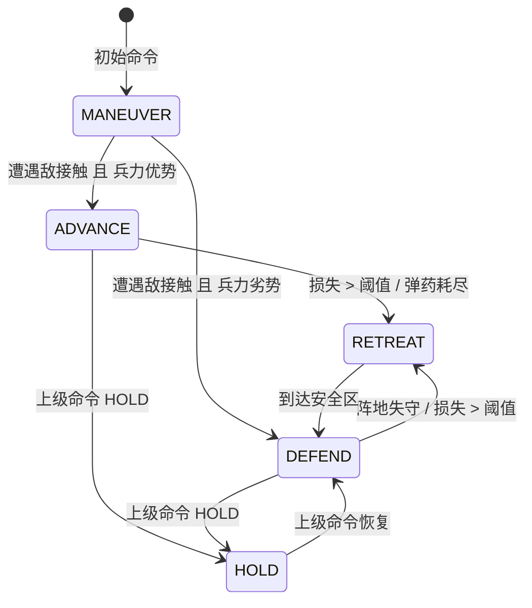
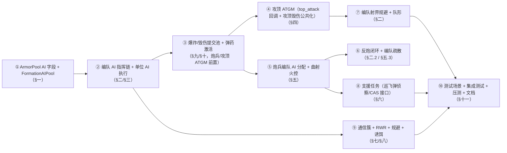

# Phase 6c 剩余子系统设计 —— 编队指挥链 AI、攻顶反坦克导弹、炮兵、支援、RWR 与弹药激活

> 状态：**设计定稿（2026-08-14）**
> 定位：本文档是 `phase6-guidance-pipeline.md`（Phase 6b 已实施 ✅，步骤 1~9）的**姊妹篇**，
> 覆盖 Phase 6 清单中**尚未实施**的部分：

| 已实施（6b） | 本文范围（6c，未实施） |
|---|---|
| 制导律脚本化（Numba 回调） | **编队 AI**（指挥链：意图 FSM + 打击任务/目标分配） |
| 电子战闭环（EmitterPool + ESM/ARM） | **单位 AI**（执行命令：自由射击/机动/自保） |
| 末敏弹 SFM（双模扫描 + EFP 攻顶） | **攻顶反坦克导弹**（自锁定发射后不管） |
| 激光制导炸弹 SAL（炸桥） | **炮兵**（编队 AI 分配弹药与目标） |
| 序列化 / 存档扩展 | **支援任务**（炮兵 / 巡飞弹 / CAS 任务） |
| | **RWR 告警 + 规避**（导弹/反炮） |
| | **通信网络**（去中心化数据共享） |
| | **爆炸/毁伤提交池**（统一批量结算） |
| | **弹药类型激活**（HE/APCR/SAPHE/PELE/HE_FRAG） |
| | **测试场景 + 集成测试 + 性能压测 + 用户文档** |

> 读前必读：`phase6-guidance-design.md`（Numba 回调方案）与 `phase6-guidance-pipeline.md`
> （制导管线接缝）。本文复用其中的 SoA 约定、`EmitterPool` 辐射源模型、`detection` 检测层、
> 与 `FiringControl` 开火链，不重复论证。

---

## 〇、总纲：编队 AI 决策，单位 AI 执行

与制导律不同，AI **不进 Numba 热路径**。理由：

| 维度 | 制导律（6b） | AI（6c） |
|------|-------------|----------|
| 频率 | 每弹丸 × 0.01s 子步 | 编队/单位 × 1s 地面 Tick |
| 逻辑 | 纯数学（加速度向量） | 分支密集（意图/指挥链/目标分配） |
| 形态 | `@njit` 纯函数回调 | Python 状态机 + 向量化评估 |
| 决策 | 无（只算加速度） | 有（编队 AI 定任务，单位 AI 执行） |

**核心原则**：

1. **编队 AI 决策，单位 AI 执行**。编队 AI 持有意图 FSM、汇总敌方接触表、分配打击任务，
   通过指挥链（写成员 `order`/`target_idx`）下达指令；单位 AI **只执行**指令（fire/move），
   不做独立决策（§二/§三）。
2. **AI 只决策，不执行**。AI 通过既有接口行动——`FiringControl.fire()`、`ArmorPool.wp`、
   `CommandQueue`（对上级指令）——**绝不直接改 SoA 数组**，与叙事层「永不直接修改模拟状态」
   同构（AGENTS.md 3.7）。
3. **感知驱动，非上帝视角**。AI 的态势感知来自 `detection` 层输出 + 通信簇内数据共享（§七），
   不是直接读敌方 `armor.pos`。Phase 6c 用简化「全知接触」接口，Phase 8 战争迷雾接入后换成
   孪生数据（`docs/数据链与战争迷雾设计.md`）。
4. **热路径只做向量化批量评估**：目标评分/威胁排序用 NumPy 向量化 + 少量 `@njit` 评分内核；
   编队 FSM 是纯 Python 逐编队遍历（≤256 编队 × 简单分支 < 0.1ms）。

---

## 一、数据模型扩展（SoA）

### 1.1 `ArmorPool` 新增 AI 字段（`entities/pools.py`）

在现有 `pos/half/yaw/health/active/wp/…/rcs/ecm` 之后追加（全部 `spawn`/`_expand` 同步）：

```python
# ---- Phase 6c AI 字段（docs/phase6-ai-design.md §一）----
self.side        = np.zeros(self.capacity, dtype=np.uint8)    # 绝对阵营（Side：0=北约 1=华约 2=中立）
self.role        = np.zeros(self.capacity, dtype=np.int8)    # 角色：0=坦克 1=炮兵 2=侦察 3=防空 4=攻顶ATGM发射器 5=预留(空中,Phase7)
self.order       = np.zeros(self.capacity, dtype=np.int8)    # 编队下达的执行指令（§三.1，非单位独立意图）
self.target_idx  = np.full(self.capacity, -1, dtype=np.int32) # 编队分配的目标装甲索引（-1 无）
self.target_kind = np.zeros(self.capacity, dtype=np.int8)    # 目标类型：0=装甲 1=辐射源 2=光斑 3=地形点
self.comm        = np.ones(self.capacity, dtype=np.float32)  # 通信质量 0~1（数据链，门控命令下达）
self.contact_age = np.full(self.capacity, 1e9, dtype=np.float32) # 最近一次接触距今（秒，态势老化）
self.formation_id = np.full(self.capacity, -1, dtype=np.int32)   # 所属编队 AI 池索引（§1.2，-1 未编队）
```

> `role`/`side` 此前在渲染层以动态属性（`side`）演示（dev-progress 2026-08-13），本阶段**正式
> 下沉为 SoA 字段**，渲染 `WorldAdapter` 改读 `armor.side`。
>
> 🔥 **2026-08-15 改名**：`team`（相对友/敌/中立）→ `side`（绝对阵营），敌友中立改由
> `entities/side.py` 的 `hostile()`/`allegiance()` 派生（见该模块 docstring）。
>
> **意图 FSM 不再挂在单位上**——单位只持有 `order`（编队下达的执行指令），意图/战术姿态由
> 编队 AI 决定（§二）。通信断裂时单位按 §三.3 的自主自保行为兜底。
>
> `target_idx` 是**编队 AI 的分配产物**（写成员目标），与导弹 `guid_target_pos`（detection 驱动
> 坐标）语义不同：前者「这个单位打谁」，后者「导弹在追哪」。开火链不感知 AI 的存在。

### 1.2 新池 `FormationAIPool`（编队 AI 池）

编队 AI 是**决策主体**，独立建池（数量少，`MAX_FORMATIONS=256`）：

```python
MAX_FORMATIONS = 256

class FormationAIPool:
    """编队 AI 池（SoA，MAX_FORMATIONS=256）。一编队 = 单/多单位，战术姿态由编队 AI 决定。"""
    def __init__(self, capacity: int = MAX_FORMATIONS) -> None:
        self.active       = np.zeros(capacity, dtype=np.bool_)
        self.team         = np.zeros(capacity, dtype=np.int8)     # 阵营
        self.role         = np.zeros(capacity, dtype=np.int8)     # 编队角色（装甲/炮兵/侦察/混合）
        self.intent       = np.zeros(capacity, dtype=np.int8)     # 编队意图 FSM（§二.1）
        self.order        = np.zeros(capacity, dtype=np.int8)     # 编队级命令（上级/玩家下达）
        self.stance       = np.zeros(capacity, dtype=np.int8)     # 战术姿态（进攻/防御）
        self.target_zone  = np.zeros((capacity, 3), dtype=np.float32)  # 任务目标区中心
        self.comm         = np.ones(capacity, dtype=np.float32)   # 编队通信质量（指挥链门控）
        self.member_count = np.zeros(capacity, dtype=np.int32)    # 成员数
        self.contact_set  = [None] * capacity                     # 本编队汇总的敌接触表（Python 层，非 SoA）
        self._free_stack: list[int] = list(range(capacity))
    # spawn / destroy / _expand 同 ArmorPool 惯例
```

> `contact_set` 是编队 AI 的**汇总接触表**（Python 数据结构，非热路径），每 1s Tick 由编队 AI
> 从成员 `detection` 输出 + 通信簇共享（§七）整理而成。它不属于 SoA 热路径，可安全用 Python list。

### 1.3 攻顶反坦克导弹发射器（无新池）

「反坦克地雷」在现阶段实为**自锁定的顶部攻击反坦克导弹**（NLAW / 标枪类，AGENTS.md 清单的
「红外感应式反坦克地雷自主跟踪引爆」= 发射后不管的攻顶武器），**不埋设、不建 `MinePool`**：

- 发射器 = `ArmorPool` 单位（`role=ATGM_LAUNCHER=4`），复用既有 SoA 字段 + 本节 AI 字段。
- 导弹 = `ProjectilePool` + 6b 制导字段（`guid_law`/`guid_target_pos`/`guid_stage`/...），零新增数组。
- 攻顶弹道/毁伤 = 新控制回调 `top_attack`（§四）+ 复用 SFM 攻顶毁伤路径。

> 数据模型**零新增池**：攻顶 ATGM 是「发射器（装甲）+ 导弹（抛射物）」的既有组合，
> 完全落在 6b 制导管线的数据模型内，只加回调与毁伤公共函数。

### 1.4 爆炸/毁伤提交池（`DamageSubmissionPool`，§九）

所有弹药的**伤害模型**（锥形 EFP/HEAT 射流、球形 HE 爆破、破片锥）统一「提交伤害事件」进池，
再批量结算（Numba 向量化）+ 供渲染统一消费爆炸特效。详见 §九。

---

## 二、编队 AI（指挥链决策主体，`simulation/ai.py`）

编队 AI 是 **Phase 6c 的决策主体**——统一整理敌方单位、分配打击任务，通过指挥链下达指令给
子单位，**而不是每个单位 AI 各自决定**（AGENTS.md 3.5「编队 AI 无指令/无法与中央通信时可自主
规划战斗」的落地）。

### 2.1 编队意图 FSM（AGENTS.md 3.5「意图层」）

```python
class FormationIntent(IntEnum):
    MANEUVER = 0   # 机动（向任务目标区行进，途中遭遇才交战）
    ADVANCE  = 1   # 进攻（主动推进 + 分配打击任务）
    DEFEND   = 2   # 防御（固守，只对进入射程目标分配射击）
    RETREAT  = 3   # 撤退（脱离接触，向安全区机动）
    HOLD     = 4   # 待命（静默，辐射管制）
```

FSM 转移（每 1s 地面 Tick，Python 逐编队评估，输入 = 编队态势 `FormationSituation`）：



转移条件由**编队态势**驱动，纯 Python 可测：

```python
@dataclass
class FormationSituation:
    friendly_active: int          # 本编队存活成员数
    enemy_contacts: int          # 汇总的敌接触数（成员检测 + 通信簇共享）
    enemy_known: int             # 已知敌总数（情报）
    ammo_ratio: float            # 编队平均弹药 0~1
    health_ratio: float          # 编队平均血量 0~1
    under_artillery: bool        # 是否处于炮击告警（§五）
    under_rwr: bool              # 是否被雷达照射（§八）
    task_reached: bool           # 是否到达任务目标区
```

### 2.2 指挥链：打击任务分配

编队 AI 每 Tick 把汇总的敌接触表**统一整理**，按贪心火力分配下发给成员（写 `order`/`target_idx`）：

1. **汇总接触**：成员 `detection` 输出 + 通信簇共享（§七）→ `contact_set`（去重、按阵营过滤）。
2. **目标分配**：对每个敌接触，选「最合适」的成员单位（距离/弹药/武器匹配），写其 `target_idx`；
   每目标并发开火上限（防过度杀伤）。
3. **下达指令**：成员 `order` = 进攻（打分配目标）/ 防御（固守射击）/ 机动（转场）/ 撤退。
4. **受击面防御**：**选择 ADVANCE 的编队 AI 也会命令受击严重的成员转 DEFEND**（血量/压制阈值触发），
   实现「进攻中的局部防御」。

### 2.3 指挥链门控（通信）

编队 AI 下达指令受 `comm` 门控（§七）：
- 编队 `comm` 高 → 接收玩家/上级命令 + 向成员下达指令。
- 编队 `comm` 低（与中央通信断裂）→ 仍可**自主规划**（成员间点对点通信尚存，独立建网），
  **且不被大面板看见在干什么**（§七.3 可见性）。
- 成员 `comm` 低 → 收不到编队指令 → 退回 §三.3 自主自保。

### 2.4 编队机动与战术行为

- **队形保持**：编队锚点 = 领队单位（或 `target_zone`），成员围绕锚点保持间距（菱形/楔形/横队）；
  复用 `FormationResolver`（已有编队推开）保证不重叠，队形偏移由编队槽位号决定。
- **反炮兵疏散**（§五.3）：收到炮击告警 → 命令成员疏散机动（随机方向 + 拉大间距 + 转移）。
- **反坦克武器射界规避**：发现敌方攻顶 ATGM 发射器/直射火力射界 → 标记危险区（`GraphPathfinder`
  `forbidden_zones`）→ 命令成员绕出射界 / 烟幕遮蔽 / 退出有效射程。

> 传统压发雷场若后续需要，可作为 `forbidden_zones` 的一种静态来源（人工编辑地形时标注），
> 本阶段不实现压发地雷实体。

---

## 三、单位 AI（执行者，`simulation/ai.py`）

单位 AI **不做独立决策**，只执行编队 AI 下达的 `order`/`target_idx`。

### 3.1 执行态（读指令）

| 编队下达 `order` | 单位行为 |
|---|---|
| 进攻 | 向 `target_idx` 机动 + 自由射击 |
| 防御 | 固守阵位，只对进入射程的分配目标射击 |
| 机动 | 向编队 `target_zone` 寻路移动（GraphPathfinder + wp） |
| 撤退 | 脱离接触，向安全区机动 |
| 待命 | 静默（不移动不射击，辐射管制） |

### 3.2 行动层：自由射击 + 机动

- **射击**：`FiringControl.can_fire(shooter)` 且目标在 `max_range_m` 内 → `fc.fire(shooter, target_idx)`。
- **机动**：`GraphPathfinder` 寻路 → 写 `armor.wp / wp_count / wp_idx`（复用 Phase 2 路标点系统）。

### 3.3 通信断裂自主自保

成员收不到编队指令（`comm` 低于阈值，或编队已被摧毁）时，退回**简单自保**：
- 对最近威胁还击（局部威胁评分，§3.4 降级版）。
- 血量过低 → 向友军/安全区撤退。
- 不主动发起进攻（决策权在编队 AI）。

### 3.4 目标评分内核（`simulation/ai.py` 内，供编队 AI 与自保复用）

向量化威胁评分（NumPy 批量，非逐对 Python 循环）：

```
threat_i = w_range · (1 − d_i / max_range)      # 距离越近越危险
         + w_speed · speed_i                    # 敌方速度（机动威胁）
         + w_weapon · weapon_penalty_i          # 敌武器对己方的威胁
         + w_health · (1 − health_i)            # 残血目标优先补刀（易击杀）
target = argmax(threat_i)  subject to: d_i ≤ max_range, LOS 通, 敌方阵营
```

- 目标评分写成 `@njit` 内核 `score_targets(...)`（数组批量），编队 FSM/目标分配仍是 Python。
- **防御姿态**优先打最近威胁（`w_range` 上调）；**进攻姿态**优先打高价值（`w_weapon` 上调）。

---

## 四、自锁定反坦克导弹 / 攻顶发射器（`simulation/ai.py` + 制导回调，不新建模块）

> 核心认知：AGENTS.md 清单「红外感应式反坦克地雷自主跟踪引爆」实为**发射后不管的顶部攻击
> 反坦克武器**（NLAW / 标枪类）——「地雷」是「智能反坦克武器」的口语，不是埋设爆炸物。
> 它是 6b 制导管线的**单位级封装**：发射器锁定 → 发射 → 导弹自主爬升 → 俯冲攻顶。

### 4.1 现实机制 → 模型映射

| 现实机制（NLAW/标枪类） | 模型 |
|---|---|
| 发射器（步兵/车载） | `ArmorPool` 单位，`role=ATGM_LAUNCHER=4`（§一） |
| 发射前锁定（lock-on before launch） | 编队 AI 分配目标 → 操作手（单位 AI）`_seeker_detect` 锁定 → `fire(shooter, target)` |
| 发射后不管（fire-and-forget） | 复用 6b `fire()` + 制导字段（`guid_law`/`guid_target_pos`/`guid_stage`） |
| 顶部攻击弹道（pop-up loft） | 新控制回调 `top_attack`（§4.3）：爬升 → PN → 俯冲攻顶 |
| 红外成像导引头 | `SeekerType.IR_IMAGING`（已有，被动不暴露，不可被 ESM/ARM 反辐射） |
| 攻顶毁伤 | 复用 SFM 攻顶（`top_armor_factor` + 空心装药穿深，§4.4 公共化） |

### 4.2 「自主跟踪引爆」语义澄清

- **自锁定** = 导引头发射前/后自主锁定（`_seeker_detect` 已有：锁定坐标 200m 内最近合格目标）。
- **自主跟踪** = 6b 制导律（PN/PP 公共求解器）自动跟踪，发射后不依赖发射器持续引导。
- **引爆** = 命中/攻顶后毁伤（复用 `DamageResolver`，伤害经 §九提交池结算）。
- 与埋设地雷的本质区别：**主动发射、不埋设、不等待、不近炸**；发射器可反复装填（受
  `AmmoManager` 弹药 + 开火冷却约束）。

### 4.3 顶部攻击弹道控制回调 `top_attack`

注册进 `MissileControlRegistry`（追加，不破坏既有固定顺序）：

```python
@njit
def control_top_attack(pos, vel, age, target_pos, target_vel, nav_gain, dt, out):
    """顶部攻击：BOOST 直线爬升（越过掩体）→ MID 转 PN 制导 → 末端俯冲攻顶。
    内部调用 guidance.proportional_nav 公共求解器，不重复实现 PN。"""
    # BOOST 段（age < boost_s）：固定仰角爬升，无制导
    # MID 段：proportional_nav（复用公共求解器）
    # TERMINAL 段：接近目标时加大 nav_gain（俯冲收敛）
```

- 推进剖面（爬升时长/仰角）写死在回调内，per-ammo 参数化留后续（同 6b `boost_coast_pn` 先例）。
- `GuidanceStage` **无需新增**——`top_attack` 复用 TRACK/MEMORY/TERMINAL 现有状态机，仅回调
  内部按 `age` 分派爬升/制导。

### 4.4 发射器行为 + 攻顶毁伤公共化

- `role=ATGM_LAUNCHER` 单位的**战术姿态由编队 AI 决定**（伏击阵地 = 编队 DEFEND 姿态）：
  锁定 → 发射 → **转移**（打一枪换地方，编队 AI 下达机动指令）。
- **弹药**：`AmmoType.ATGM` + `top_attack=True` + `seeker=IR_IMAGING` + `control_law_id="top_attack"`。
- **攻顶毁伤公共化**：把 SFM `_resolve_sfm_hit` 的「攻顶穿深 + 部位判定」抽成
  `_resolve_top_attack(proj, target, pen_mm, top_factor)`，SFM 与攻顶 ATGM 共用（去重），
  伤害经 §九提交池结算。
- 事件：`emit("atgm_hit"/"atgm_top_attack", {...})` 供叙事层/战报消费（击杀归属 = 发射器方）。

---

## 五、炮兵（`simulation/ai.py` + 既有 fire/弹药，不新建模块）

### 5.1 角色与建模

炮兵单位 = `ArmorPool` 中 `role=ARTILLERY` 的实体（`WeaponCategory.HOWITZER` 已有），
**不直接参与直射**，通过**曲射弹道**打击坐标：

- **弹道**：复用 `integrate_projectile_movement`（直线 + 重力），初速方向指向目标上空抛物顶点。
  高抛角（`elevation_deg`）由射距解算（简化：固定 45° 或由 `WeaponSystem.solve` 扩展）。
- **落点毁伤**：HE 爆破 + 破片（§十弹药激活后 HE 有范围毁伤，经 §九提交池结算）。
- **弹药消耗**：复用 `AmmoManager`（每发 1 单位）。

### 5.2 火控任务（炮兵编队 AI 分配弹药与目标）

炮兵**编队 AI** 统一分配弹药与目标（§二.2），接受两类指令，**统一走既有 `CommandQueue`**
（万物皆单位，不建 `FireMission` 数据结构）：

- **友军请求**：装甲部队/侦察发现目标 → 向**后方炮兵的编队 AI 下单**
  （`Command(CommandType.STRIKE, target, {"coords": ..., "ammo": ...})`）→ 炮兵编队 AI 分配
  弹药/目标/齐射数 → 曲射解算。
- **玩家指令**：叙事层同样发 `CommandType.STRIKE`（AGENTS.md 3.7 唯一入口），
  **优先级高于 AI 互相下单**（玩家指令覆盖编队 AI 决策）。
- **C2 传播延迟**：指令经数据链，`comm` 门控 + 延迟 N 秒（§七）。

### 5.3 反炮兵循环（Counter-battery）

1. 炮兵开火 → 炮口红外脉冲（`EmitterPool` `pulse()`，复用 6b 红外脉冲接入点）→ **暴露**。
2. 敌方侦察/炮兵检测到该红外 emitter → 解算反炮 → 敌方炮兵编队 AI 对我炮兵阵地坐标发起
   `STRIKE` 指令（复用 CommandQueue）。
3. 我方炮兵编队 AI 收到「炮击告警」→ 命令成员**转移阵地**（`order=机动`）→ 规避反炮。

> 这是 §二.2 指挥链在炮兵编队的具体化，构成「开火→暴露→反炮→转移」的完整闭环。

---

## 六、支援任务（炮兵 / 巡飞弹 / CAS，`simulation/ai.py` 内，不新建模块）

### 6.1 统一支援入口（复用 CommandQueue，不建 SupportCoordinator）

万物皆单位：支援不是独立调度系统，而是「**指挥员/友军下达 `STRIKE` 指令 → 编队 AI 按角色分派**」
（`simulation/ai.py` 内一个 `_dispatch_support(cmd)` 函数）：

- `role=ARTILLERY` 编队收到 `STRIKE` → 曲射解算（§五）。
- 巡飞弹平台收到 `STRIKE` → 发射巡飞弹（§6.2）。
- CAS 任务收到 `STRIKE` → 空中打击任务（§6.3，Phase 7 执行）。

不新建 `SupportKind`/`SupportRequest`/`SupportCoordinator`，指令目标与弹药种类由
`Command.params` 表达（`coords`/`ammo`/`target_kind`）。

### 6.2 巡飞弹（Loitering Munition，兼侦察）

复用 6b 制导管线，**新控制回调 `loiter_attack`**（注册进 `MissileControlRegistry`）：

- **LOITER 段**：绕目标区上空盘旋（圆周运动，`age` 查时序）。
- **TERMINAL 段**：导引头锁定目标（复用 `_seeker_detect`）→ 俯冲攻顶（复用 SFM 的 EFP 攻顶
  或直接碰撞毁伤）。
- 巡飞弹 = `ProjectileType.MISSILE` + `GuidanceStage` 扩展 `LOITER=5`（追加不重排，旧存档兼容）。
- **侦察功能**：巡飞弹盘旋期**提前发现敌方单位**（导引头/传感器输出并入通信簇共享 §七），
  通信良好时上报编队 AI，实现「装甲部队借巡飞弹先敌发现」。

### 6.3 CAS（近距离空中对地支援）

> ⚠️ **CAS 是 Close Air Support（近距离空中对地支援）的简称，是任务类型，不是单位**。

- CAS = 空中平台对地打击**任务**（投 SAL 炸弹/自由落体炸弹），执行者属 **Phase 7 空中单位**。
- Phase 6c **不实现空中单位**：CAS 任务作为 `STRIKE` 指令的一种 `target_kind`（空中打击）预留，
  实际投弹由 Phase 7 空中部队接入（复用 6b `SALSystem` + HE 爆破，经 §九提交池结算）。
- 本阶段 CAS 仅留接口（`_dispatch_support` 的 CAS 分支），不落地实体。

---

## 七、通信网络（去中心化数据共享）

> 现状：通信以 `comm`（0~1）标量表达。本节把 `comm` **抽象为去中心化系统参量**——
> 不只「中央集群 vs 失联」，而是「按通信质量分簇，多网并存」。

### 7.1 通信簇（Communication Clusters）

- 单位/编队各有 `comm` 字段；按「单位间通信质量」构建**连通图**（阈值门控的点对点链路）。
- 连通分量 = **通信簇**。簇内单位/编队可互相共享接触表、传递命令。
- **中央集群** = 连通到玩家/最高指挥官的簇；**独立建网** = 与中央断开、但内部仍互连的簇——
  它们照常协同（编队 AI 自主规划），只是玩家不可见其行动（§7.3）。

### 7.2 数据共享规则

| 共享内容 | 条件 |
|---|---|
| 敌方接触表 | 同一通信簇内广播（巡飞弹侦察上报、成员检测汇总） |
| 编队指令下达 | 编队 `comm` 高 → 成员可收到 |
| 跨编队协同（炮兵/装甲下单） | 两编队同簇 + 双方 `comm` 高 |
| 玩家指令 | 只到达中央集群（玩家所在簇），**优先级最高** |

### 7.3 可见性（大面板）

- **中央集群**（`comm` 高）的编队 → 大面板可见其部署与行动。
- **独立建网/失联**（`comm` 低）的编队 → **大面板不可见在干什么**（战争迷雾的一部分，
  与 `docs/数据链与战争迷雾设计.md` 的 Twin 层同构）。

> 本阶段预留接口（`comm` 字段 + 分簇算法占位），Phase 8 战争迷雾接入时实现完整分簇与 Twin 同步。

---

## 八、RWR 告警与规避（复用 `detection`，不建 RWR 模块）

### 8.1 RWR（雷达告警接收机）

RWR 是 **ESM 家族的被动接收器**，语义 = 「我被敌方雷达照射/锁定了吗」：

- **检测**：复用 `evaluate_esm_emitter_detection`（6b 已实现，读 `EmitterPool` RF emitter）。
  判定「照射方向对准我方 + 功率达标」→ 产生**告警**。
- **激光告警**：检测到敌方 LASER 照射器（`kind=2`）→ 告警（SAL 来袭前兆）。
- **告警输出**：`emit("rwr_warning", {unit, band, threat_kind, direction})` → 编队 AI 消费。

### 8.2 规避行为（编队 AI 消费告警）

| 告警 | 规避行为（编队 AI 下达） |
|---|---|
| 雷达照射（敌主动导引头/火控雷达） | 命令成员开 ECM（`armor.ecm` 提升）+ 机动规避 + 烟雾 |
| 激光照射（SAL 来袭） | 命令成员紧急机动 + 抛烟雾遮蔽光斑（光斑失效 → SAL 转 MEMORY，复用 6b） |
| 导弹来袭（detection 发现来袭弹丸） | 命令成员急转 + 抛诱饵（§8.3）+ ECM |

### 8.3 诱饵（Decoy）

- 红外诱饵（flare）/ 箔条（chaff）→ `EmitterPool` 新 kind（`EMITTER_KIND_DECOY=5`，追加）。
- 诱饵 = 短寿命高功率 emitter（IR/RF），激活后吸引敌方导引头目标选择（复用 `_seeker_detect`
  的「锁最近合格目标」逻辑，诱饵 RCS/IR 功率更高 → 被优先锁定）。
- 诱饵寿命到 → `deactivate` + 索引归还 free_stack（复用 6b emitter 生命周期）。

---

## 九、爆炸/毁伤提交池（`DamageSubmissionPool`）

> 用户拍板（2026-08-14）：所有弹药的**伤害模型**（锥形/球形/类型）先提交到一个池，再统一
> 批量计算——既加速运算（Numba 向量化），又为渲染提供统一的爆炸数据源。

### 9.1 伤害模型参数化

| 伤害模型 | 几何 | 弹药 |
|---|---|---|
| 细锥射流（动能长杆侵彻） | 极细锥（直径≈弹径，深度=穿深） | APFSDS/AP/APCR/PELE |
| 锥形射流（化学能 EFP/HEAT） | 锥（定向金属射流） | HEAT/SFM EFP/攻顶 ATGM |
| 球形爆破 | 球（半径 + 线性/高斯衰减） | HE/HE_FRAG/SAL/巡飞弹 |
| 破片锥 | 锥（方向 + 角度 + 碎片数） | HE_FRAG/HE |

> AP 弹（APCR/APFSDS/AP）的长杆侵彻本质是**特别细的锥形射流**——直径≈弹径、深度=穿深的
> 细长侵彻通道，统一进提交池（与 EFP/HEAT 的化学能锥形射流同构，仅锥角/尺度不同）。

### 9.2 提交 → 统一结算

```python
class DamageSubmissionPool:
    """伤害提交池：弹药把「伤害事件」提交进池，Tick 末统一批量结算。"""
    # 提交：submit_damage(kind, center, radius, pen_mm, target_idx, ...)
    # 结算：resolve_all()（Numba 向量化：批量穿深/范围衰减/部位判定）
    # 渲染：drain_explosions() → 爆炸特效数据源（位置/半径/类型）
```

- 现有 `_sal_blast_damage` / `_resolve_sfm_hit` / `apply_area_damage` **全部改为「提交伤害事件」**，
  消除散落的多处毁伤循环，统一为一个 Numba 结算内核。
- **渲染消费**：爆炸特效（球形冲击波/锥形射流/细锥侵彻）直接读提交池，避免渲染层二次解析毁伤。

---

## 十、弹药类型激活（`combat/weapons.py` + `combat/damage.py`）

从 `docs/ammunition-expansion-design.md` 的预留值**激活** Phase 6 战役需要的弹头：

| AmmoType（激活） | 预留值 | 伤害模型（§九提交池） | 用途 |
|---|---|---|---|
| `HE_FRAG=6` | 已预留 | 球形爆破 + 破片锥 | 炮兵 / CAS |
| `PELE=7` | 已预留 | 细锥射流 + 横向效应（穿后碎裂） | IFV/APC |
| `APCR=9` | 已预留 | 细锥射流（复用 DeMarre） | 旧式中甲 |
| `SAPHEI=34` | 已预留 | 细锥射流 + 延迟引爆（半穿 + 爆） | 防空/步兵战车 |

**实现要点**：

1. `damage.py` 的 `resolve_penetration_single` 增加 `blast_radius`/`frag_dmg`/`delay_fuse`
   分支，伤害模型统一走 §九提交池（锥形/球形参数化）。
2. `_kind_of`（`engagement.py`）扩展：HE_FRAG/SAPHEI 为 `MISSILE`（有爆炸），APCR/PELE 为 `BULLET`。
3. 弹头参数（`blast_radius`/`frag_dmg`/`fuse_delay`）进 `AmmoConfig`（带默认值，旧 YAML 兼容）。

> APFSDS/AP/HEAT/ATGM/HESH 五种已实现；末敏弹 SENSOR_FUZED=35 已在 6b 实现。本阶段只补
> 战役剧情需要的 4 种，其余（THERMOBARIC/AMP/CANISTER/步兵/防空可编程弹）仍留 Roadmap。

---

## 十一、测试场景 + 集成测试 + 压测 + 文档（Phase 6 收尾）

### 11.1 测试场景（⚠️ Phase 10 前不新增地图）

> 用户拍板（2026-08-14）：**Airia 引擎完全开发完（Phase 10）之前不新增地图**，测试场景一律
> 复用 `tests/terrain_factory.py` 的现有地图（`flat`/`fbm`/`default`），或作为**纯测试地图**维护。

| 测试场景 | 敌我编队 | 地形（复用 factory） | 验证目标 |
|---|---|---|---|
| 编队伏击 | 友 8 坦克 vs 敌 6 坦克 + 2 攻顶ATGM发射器 | `default`（峡谷长桥） | 指挥链 + 攻顶 ATGM |
| 炮兵对决 | 友 4 坦克 + 2 炮兵 vs 敌 6 坦克 + 3 炮兵 | `fbm` 丘陵 | 反炮兵闭环 |
| 巡飞弹侦察 | 友 2 侦察 + 巡飞弹平台 vs 敌装甲纵队 | `flat` + 结构 | 侦察上报 + 巡飞弹 |

- YAML → Pydantic（`ScenarioConfig`），含单位编成/初始位置/编队意图/胜利条件。
- 加载器在 `simulation/` 或新 `scenario.py`，装配 `SimulationLoop` 全套 hook。
- 场景文件放 `story/` 或 `tests/`（纯测试用途，不进生产地图目录）。

### 11.2 集成测试（`tests/test_phase6_ai.py` 等）

| 用例 | 断言 |
|---|---|
| 编队意图 FSM | 遭遇敌 → ADVANCE；损失超阈值 → RETREAT |
| 指挥链目标分配 | 编队 AI 统一分配目标，成员按 `order`/`target_idx` 执行 |
| 受击面防御 | 进攻编队 AI 命令受击严重成员转 DEFEND |
| 自由射击 | 编队下达进攻后成员自主开火命中 |
| 攻顶 ATGM | 锁定 → 爬升 → PN 攻顶命中；烟幕干扰下脱靶；发射后转移 |
| 炮兵编队 AI | 友军下单 → 炮兵编队 AI 分配弹药/目标 → 曲射落点毁伤 |
| 玩家指令优先 | 玩家 STRIKE 覆盖编队 AI 决策 |
| 反炮疏散 | 炮兵开火暴露 → 告警 → 编队命令转移阵地 |
| 巡飞弹 | LOITER → 侦察上报 → 锁定 → 俯冲攻顶 |
| 通信簇 | comm 高编队可见/协同；comm 低编队独立建网、大面板不可见 |
| RWR 规避 | 被雷达照射 → 编队命令开 ECM + 机动 |
| 爆炸提交池 | 锥形/球形伤害统一结算；渲染可读爆炸数据 |
| 弹药激活 | HE_FRAG 范围毁伤 / SAPHEI 穿后延迟 / PELE 轻穿 |

### 11.3 性能压测（`tests/benchmark_phase6.py`）

- 2048 装甲 + 16384 弹丸 + 攻顶 ATGM/炮兵/巡飞弹全开，持续 **10 分钟**。
- 目标：编队/单位 AI 决策 < 1ms/帧（1s Tick 摊薄）、伤害提交池结算 < 1ms/帧、整体 ≥ 30fps。

### 11.4 用户文档

- `docs/操作手册.md`（操作手册）+ `docs/指挥官指南.md`（指挥官指南），按 AGENTS.md Phase 6 清单。

---

## 十二、实施顺序与依赖



**依赖方向（严格向下）**：AI（`simulation/ai.py` 单一模块）导入 `combat`/`movement`/`detection`/`entities`，
不新增 `combat/*` 子模块——攻顶弹道=制导回调、曲射/投弹=既有 `fire()` + 弹药、伤害=§九提交池。
`combat` 不反向依赖 `simulation/ai.py`。

---

## 十三、风险与注意事项

| 风险 | 对策 |
|---|---|
| 编队 AI 决策串行化（256 编队） | 256 × 简单分支 < 0.1ms；目标分配用向量化评分内核 |
| 指挥链断裂后单位无决策 | 单位退回 §三.3 自主自保，不失控 |
| 攻顶弹道初始爬升段无制导易脱靶 | BOOST 段短（<1s），末端 PN 收敛补偿；`boost_s`/仰角 YAML 可调 |
| 目标分配过度杀伤 | 编队 AI 火力分配（每目标并发开火上限） |
| 反炮死循环（双方互反） | 反炮有冷却 + 弹药消耗，自然收敛 |
| 通信簇计算开销 | 分簇仅每 1s（或更慢）跑一次；Phase 8 才实现完整分簇 |
| 弹药激活破坏旧存档 | 新 AmmoType 用预留值 + 默认字段，`_restore` 兼容（`if name in data`） |
| `GuidanceStage.LOITER=5` 追加 | 追加不重排，旧存档兼容（同 SENSOR_FUZED 先例） |
| AI 与叙事层指令冲突 | 玩家 `CommandQueue` 优先级最高，覆盖编队 AI 决策 |
| 伤害提交池内存 | 池按需扩容（Tick 间隙），爆炸事件结算后立即回收 |

---

## 十四、一句话总结

> **编队 AI 是大脑（意图 + 指挥链 + 目标分配），单位 AI 是手脚（只执行）；通信分簇定「谁看得见谁」，
> 攻顶导弹炮兵支援构成「打得了、跑得掉、叫得到」的体系闭环，爆炸统一进提交池——全程走既有接口、不碰 SoA 热路径。**
