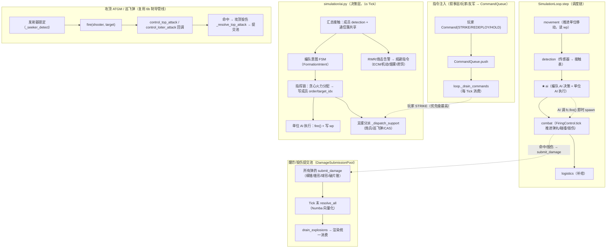
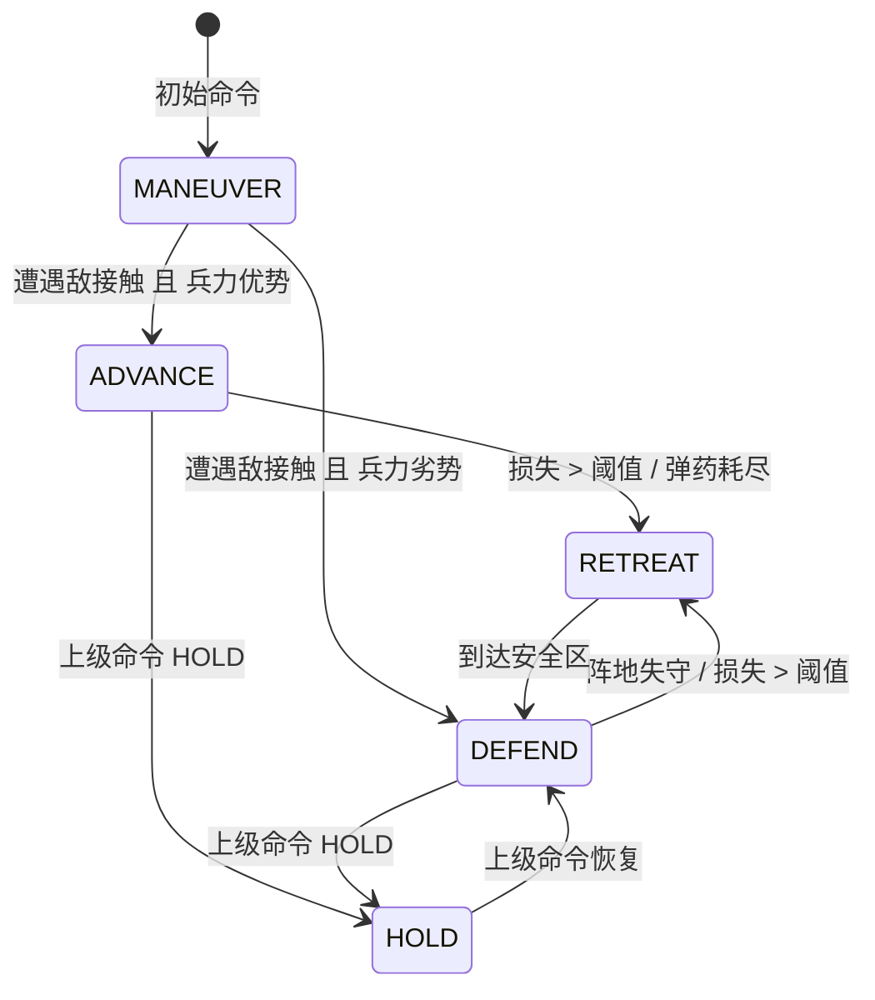
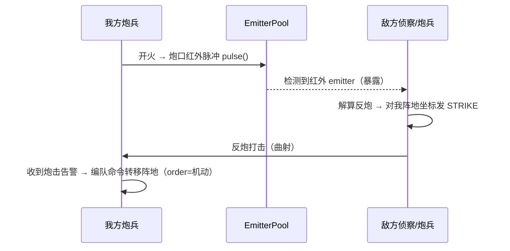
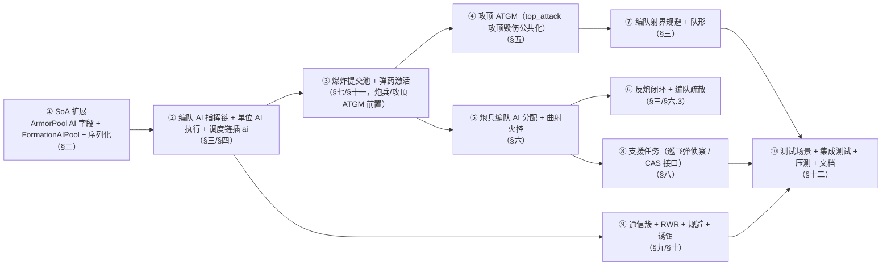

# Phase 6c AI 管线与算法设计（实施级）

> 定位：本文档是 `docs/phase6-ai-design.md`（设计定稿）的**实施级细化**——
> 把定稿方案落成可直接编码的**管线（数据流 + 编排顺序）**与**算法（公式 + 内核签名 + 接缝）**。
>
> 范围：**Phase 6c 剩余子系统**——编队 AI（指挥链）、单位 AI（执行）、攻顶反坦克导弹、
> 炮兵、支援任务（巡飞弹 / CAS 接口）、RWR 告警 + 规避 + 诱饵、通信网络（去中心化）、
> 爆炸/毁伤提交池、弹药类型激活 + 测试场景 / 集成测试 / 压测 / 文档。
>
> 读前必读：`phase6-ai-design.md`（方案选型与概念）——本文不重复论证「为什么编队 AI 决策、
> 单位 AI 执行」，只负责「怎么落地」。

> ⏳ **实施状态（2026-08-14）**：**步骤 ① 完成**（SoA 扩展：ArmorPool 8 AI 字段 +
> FormationAIPool + 序列化 + WorldAdapter）+ **步骤 ② 完成**（编队 AI 指挥链 +
> 单位 AI 执行 + 调度链插 `ai`，`simulation/ai.py` + `tests/test_phase6_ai.py` 16 用例）+
> **步骤 ③ 完成**（爆炸/毁伤提交池 `combat/damage_submission.py` + 弹药激活
> HE_FRAG/PELE/APCR/SAPHEI，`tests/test_damage_submission.py` 14 用例）。
> 全量 **402 测试全绿**（388 基线 + 14 新增）。**步骤 ④（攻顶 ATGM）与 ⑧（巡飞弹/CAS）
> 延后**（用户拍板不紧急，2026-08-14）；⑤⑥⑦⑨⑩ 未实施。
> 前置：Phase 6b（制导 + 电子战闭环 + 末敏弹 + 激光制导炸弹）已全部完成 ✅
> （`phase6-guidance-pipeline.md` 步骤 1~9，全量 363 测试全绿）。
> 本文复用 6b 的 `EmitterPool` / `FiringControl` / `MissileControlRegistry` / `detection` 层，
> 不重复论证其内部实现。

---

## 〇、架构红线（贯穿全文）

与制导律不同，**AI 不进 Numba 热路径**（`phase6-ai-design.md` §〇）：

| 维度 | 制导律（6b） | AI（6c） |
|------|-------------|----------|
| 频率 | 每弹丸 × 0.01s 子步 | 编队/单位 × 1s 地面 Tick |
| 逻辑 | 纯数学（加速度向量） | 分支密集（意图/指挥链/目标分配） |
| 形态 | `@njit` 纯函数回调 | Python 状态机 + 向量化评估 |
| 决策 | 无（只算加速度） | 有（编队 AI 定任务，单位 AI 执行） |

三条红线（违背即返工）：

1. **编队 AI 决策，单位 AI 执行**。编队 AI 持有意图 FSM、汇总敌接触、分配打击任务，
   通过指挥链（写成员 `order` / `target_idx`）下达指令；单位 AI 只执行（fire / move）。
2. **AI 只决策，不执行**。AI 只通过既有接口行动——`FiringControl.fire()`、`ArmorPool.wp`、
   `CommandQueue`——**绝不直接改 SoA 数组**（与叙事层「永不直接修改模拟状态」同构，AGENTS.md 3.7）。
3. **热路径只做向量化批量评估**：目标评分/威胁排序用 NumPy 向量化 + 少量 `@njit` 评分内核；
   编队 FSM 是纯 Python 逐编队遍历（≤256 编队 × 简单分支 < 0.1ms）。

---

## 一、端到端管线总览



**数据流要点**（与 6b 制导管线的关系）：

| 现有 6b 能力 | Phase 6c 插入点 |
|------|------|
| `fire(shooter, target, aim_at=...)` 开火链 | 攻顶 ATGM 复用（`aim_at` 用于地形/光斑目标）；AI 单位自由射击走同一条链 |
| `MissileControlRegistry` | 追加 `top_attack` / `loiter_attack` 两个回调（不重排既有固定顺序） |
| `GuidanceStage` | 追加 `LOITER=5`（巡飞弹盘旋段，追加不重排） |
| `EmitterPool` | 追加 `EMITTER_KIND_DECOY=5`（诱饵）；炮口红外脉冲复用 `pulse()` |
| `_seeker_detect` / `evaluate_esm_emitter_detection` | 发射器锁定 / RWR 告警直接复用 |
| `_resolve_sfm_hit` / `_sal_blast_damage` / `apply_area_damage` | **全部改为「提交伤害事件」进提交池**（§七） |
| `SimulationLoop.step` 调度链 | **插入 `ai` hook**（movement→detection→**ai**→combat→logistics） |

---

## 二、数据模型与接缝（现状 → 目标）

### 2.1 `ArmorPool` 新增 AI 字段（`entities/pools.py`）

> ✅ **已实施（2026-08-14，步骤 ①）**：8 字段已加入 `ArmorPool`（`__init__`/`spawn`/`_expand`
> 三处同步），`spawn` 追加 `team`/`role`/`formation_id` 参数（带默认值，旧调用不变）。
> 实施前现状：`ArmorPool` 只有 `pos/half/yaw/health/active/wp/wp_count/wp_idx/mesh_id/`
> `pitch/roll/suspension/contact_z/contact_mesh_id/pitch_vel/roll_vel/rcs/ecm`，AI 字段全不存在。

在 `self.ecm` 之后追加（`__init__` / `spawn` / `_expand` 三处同步）：

```python
# ---- Phase 6c AI 字段（docs/phase6-ai-design.md §1.1）----
self.team         = np.zeros(self.capacity, dtype=np.int8)    # 阵营：0=友 1=敌 2=中立
self.role         = np.zeros(self.capacity, dtype=np.int8)    # 角色：0坦克 1炮兵 2侦察 3防空 4攻顶ATGM发射器 5预留(空中,Phase7)
self.order        = np.zeros(self.capacity, dtype=np.int8)    # 编队下达的执行指令（§四.1，非单位独立意图）
self.target_idx   = np.full(self.capacity, -1, dtype=np.int32) # 编队分配的目标装甲索引（-1 无）
self.target_kind  = np.zeros(self.capacity, dtype=np.int8)    # 目标类型：0=装甲 1=辐射源 2=光斑 3=地形点
self.comm         = np.ones(self.capacity, dtype=np.float32)  # 通信质量 0~1（数据链，门控命令下达）
self.contact_age  = np.full(self.capacity, 1e9, dtype=np.float32) # 最近一次接触距今（秒，态势老化）
self.formation_id = np.full(self.capacity, -1, dtype=np.int32)    # 所属编队 AI 池索引（§2.2，-1 未编队）
```

`spawn` 追加参数（带默认值，旧测试构造不变）：

```python
def spawn(self, x, y, z, *, team=0, role=0, formation_id=-1, ...):
    ...
    self.team[idx] = int(team)
    self.role[idx] = int(role)
    self.order[idx] = 0
    self.target_idx[idx] = -1
    self.target_kind[idx] = 0
    self.comm[idx] = 1.0
    self.contact_age[idx] = 1e9
    self.formation_id[idx] = int(formation_id)
```

`_expand` 用既有 `_resize` 逐数组扩容（8 个新数组）。

> 🔥 **实施差异（步骤 ① 顺手修复既有 bug）**：`_resize` 用 `np.zeros`，扩容新区会把构造
> **非零默认值**（`target_idx=-1`/`comm=1.0`/`contact_age=1e9`/`formation_id=-1`/`rcs=50.0`）
> 覆盖成 0——平时被 `spawn` 显式重置掩盖（读档/读新区才暴露）。修复 = 扩容后
> `xxx[old_cap:] = 默认` 补填（`FormationAIPool` 的 `comm=1.0` 同样补填；
> `ProjectilePool` 的 guid 字段有同款遗留，未动）。

> `role` / `team` 此前在渲染层以动态属性 `side` 演示（dev-progress 2026-08-13），
> 本阶段**正式下沉为 SoA 字段**；`Airis/render/adapter.py` 的 `WorldAdapter` 改读 `armor.team`
> （`getattr` 防御保留）。

### 2.2 新池 `FormationAIPool`（`entities/pools.py`）

> ✅ **已实施（2026-08-14，步骤 ①）**：已落地 `entities/pools.py`，含 `spawn`/`destroy`/
> `active_count`/`active_indices`/`_expand` + `contact_set`（Python list）三处同步。

编队 AI 是**决策主体**，独立建池（`MAX_FORMATIONS = 256`）：

```python
MAX_FORMATIONS = 256

class FormationAIPool:
    """编队 AI 池（SoA，MAX_FORMATIONS=256）。一编队 = 单/多单位，战术姿态由编队 AI 决定。"""
    def __init__(self, capacity: int = MAX_FORMATIONS) -> None:
        self.active       = np.zeros(capacity, dtype=np.bool_)
        self.team         = np.zeros(capacity, dtype=np.int8)
        self.role         = np.zeros(capacity, dtype=np.int8)     # 编队角色（装甲/炮兵/侦察/混合）
        self.intent       = np.zeros(capacity, dtype=np.int8)     # 编队意图 FSM（§三.1）
        self.order        = np.zeros(capacity, dtype=np.int8)     # 编队级命令（上级/玩家下达）
        self.stance       = np.zeros(capacity, dtype=np.int8)     # 战术姿态（进攻/防御）
        self.target_zone  = np.zeros((capacity, 3), dtype=np.float32)  # 任务目标区中心
        self.comm         = np.ones(capacity, dtype=np.float32)   # 编队通信质量（指挥链门控）
        self.member_count = np.zeros(capacity, dtype=np.int32)    # 成员数
        self.contact_set  = [None] * capacity                     # 汇总敌接触表（Python 层，非热路径）
        self._free_stack: list[int] = list(range(capacity))

    def spawn(self, team, role, target_zone=(0.0, 0.0, 0.0)) -> int: ...
    def destroy(self, idx) -> None: ...
    def _expand(self, factor=2.0) -> None: ...  # 同 ArmorPool._expand 惯例
```

> `contact_set` 是编队 AI 的**汇总接触表**（Python 数据结构，非热路径），每 1s Tick
> 从成员 `detection` 输出 + 通信簇共享（§九）整理，可安全用 Python list。

### 2.3 新池 `DamageSubmissionPool`（`combat/damage_submission.py`，§七）

### 2.4 `SimulationState` 扩展（`simulation/state.py`）

> ✅ **已实施（2026-08-14，步骤 ①）**：`formation_pool` 已加入，`snapshot().pools` 含 `"formation"`。
> `damage_pool`（伤害提交池）待步骤 ③。

```python
@dataclass
class SimulationState:
    ...
    formation_pool: Any = None   # Phase 6c 编队 AI 池（可选装配）
    damage_pool: Any = None      # Phase 6c 伤害提交池（可选装配）
```

`snapshot()` 的 `pools` 字典追加 `"formation": self.formation_pool`（供渲染/战报读编队态势）。

### 2.5 `SimulationLoop` 调度链插入 `ai`（`simulation/loop.py`）

> ✅ **已实施（2026-08-14，步骤 ②）**：调度链已插入 `"ai"`（movement→detection→ai→combat→
> logistics），`configure_default_rates` 已配 `set_rate("ai", TICK_GROUND)`。
> 实施前现状：`step()` 调度是硬编码元组 `("movement", "detection", "combat", "logistics")`。

```python
# loop.py step() 调度链（唯一改动点）
for name in ("movement", "detection", "ai", "combat", "logistics"):
    ...
# configure_default_rates()
self.set_rate("ai", TICK_GROUND)
```

> **AI 只决策不执行**：AI hook 需要拿到 `FiringControl` / `GraphPathfinder` / `AmmoManager`
> 等既有子系统的引用才能行动。装配时（scenario 装配器，§十二）把这些引用**注入 AI 模块**，
> AI 内部不 import 反向依赖，保持 `combat` 不反向依赖 `simulation/ai.py`（依赖链 §十三）。

---

## 三、编队 AI（指挥链决策主体，`simulation/ai.py`）

### 3.1 编队意图 FSM

```python
class FormationIntent(IntEnum):
    MANEUVER = 0   # 机动（向任务目标区行进，途中遭遇才交战）
    ADVANCE  = 1   # 进攻（主动推进 + 分配打击任务）
    DEFEND   = 2   # 防御（固守，只对进入射程目标分配射击）
    RETREAT  = 3   # 撤退（脱离接触，向安全区机动）
    HOLD     = 4   # 待命（静默，辐射管制）
```

FSM 转移（每 1s Tick，Python 逐编队评估）：



```python
@dataclass
class FormationSituation:
    friendly_active: int          # 本编队存活成员数
    enemy_contacts: int          # 汇总的敌接触数
    enemy_known: int             # 已知敌总数（情报）
    ammo_ratio: float            # 编队平均弹药 0~1
    health_ratio: float          # 编队平均血量 0~1
    under_artillery: bool        # 是否处于炮击告警（§八）
    under_rwr: bool              # 是否被雷达照射（§十）
    task_reached: bool           # 是否到达任务目标区
```

**接缝**：`simulation/ai.py` 新建，`FormationAIPool` 从 `entities/pools.py` 导入。
FSM 转移纯 Python 可测（§十二.2 用例 1）。

### 3.2 指挥链：打击任务分配（贪心火力分配）

每 Tick 把汇总接触表统一整理，贪心分配下发成员（写 `order` / `target_idx`）：

```python
def _assign_targets(self, fidx: int) -> None:
    """贪心火力分配（docs §二.2）：对每个敌接触选最合适成员，写 order/target_idx。

    约束：每目标并发开火上限（防过度杀伤）+ 每个成员最多分配一个目标。
    """
    contacts = self.formations.contact_set[fidx] or []
    members = self._members_of(fidx)
    if not contacts or not members:
        return
    intent = int(self.formations.intent[fidx])
    for m in members:                       # 重置成员目标（每 tick 重新分配）
        self.armor.target_idx[m] = -1

    fire_count: dict[int, int] = {}
    available = list(members)

    def assign_one(contact):
        best = self._best_assignee(available, contact)   # 距离最近 + 有弹药
        if best is None:
            return False
        self.armor.target_idx[best] = contact.idx
        self.armor.target_kind[best] = 0
        self.armor.order[best] = self._order_for_intent(intent)
        fire_count[contact.idx] = fire_count.get(contact.idx, 0) + 1
        available.remove(best)
        return True

    # 第一轮：每个目标覆盖一个成员（目标数 ≥ 成员数时全覆盖，避免挤单目标）
    for contact in contacts:
        if not available:
            break
        assign_one(contact)
    # 第二轮：补充并发（成员多目标少时，每目标最多 MAX_CONCURRENT_FIRE）
    for contact in contacts:
        while fire_count.get(contact.idx, 0) < self.MAX_CONCURRENT_FIRE and available:
            if not assign_one(contact):
                break
```

> 🔥 **实施差异（步骤 ② 踩坑修复）**：设计版「对每个接触只分配一次」会**覆盖 bug**——
> 一个成员可被多个接触选中，后写覆盖前写，导致部分目标落空（2 成员 vs 2 目标只分配 1 个）。
> 修复 = **两轮分配**（第一轮保覆盖、第二轮补并发到 `MAX_CONCURRENT_FIRE=3`）。

> **受击面防御**：选择 ADVANCE 的编队 AI 也会命令受击严重的成员转 DEFEND
> （血量/压制阈值触发），实现「进攻中的局部防御」（§十二.2 用例 3）。

### 3.3 指挥链门控（通信）

- 编队 `comm` 高 → 接收玩家/上级命令 + 向成员下达指令。
- 编队 `comm` 低（与中央断裂）→ 仍可**自主规划**（成员间点对点通信尚存，独立建网，§九）。
- 成员 `comm` 低 → 收不到编队指令 → 退回 §四.3 自主自保。

### 3.4 编队机动与战术行为

- **队形保持**：编队锚点 = 领队单位（或 `target_zone`），成员围绕锚点保持间距
  （菱形/楔形/横队）；复用 `FormationResolver`（已有编队推开）保证不重叠，
  队形偏移由编队槽位号决定。
- **反炮兵疏散**（§八.3）：收到炮击告警 → 命令成员疏散机动（随机方向 + 拉大间距 + 转移）。
- **射界规避**：发现敌方攻顶 ATGM 发射器/直射火力射界 → 标记危险区（`GraphPathfinder`
  `forbidden_zones`）→ 命令成员绕出射界 / 烟幕遮蔽 / 退出有效射程。

---

## 四、单位 AI（执行者，`simulation/ai.py`）

单位 AI **不做独立决策**，只执行编队 AI 下达的 `order` / `target_idx`。

### 4.1 执行态（读指令）

```python
class UnitOrder(IntEnum):
    ENGAGE = 0   # 进攻：向 target_idx 机动 + 自由射击
    DEFEND = 1   # 防御：固守阵位，只对进入射程的分配目标射击
    MANEUVER = 2 # 机动：向编队 target_zone 寻路移动
    RETREAT = 3  # 撤退：脱离接触，向安全区机动
    HOLD = 4     # 待命：静默（不移动不射击，辐射管制）
```

### 4.2 行动层：自由射击 + 机动

```python
def execute_unit_order(self, aidx: int) -> None:
    order = int(self.armor.order[aidx])
    if order == int(UnitOrder.ENGAGE):
        tid = int(self.armor.target_idx[aidx])
        if tid >= 0 and self.fc.can_fire(aidx):
            # 目标在射程内（fire 内部已判 max_range）→ 自由射击
            self.fc.fire(aidx, tid)
        else:
            self._move_toward_target(aidx, tid)
    elif order == int(UnitOrder.MANEUVER):
        self._move_toward_zone(aidx)   # GraphPathfinder 寻路 → 写 wp
    elif order == int(UnitOrder.RETREAT):
        self._move_toward_safe(aidx)
    # DEFEND / HOLD：仅 DEFEND 对进入射程的分配目标射击
    elif order == int(UnitOrder.DEFEND):
        tid = int(self.armor.target_idx[aidx])
        if tid >= 0 and self._in_range(aidx, tid) and self.fc.can_fire(aidx):
            self.fc.fire(aidx, tid)
```

- **射击**：`FiringControl.can_fire(shooter)` 且目标在 `max_range_m` 内 → `fc.fire(shooter, target_idx)`。
- **机动**：`GraphPathfinder` 寻路 → 写 `armor.wp / wp_count / wp_idx`（复用 Phase 2 路标点系统）。

> 🔥 **实施差异（步骤 ②）**：实际实现为 `_execute_unit_orders()`——遍历**全部活跃装甲**，
> 每单位先判「无编队 / 编队已销毁 / `comm` < `COMM_THRESHOLD(0.5)`」→ 走 `_self_preserve`
> 自保（血量 < 25% 撤退，否则对最近威胁还击，不主动进攻）；否则按 `order` 分派。
> `_try_fire` 先 `fc.can_fire` + 射程内再 `fc.fire`，超射程的 ENGAGE 单位退化为机动靠近。
> ⚠️ 装配必须注入 `fc`（`FormationAI(fc=...)`）——漏传则 `ai.fc=None`，`_try_fire` 首行
> 短路恒不开火（直接调 `fc.fire` 成功但 tick 里全 False）。

### 4.3 通信断裂自主自保

成员收不到编队指令（`comm` 低于阈值，或编队已被摧毁）时，退回**简单自保**：
- 对最近威胁还击（§4.4 评分内核的降级版）。
- 血量过低 → 向友军/安全区撤退。
- 不主动发起进攻（决策权在编队 AI）。

### 4.4 目标评分内核（`simulation/ai.py` 内，编队 AI 与自保复用）

```python
@njit
def score_targets(
    dist,          # (K,) float32  距离
    speed,         # (K,) float32  目标速度
    weapon_pen,    # (K,) float32  敌武器对己方的威胁
    health,        # (K,) float32  目标血量（残血优先补刀）
    w_range, w_speed, w_weapon, w_health,  # 标量权重
    max_range,     # 标量
    out,           # (K,) float32  威胁分
) -> None:
    """威胁评分：threat = w_range·(1−d/max_range) + w_speed·speed
                           + w_weapon·weapon_pen + w_health·(1−health)。"""
    k = dist.shape[0]
    for i in range(k):
        out[i] = (w_range * (1.0 - dist[i] / max_range)
                  + w_speed * speed[i]
                  + w_weapon * weapon_pen[i]
                  + w_health * (1.0 - health[i]))
```

- 目标评分写成 `@njit` 内核（数组批量），编队 FSM / 目标分配仍是 Python。
- **防御姿态**优先打最近威胁（`w_range` 上调）；**进攻姿态**优先打高价值（`w_weapon` 上调）。

---

## 五、自锁定反坦克导弹 / 攻顶发射器（制导回调 + 攻顶毁伤公共化）

> ⚠️ **实施状态（2026-08-14）**：本步骤（攻顶 ATGM / 攻顶发射器）**延后**（用户拍板不紧急）。
> 前置已就绪：攻顶毁伤公共化 `FiringControl._resolve_top_attack` 已在步骤③ 抽出（SFM 直接路径
> + 提交池 CONE 事件共用），本步骤只需补 `control_top_attack` 制导回调（§5.2）+ 发射器行为（§5.4）。

> 核心认知（`phase6-ai-design.md` §四）：「红外感应式反坦克地雷自主跟踪引爆」实为
> **发射后不管的顶部攻击反坦克武器**（NLAW / 标枪类），不埋设、不建 `MinePool`。

### 5.1 现实机制 → 模型映射

| 现实机制 | 模型 |
|---|---|
| 发射器（车载/步兵） | `ArmorPool` 单位，`role=ATGM_LAUNCHER=4` |
| 发射前锁定 | 编队 AI 分配目标 → 单位 AI `_seeker_detect` 锁定 → `fire(shooter, target)` |
| 发射后不管 | 复用 6b `fire()` + 制导字段（`guid_law`/`guid_target_pos`/`guid_stage`） |
| 顶部攻击弹道 | 新控制回调 `top_attack`（§5.2） |
| 红外成像导引头 | `SeekerType.IR_IMAGING`（已有，被动不暴露） |
| 攻顶毁伤 | 复用 SFM 攻顶（`top_armor_factor` + 空心装药穿深，§5.3 公共化） |

### 5.2 顶部攻击弹道控制回调 `control_top_attack`（`combat/guidance.py`）

注册进 `MissileControlRegistry`（**追加**，不破坏既有固定顺序）：

```python
@njit
def control_top_attack(pos, vel, age, target_pos, target_vel, nav_gain, dt, out):
    """顶部攻击：BOOST 直线爬升（越过掩体）→ MID 转 PN → 末端俯冲攻顶。
    内部调用 proportional_nav 公共求解器，不重复实现 PN。"""
    # BOOST 段（age < boost_s）：固定仰角爬升，无制导
    # MID 段：proportional_nav（复用公共求解器）
    # TERMINAL 段：接近目标时加大 nav_gain（俯冲收敛）
```

- 推进剖面（爬升时长/仰角）写死在回调内，per-ammo 参数化留后续（同 6b `boost_coast_pn` 先例）。
- `GuidanceStage` **无需新增**——复用 TRACK/MEMORY/TERMINAL 状态机，仅回调内部按 `age` 分派。

### 5.3 攻顶毁伤公共化（`combat/engagement.py`）

> **现状核实（2026-08-14）**：`_resolve_sfm_hit` 已含「攻顶穿深 + 部位判定」逻辑，
> `_resolve_top_part`（攻顶部位判定）已存在。需抽出公共函数供 SFM 与攻顶 ATGM 共用：

```python
def _resolve_top_attack(self, proj_idx, armor_idx, pen_mm, top_factor, cause: str) -> None:
    """攻顶毁伤公共函数：顶部 = 正面 × top_factor，垂直攻顶（impact_angle_deg=0），
    固定穿深（化学能语义）。SFM 与攻顶 ATGM 共用。伤害经 §七提交池结算。"""
    ...
```

`_resolve_sfm_hit` 改为调用 `_resolve_top_attack`；攻顶 ATGM 命中同样走此函数。

### 5.4 发射器行为

- `role=ATGM_LAUNCHER` 的战术姿态由编队 AI 决定（伏击阵地 = 编队 DEFEND 姿态）：
  锁定 → 发射 → **转移**（打一枪换地方，编队 AI 下达机动指令）。
- **弹药**：`AmmoType.ATGM` + `top_attack=True` + `seeker=IR_IMAGING` + `control_law_id="top_attack"`。
- 事件：`emit("atgm_hit"/"atgm_top_attack", {...})` 供叙事层/战报消费（击杀归属 = 发射器方）。

---

## 六、炮兵（`simulation/ai.py` + 既有 fire/弹药）

### 6.1 角色与建模

炮兵单位 = `ArmorPool` 中 `role=ARTILLERY` 的实体（`WeaponCategory.HOWITZER=4` 已有），
**不直接参与直射**，通过**曲射弹道**打击坐标：

- **弹道**：复用 `integrate_projectile_movement`（直线 + 重力），初速方向指向目标上空抛物顶点。
  高抛角（`elevation_deg`）由射距解算（简化：固定 45° 或由 `WeaponSystem.solve` 扩展）。
- **落点毁伤**：HE 爆破 + 破片（§七.1 球形 + 破片锥），经提交池结算。
- **弹药消耗**：复用 `AmmoManager`（每发 1 单位）。

> 炮兵开火走 `fc.fire(shooter, target_idx=-1, aim_at=(落点坐标))`——`aim_at` 已支持地形
> 坐标瞄准（6b SAL 先例），无需扩展 fire 签名。

### 6.2 火控任务（炮兵编队 AI 分配弹药与目标）

炮兵**编队 AI** 统一分配弹药与目标（§三.2），接受两类指令，**统一走既有 `CommandQueue`**
（万物皆单位，不建 `FireMission` 数据结构）：

- **友军请求**：装甲部队/侦察发现目标 → 向后方炮兵的编队 AI 下单
  （`Command(CommandType.STRIKE, target, {"coords": ..., "ammo": ...})`）。
- **玩家指令**：叙事层同样发 `CommandType.STRIKE`（AGENTS.md 3.7 唯一入口），
  **优先级高于 AI 互相下单**（玩家指令覆盖编队 AI 决策）。
- **C2 传播延迟**：指令经数据链，`comm` 门控 + 延迟 N 秒（§九）。

### 6.3 反炮兵循环（Counter-battery）



> 这是 §三.2 指挥链在炮兵编队的具体化，构成「开火→暴露→反炮→转移」的完整闭环。

---

## 七、爆炸/毁伤提交池（`combat/damage_submission.py`）

> 用户拍板（2026-08-14）：所有弹药的**伤害模型**（锥形/球形/类型）先提交到一个池，再统一
> 批量计算——既加速运算（Numba 向量化），又为渲染提供统一的爆炸数据源。

### 7.1 伤害模型参数化

| 伤害模型 | 几何 | 弹药 |
|---|---|---|
| 细锥射流（动能长杆侵彻） | 极细锥（直径≈弹径，深度=穿深） | APFSDS/AP/APCR/PELE |
| 锥形射流（化学能 EFP/HEAT） | 锥（定向金属射流） | HEAT/SFM EFP/攻顶 ATGM |
| 球形爆破 | 球（半径 + 线性/高斯衰减） | HE/HE_FRAG/SAL/巡飞弹 |
| 破片锥 | 锥（方向 + 角度 + 碎片数） | HE_FRAG/HE |

> AP 弹（APCR/APFSDS/AP）的长杆侵彻本质是**特别细的锥形射流**——直径≈弹径、深度=穿深的
> 细长侵彻通道，统一进提交池（与 EFP/HEAT 的化学能锥形射流同构，仅锥角/尺度不同）。

### 7.2 提交 → 统一结算

```python
MAX_DAMAGE_EVENTS = 4096

class DamageSubmissionPool:
    """伤害提交池：弹药把「伤害事件」提交进池，Tick 末统一批量结算。"""
    def __init__(self, capacity: int = MAX_DAMAGE_EVENTS) -> None:
        self.kind       = np.zeros(capacity, dtype=np.int8)       # 0 细锥 1 锥形 2 球形 3 破片锥
        self.center     = np.zeros((capacity, 3), dtype=np.float32)
        self.radius     = np.zeros(capacity, dtype=np.float32)    # 球半径 / 锥底半径
        self.pen_mm     = np.zeros(capacity, dtype=np.float32)    # 穿深
        self.target_idx = np.full(capacity, -1, dtype=np.int32)   # 直接目标（-1=纯范围）
        self.direction  = np.zeros((capacity, 3), dtype=np.float32)  # 锥方向（单位向量）
        self.cone_angle = np.zeros(capacity, dtype=np.float32)    # 锥半角（rad）
        self.frag_count = np.zeros(capacity, dtype=np.int32)      # 破片数
        self.active     = np.zeros(capacity, dtype=np.bool_)
        self._free_stack: list[int] = list(range(capacity))

    # 提交：submit_damage(kind, center, radius, pen_mm, target_idx, ...) → 事件索引
    # 结算：resolve_all(armor, boxes, damage_resolver, rng)（Numba 向量化：批量穿深/范围衰减/部位判定）
    # 渲染：drain_explosions() → 爆炸特效数据源（位置/半径/类型），消费后归池
```

**Numba 结算内核**（`@njit`，批量）：

```python
@njit
def resolve_damage_events(
    kind, center, radius, pen_mm, target_idx, direction, cone_angle, frag_count, active,
    armor_pos, armor_half, armor_health, armor_active,
    out_health_dmg,   # (E,) 每事件对直接目标伤害
) -> None:
    """批量结算：锥形→细锥侵彻（pen_mm）；球形→范围衰减；破片锥→碎片。"""
    # 细锥/锥形：只对 target_idx 结算穿深
    # 球形/破片锥：遍历装甲（O(E×N)，Phase 6c 可接受；E≤4096，热点后续加空间哈希）
```

### 7.3 现有毁伤循环改造

> **现状核实（2026-08-14）**：`_resolve_sfm_hit`（engagement.py:563）、`_sal_blast_damage`
> （engagement.py:717）、`apply_area_damage`（damage.py）是**散落的多处毁伤循环**。

改造后：

| 旧入口 | 改造 |
|---|---|
| `_resolve_sfm_hit` | 攻顶穿深 → `submit_damage(锥形, ...)`；`resolve_all` 结算（或保留直接命中路径，仅范围部分提交） |
| `_sal_blast_damage` | 球形爆破 → `submit_damage(球形, ...)` |
| `apply_area_damage` | 球形/破片锥 → `submit_damage` |

- 统一为一个 Numba 结算内核，消除散落循环。
- **渲染消费**：爆炸特效（球形冲击波/锥形射流/细锥侵彻）直接读提交池（`drain_explosions()`），
  避免渲染层二次解析毁伤。

> ✅ **实施（2026-08-14，步骤 ③）**：
> - `combat/damage_submission.py` 新建：`DamageKind`（FINE_CONE/CONE/SPHERE/FRAG_CONE）+
>   `DamageSubmissionPool`（SoA，MAX_DAMAGE_EVENTS=4096，submit/clear/active/_expand）+ Numba
>   内核 `resolve_area_damage`（SPHERE 线性衰减 / FRAG_CONE 锥内判定，O(E×N) 原地扣血）。
> - **字段扩展（超出本文档核心清单）**：`top_factor`（锥形事件攻顶因子，§五.3 语义）。
> - **`_resolve_sfm_hit` 保留直接命中路径**（文档允许「或保留直接命中路径」）——SFM/SAL
>   的 17 个测试直接调 `_sfm_scan()` 后立即断言血量，改提交池会破坏它们；顶级毁伤逻辑已抽
>   `FiringControl._resolve_top_attack`（§五.3 公共函数，供步骤④ 攻顶 ATGM 与提交池 CONE 事件共用）。
> - **`_sal_blast_damage` 完全改造**为提交 SPHERE 事件（Tick 末统一结算）。
> - **`_resolve_hit` 命中爆炸/破片弹药**（`blast_radius>0`）→ `_submit_hit_blast` 提交
>   SPHERE（`blast_dmg` 中心毁伤量）+ FRAG_CONE（方向=弹丸速度、半角 30°、射程=blast_radius）。
> - `FiringControl.tick()` 末尾调 `_resolve_damage_pool()`：区域毁伤 Numba 批量 → `_finalize_area_kills`
>   补摧毁 → 锥形/细锥逐事件 `_resolve_top_attack` → `pool.clear()`。
> - **提交池不序列化**：它是瞬态结算缓冲（Tick 末必清空），存档只存持久状态（同 emitter/armor
>   的 AI 字段，见 §二）。
> - 测试 `tests/test_damage_submission.py` **14 用例全绿**（池基础/扩容/爆炸 drain/球形衰减/
>   失活忽略/破片锥/端到端 3 例/弹药激活 2 例/state 挂载）。

---

## 八、支援任务（炮兵 / 巡飞弹 / CAS，`simulation/ai.py` 内）

> ⚠️ **实施状态（2026-08-14）**：本步骤（巡飞弹 / CAS 接口）**延后**（用户拍板不紧急）。
> CAS 分支本就只留接口不落地实体（§8.3，Phase 7 接入）；`GuidanceStage.LOITER=5` 追加 + `loiter_attack`
> 回调 + 巡飞弹侦察上报留待后续。

### 8.1 统一支援入口（复用 CommandQueue，不建 SupportCoordinator）

万物皆单位：支援不是独立调度系统，而是「**指挥员/友军下达 `STRIKE` 指令 → 编队 AI 按角色分派**」：

```python
def _dispatch_support(self, cmd: Command) -> None:
    """统一支援入口：按目标/弹药把 STRIKE 指令分派给对应角色编队。"""
    if cmd.type != CommandType.STRIKE:
        return
    coords = cmd.params.get("coords")
    ammo = cmd.params.get("ammo")
    target_kind = cmd.params.get("target_kind", "armor")
    # role=ARTILLERY 编队 → 曲射解算（§六）
    # 巡飞弹平台 → 发射巡飞弹（§8.2）
    # CAS 任务 → 空中打击任务（§8.3，Phase 7 执行）
```

不新建 `SupportKind`/`SupportRequest`，指令目标与弹药种类由 `Command.params` 表达
（`coords`/`ammo`/`target_kind`）。

### 8.2 巡飞弹（Loitering Munition，兼侦察）

复用 6b 制导管线，**新控制回调 `loiter_attack`**（注册进 `MissileControlRegistry`）：

- **LOITER 段**：绕目标区上空盘旋（圆周运动，`age` 查时序）。
- **TERMINAL 段**：导引头锁定目标（复用 `_seeker_detect`）→ 俯冲攻顶（复用 §5.3 攻顶毁伤或直接碰撞）。
- 巡飞弹 = `ProjectileType.MISSILE` + `GuidanceStage.LOITER=5`（追加不重排，旧存档兼容）。
- **侦察功能**：巡飞弹盘旋期**提前发现敌方单位**（导引头/传感器输出并入通信簇共享 §九），
  通信良好时上报编队 AI，实现「装甲部队借巡飞弹先敌发现」。

**`GuidanceStage` 追加（`combat/guidance.py`）**：

```python
class GuidanceStage(IntEnum):
    ...
    SCAN = 4        # 开伞扫描（已有）
    LOITER = 5      # 盘旋（巡飞弹，Phase 6c；追加不重排既有值，旧存档兼容）
```

**`control_loiter_attack` 回调**：

```python
@njit
def control_loiter_attack(pos, vel, age, target_pos, target_vel, nav_gain, dt, out):
    """巡飞弹：LOITER 段绕目标区盘旋（圆周加速度），TERMINAL 段转 PN 俯冲。"""
    # LOITER：向心加速度 = 圆周运动（半径查时序）
    # TERMINAL：proportional_nav（复用公共求解器）
```

### 8.3 CAS（Close Air Support，任务类型非单位）

> ⚠️ **CAS 是任务类型，不是单位**。执行者属 Phase 7 空中单位。

- CAS = 空中平台对地打击**任务**（投 SAL 炸弹/自由落体炸弹）。
- Phase 6c **不实现空中单位**：CAS 作为 `STRIKE` 指令的一种 `target_kind` 预留，
  实际投弹由 Phase 7 接入（复用 6b `SALSystem` + HE 爆破，经提交池结算）。
- 本阶段 `_dispatch_support` 的 CAS 分支仅留接口，不落地实体。

---

## 九、通信网络（去中心化数据共享）

> 现状：通信以 `comm`（0~1）标量表达。本节把 `comm` **抽象为去中心化系统参量**——
> 按通信质量分簇，多网并存。

### 9.1 通信簇（Communication Clusters）

- 单位/编队各有 `comm` 字段；按「单位间通信质量」构建**连通图**（阈值门控的点对点链路）。
- 连通分量 = **通信簇**。簇内单位/编队可互相共享接触表、传递命令。
- **中央集群** = 连通到玩家/最高指挥官的簇；**独立建网** = 与中央断开、但内部仍互连的簇——
  它们照常协同（编队 AI 自主规划），只是玩家不可见其行动（§9.3）。

### 9.2 数据共享规则

| 共享内容 | 条件 |
|---|---|
| 敌方接触表 | 同一通信簇内广播（巡飞弹侦察上报、成员检测汇总） |
| 编队指令下达 | 编队 `comm` 高 → 成员可收到 |
| 跨编队协同（炮兵/装甲下单） | 两编队同簇 + 双方 `comm` 高 |
| 玩家指令 | 只到达中央集群（玩家所在簇），**优先级最高** |

### 9.3 可见性（大面板）

- **中央集群**（`comm` 高）的编队 → 大面板可见其部署与行动。
- **独立建网/失联**（`comm` 低）的编队 → **大面板不可见在干什么**（战争迷雾的一部分，
  与 `docs/数据链与战争迷雾设计.md` 的 Twin 层同构）。

> 本阶段预留接口（`comm` 字段 + 分簇算法占位），Phase 8 战争迷雾接入时实现完整分簇与 Twin 同步。

---

## 十、RWR 告警与规避（复用 `detection`，不建 RWR 模块）

### 10.1 RWR（雷达告警接收机）

RWR 是 **ESM 家族的被动接收器**，语义 = 「我被敌方雷达照射/锁定了吗」：

- **检测**：复用 `evaluate_esm_emitter_detection`（6b 已实现，读 `EmitterPool` RF emitter）。
  判定「照射方向对准我方 + 功率达标」→ 产生**告警**。
- **激光告警**：检测到敌方 LASER 照射器（`kind=2`）→ 告警（SAL 来袭前兆）。
- **告警输出**：`emit("rwr_warning", {unit, band, threat_kind, direction})` → 编队 AI 消费。

### 10.2 规避行为（编队 AI 消费告警）

| 告警 | 规避行为（编队 AI 下达） |
|---|---|
| 雷达照射（敌主动导引头/火控雷达） | 命令成员开 ECM（`armor.ecm` 提升）+ 机动规避 + 烟雾 |
| 激光照射（SAL 来袭） | 命令成员紧急机动 + 抛烟雾遮蔽光斑（光斑失效 → SAL 转 MEMORY，复用 6b） |
| 导弹来袭（detection 发现来袭弹丸） | 命令成员急转 + 抛诱饵（§10.3）+ ECM |

### 10.3 诱饵（Decoy）

- 红外诱饵（flare）/ 箔条（chaff）→ `EmitterPool` 新 kind（`EMITTER_KIND_DECOY=5`，追加）。
- 诱饵 = 短寿命高功率 emitter（IR/RF），激活后吸引敌方导引头目标选择（复用 `_seeker_detect`
  的「锁最近合格目标」逻辑，诱饵 RCS/IR 功率更高 → 被优先锁定）。
- 诱饵寿命到 → `deactivate` + 索引归还 free_stack（复用 6b emitter 生命周期）。

---

## 十一、弹药类型激活（`combat/weapons.py` + `combat/damage.py`）

> 从 `docs/ammunition-expansion-design.md` 的预留值**激活** Phase 6 战役需要的弹头。

| AmmoType（激活） | 预留值 | 伤害模型（§七提交池） | 用途 |
|---|---|---|---|
| `HE_FRAG` | 6 | 球形爆破 + 破片锥 | 炮兵 / CAS |
| `PELE` | 7 | 细锥射流 + 横向效应（穿后碎裂） | IFV/APC |
| `APCR` | 9 | 细锥射流（复用 DeMarre） | 旧式中甲 |
| `SAPHEI` | 34 | 细锥射流 + 延迟引爆（半穿 + 爆） | 防空/步兵战车 |

**实现要点**：

1. `AmmoType` 追加 `HE_FRAG=6 / PELE=7 / APCR=9 / SAPHEI=34`（**用预留值，不重排**，旧存档兼容）。
2. `AmmoConfig` 追加 `blast_radius / blast_dmg / frag_dmg / frag_count / fuse_delay`（带默认值，
   旧 YAML 兼容，`extra=forbid` 下一次性加齐）。`blast_dmg` = 球形爆破中心毁伤量（本文档
   §七 字段清单外补加的强度字段）。
3. 爆炸/破片伤害**不进 `resolve_penetration_single`**（⚠️ 实施差异）：穿透核签名不改（避免动热路径
   Numba + 全部调用点），爆炸/破片统一由 §七提交池结算——`_resolve_hit` 命中 `blast_radius>0` 的
   弹药 → `_submit_hit_blast` 提交 SPHERE + FRAG_CONE 事件，Tick 末 `resolve_area_damage` 批量结算。
4. `_kind_of`（`engagement.py`）扩展：HE_FRAG/SAPHEI 为 `MISSILE`（有爆炸），APCR/PELE 为 `BULLET`。

> 现状核实（2026-08-14）：`_kind_of` 原仅判 `(HEAT, ATGM, HESH) → MISSILE`，其余 BULLET。
> 已追加 `(HE_FRAG, SAPHEI) → MISSILE`。

---

## 十二、测试场景 + 集成测试 + 压测 + 文档（Phase 6 收尾）

### 12.1 测试场景（⚠️ Phase 10 前不新增地图）

> 用户拍板（2026-08-14）：**Airis 引擎完全开发完（Phase 10）之前不新增地图**，测试场景一律
> 复用 `tests/terrain_factory.py` 的现有地图（`flat`/`fbm`/`default`），或作为**纯测试地图**维护。

| 测试场景 | 敌我编队 | 地形（复用 factory） | 验证目标 |
|---|---|---|---|
| 编队伏击 | 友 8 坦克 vs 敌 6 坦克 + 2 攻顶ATGM发射器 | `default`（峡谷长桥） | 指挥链 + 攻顶 ATGM |
| 炮兵对决 | 友 4 坦克 + 2 炮兵 vs 敌 6 坦克 + 3 炮兵 | `fbm` 丘陵 | 反炮兵闭环 |
| 巡飞弹侦察 | 友 2 侦察 + 巡飞弹平台 vs 敌装甲纵队 | `flat` + 结构 | 侦察上报 + 巡飞弹 |

- YAML → Pydantic（`ScenarioConfig`），含单位编成/初始位置/编队意图/胜利条件。
- 加载器在 `simulation/scenario.py`（新建），装配 `SimulationLoop` 全套 hook。
- 场景文件放 `tests/` 或 `story/`（纯测试用途，不进生产地图目录）。

### 12.2 集成测试（`tests/test_phase6_ai.py`）

| 用例 | 断言 |
|---|---|
| 编队意图 FSM | 遭遇敌 → ADVANCE；损失超阈值 → RETREAT |
| 指挥链目标分配 | 编队 AI 统一分配目标，成员按 `order`/`target_idx` 执行 |
| 受击面防御 | 进攻编队 AI 命令受击严重成员转 DEFEND |
| 自由射击 | 编队下达进攻后成员自主开火命中 |
| 攻顶 ATGM | 锁定 → 爬升 → PN 攻顶命中；烟幕干扰下脱靶；发射后转移 |
| 炮兵编队 AI | 友军下单 → 炮兵编队 AI 分配弹药/目标 → 曲射落点毁伤 |
| 玩家指令优先 | 玩家 STRIKE 覆盖编队 AI 决策 |
| 反炮疏散 | 炮兵开火暴露 → 告警 → 编队命令转移阵地 |
| 巡飞弹 | LOITER → 侦察上报 → 锁定 → 俯冲攻顶 |
| 通信簇 | comm 高编队可见/协同；comm 低编队独立建网、大面板不可见 |
| RWR 规避 | 被雷达照射 → 编队命令开 ECM + 机动 |
| 爆炸提交池 | 锥形/球形伤害统一结算；渲染可读爆炸数据 |
| 弹药激活 | HE_FRAG 范围毁伤 / SAPHEI 穿后延迟 / PELE 轻穿 |

### 12.3 性能压测（`tests/benchmark_phase6.py`）

- 2048 装甲 + 16384 弹丸 + 攻顶 ATGM/炮兵/巡飞弹全开，持续 **10 分钟**。
- 目标：编队/单位 AI 决策 < 1ms/帧（1s Tick 摊薄）、伤害提交池结算 < 1ms/帧、整体 ≥ 30fps。

### 12.4 用户文档

- `docs/操作手册.md` + `docs/指挥官指南.md`，按 AGENTS.md Phase 6 清单。

---

## 十三、实施顺序与依赖



> 📌 **延后（2026-08-14，用户拍板不紧急）**：**④ 攻顶 ATGM（§五）** 与 **⑧ 支援任务（§八）** 延后实施。
> ④ 的前置（`_resolve_top_attack` 公共化 + 提交池 CONE 路径）已在步骤③ 就绪；⑧ 的 CAS 分支本就
> 只留接口。其余 ⑤⑥⑦⑨⑩ 仍按依赖顺序推进。

**依赖方向（严格向下）**：AI（`simulation/ai.py` 单一模块）导入 `combat`/`movement`/`detection`/`entities`，
不新增 `combat/*` 子模块（除 `damage_submission.py` 属 `combat` 层，被 `engagement.py` 调用）——
攻顶弹道 = 制导回调、曲射/投弹 = 既有 `fire()` + 弹药、伤害 = §七提交池。
`combat` 不反向依赖 `simulation/ai.py`。

**文件清单**：

| 文件 | 动作 | 内容 |
|---|---|---|
| `Airis/lulilo/simulation/ai.py` | 新建 | 编队 AI + 单位 AI + 支援 + RWR + 通信簇（单一模块） |
| `Airis/lulilo/simulation/scenario.py` | 新建 | ScenarioConfig + 场景装配器 |
| `Airis/lulilo/combat/damage_submission.py` | 新建 | DamageSubmissionPool + resolve_damage_events 内核 |
| `Airis/lulilo/entities/pools.py` | 修改 | ArmorPool 8 字段 + FormationAIPool |
| `Airis/lulilo/combat/weapons.py` | 修改 | AmmoType 4 值 + AmmoConfig 字段 |
| `Airis/lulilo/combat/guidance.py` | 修改 | LOITER=5 + top_attack/loiter_attack 回调（④⑧ 延后） |
| `Airis/lulilo/combat/engagement.py` | 修改 | _kind_of 扩展 + 攻顶公共化 + 毁伤提交改造 |
| `Airis/lulilo/combat/damage.py` | 修改 | 爆炸/破片分支 → 提交池 |
| `Airis/lulilo/simulation/loop.py` | 修改 | 调度链插入 ai |
| `Airis/lulilo/simulation/state.py` | 修改 | formation_pool/damage_pool |
| `Airis/lulilo/simulation/serialization.py` | 修改 | 新字段序列化（`if name in data` 兼容） |
| `Airis/render/adapter.py` | 修改 | WorldAdapter 改读 armor.team |

---

## 十四、风险与注意事项

| 风险 | 对策 |
|---|---|
| 编队 AI 决策串行化（256 编队） | 256 × 简单分支 < 0.1ms；目标分配用向量化评分内核 |
| 指挥链断裂后单位无决策 | 单位退回 §四.3 自主自保，不失控 |
| 攻顶弹道初始爬升段无制导易脱靶 | BOOST 段短（<1s），末端 PN 收敛补偿；`boost_s`/仰角 YAML 可调 |
| 目标分配过度杀伤 | 编队 AI 火力分配（每目标并发开火上限 `MAX_CONCURRENT_FIRE`） |
| 反炮死循环（双方互反） | 反炮有冷却 + 弹药消耗，自然收敛 |
| 通信簇计算开销 | 分簇仅每 1s（或更慢）跑一次；Phase 8 才实现完整分簇 |
| 弹药激活破坏旧存档 | ~~新 AmmoType 用预留值 + 默认字段，`_restore` 兼容（`if name in data`） ~~哪来旧存档??不管喵。|
| `GuidanceStage.LOITER=5` 追加 | 追加不重排，旧存档兼容（同 SENSOR_FUZED 先例） |
| AI 与叙事层指令冲突 | 玩家 `CommandQueue` 优先级最高，覆盖编队 AI 决策 |
| 伤害提交池内存 | 池按需扩容（Tick 间隙），爆炸事件结算后立即回收 |
| 伤害提交池 O(E×N) 结算 | E≤4096 时 Phase 6c 可接受；热点后续加空间哈希（§七.2 注释） |
| 贪心分配覆盖 bug（步骤 ② 实测） | 两轮分配：第一轮每目标覆盖 1 成员（保全覆盖），第二轮补并发到 `MAX_CONCURRENT_FIRE` |
| `FormationAI` 装配漏 `fc` 静默不开火（步骤 ② 实测） | `_try_fire` 首行 `self.fc is None` 短路；装配必须注入 fc（scenario 装配器 §十二） |
| `loop.step` 已先 `_drain_commands`（步骤 ② 确认） | AI 不从 `loop.commands` 读玩家指令（已被 loop 消费）；STRIKE 走装配层直连（步骤 ⑤） |
| `_expand` 非零默认被 zeros 覆盖（步骤 ① 顺手修） | 扩容后 `xxx[old_cap:] = 默认` 补填；`ProjectilePool` guid 字段同款遗留未动 |

---

## 十五、一句话总结

> **编队 AI 是大脑（意图 + 指挥链 + 目标分配），单位 AI 是手脚（只执行）；通信分簇定「谁看得见谁」，
> 攻顶导弹炮兵支援构成「打得了、跑得掉、叫得到」的体系闭环，爆炸统一进提交池——
> 全程走既有接口、不碰 SoA 热路径。**
