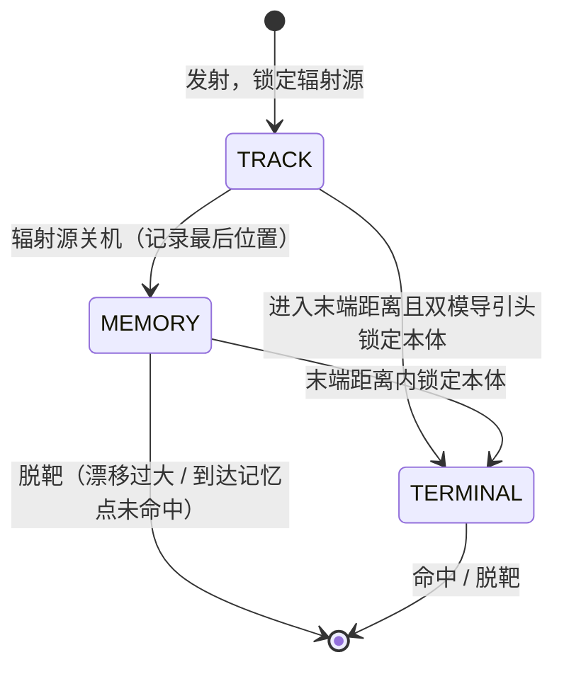
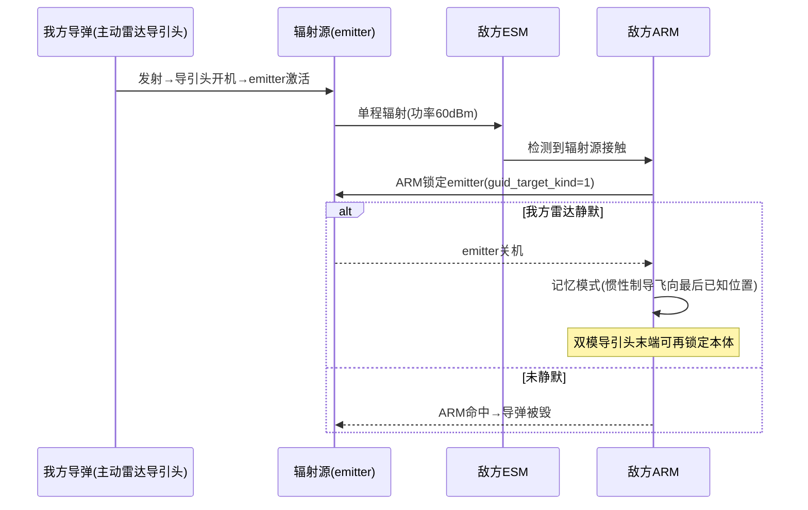
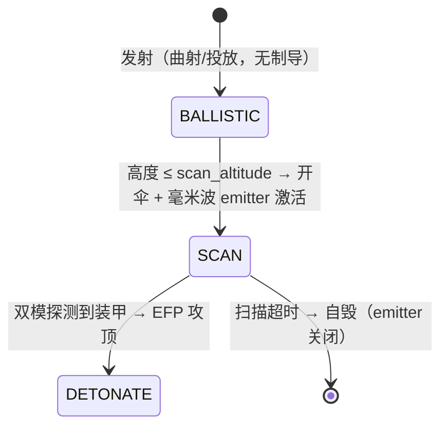
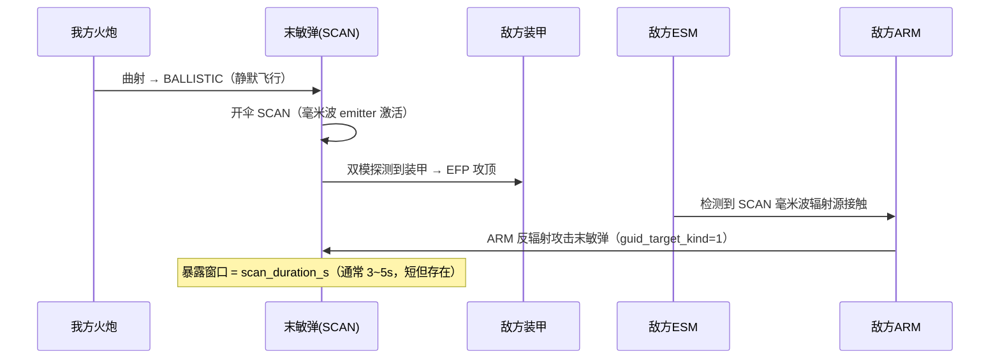

# Phase 6b 导弹制导与脚本化设计 —— Numba 回调函数方案

> 状态：**设计定稿（2026-08-13，用户拍板「用回调函数」）**
> 本文档是 Phase 6b（制导与特殊弹药）中**导弹制导律脚本化**的实施依据。
> 核心结论：制导律 = **用户写 `@njit` 纯函数 → 注册进 `GuidanceLawRegistry` → 作为回调传入 Numba 制导积分内核**。
> 不引入 Lua / 不手写 LLVM IR；零新依赖。

## 〇、背景与现状

| 现状 | 位置 |
|------|------|
| `GuidanceType` 枚举已定义（NONE/WIRE/SAL/FIRE_AND_FORGET），但**未落地**——弹道无追踪 | `combat/weapons.py` |
| `AmmoConfig.guidance` 字段已存在，仅存值不被消费 | `combat/weapons.py` |
| 弹丸积分仅直线 + 重力，`vel` 原地修改，注释已预留「导弹可能会改方向」 | `movement/integrate.py::integrate_projectile_movement` |
| `ProjectilePool` 无制导字段（无目标索引、无制导律索引） | `entities/pools.py` |
| 已知约束：nopython 模式**无法传入 Python callable**，须用 Numba 编译后的函数 | `integrate.py::integrate_armor_movement` 的 `terrain_z_func` 注释 |

**目标**：让导弹（ATGM / 炮射导弹 / 巡飞弹等）具备可自定义的制导律，且自定义逻辑
完全进入 Numba 热路径、与现有内核性能一致、无需新增第三方依赖。

## 一、方案选型（结论：Numba 回调）

| 方案 | 机制 | 进 Numba 热路径 | 运行时可改 | 新依赖 | 结论 |
|------|------|:---:|:---:|:---:|------|
| **Numba 回调（采用）** | 用户写 `@njit` 纯函数 → 传参进制导积分内核 | ✅ | ❌（需重编译，秒级） | 无 | 制导律插件点最佳形态 |
| Lua（lupa/LuaJIT） | 嵌入式脚本引擎 | ❌ 仅 Python 层逐帧调用 | ✅ | lupa | 只适合**高层行为编排**（mod/触发/目标选择），不适合每弹丸制导律 |
| 手写 LLVM IR（llvmlite） | 直接编译 IR | ✅ | ⚠️ | 无（随 numba） | 开发成本极高，不推荐 |

> **关键认知**：Numba 本身即 LLVM JIT 后端。「LLVM 脚本」在本项目的最自然形态就是
> 「用户写 Python 制导函数 → `@njit` 编译 → 作为回调传入内核」，而非手写 IR。

> **Lua 留档（未来可选，非本阶段）**：若将来要做「玩家写 mod 脚本」（类 DCS/ARMA mission
> scripting），在**行为层**（Tick 间隙决定选哪个目标 / 用哪条制导律 / 何时引爆）引入 lupa，
> **绝不进入**每弹丸热路径。导弹数量远小于子弹（16384），Python/Lua 层逐弹丸调用亦可承受。

## 二、核心机制：Numba first-class function 回调

Numba 支持把 `@njit` 编译后的函数（Dispatcher 对象）作为参数传给另一个 `@njit` 内核，
编译为**间接调用**（不同回调函数各自产生独立的内核版本并缓存）。

**两条硬约束**（AGENTS.md 爪爪法 + 性能纪律）：

1. 制导律必须是 **`@njit` 编译的纯函数**，普通 Python callable 无法传入 nopython 内核。
2. 制导律必须**只读输入、只写 out 数组**，不得读写全局/外部状态（`prange` 并行安全、无竞争）。

> 这与项目既有惯例一致：SoA 数组作参数、用 `out` 参数而非返回 tuple、循环上界用
> `.shape[0]`。制导律作为「策略函数」，与 `damage.py` 的解析内核同风格。

## 三、制导律接口（签名约定）

统一签名（out-param 风格，逐弹丸标量化）：

```python
@njit
def guidance_fn(
    proj_pos: np.ndarray,    # (3,) float32 弹丸当前位置
    proj_vel: np.ndarray,    # (3,) float32 弹丸当前速度 (m/s)
    target_pos: np.ndarray,  # (3,) float32 目标位置
    target_vel: np.ndarray,  # (3,) float32 目标速度（地面目标恒 0）
    nav_gain: float,         # 制导增益（每弹药可配）
    dt: float,               # 子步长 (s)
    out: np.ndarray,         # (3,) float32 输出加速度 (m/s²)，仅写此数组
) -> None:
    """制导律：由弹丸/目标状态计算加速度向量。纯函数，无副作用。"""
```

### 3.1 内置制导律示例

**比例导引（Proportional Navigation，默认，`proportional_nav`）**

```
a = N · Vc · λ̇
  Vc = -(r · v_rel) / |r|       # 接近速度（远离目标时为负 → 停导）
  λ̇  = (r × v_rel) / |r|²      # 视线角速率向量
  a   = N · max(Vc, 0) · λ̇     # 垂直于视线，N 取 3~5
```

```python
@njit
def guidance_proportional_nav(
    proj_pos, proj_vel, target_pos, target_vel, nav_gain, dt, out
) -> None:
    rx = target_pos[0] - proj_pos[0]
    ry = target_pos[1] - proj_pos[1]
    rz = target_pos[2] - proj_pos[2]
    r2 = rx * rx + ry * ry + rz * rz
    if r2 < 1e-6:
        out[0] = out[1] = out[2] = 0.0
        return
    vrx = target_vel[0] - proj_vel[0]
    vry = target_vel[1] - proj_vel[1]
    vrz = target_vel[2] - proj_vel[2]
    vc = -(rx * vrx + ry * vry + rz * vrz) / np.sqrt(r2)   # 接近速度
    if vc <= 0.0:
        out[0] = out[1] = out[2] = 0.0                     # 目标远离/平行 → 停导
        return
    # 视线角速率 λ̇ = r × v_rel / |r|²
    lx = (ry * vrz - rz * vry) / r2
    ly = (rz * vrx - rx * vrz) / r2
    lz = (rx * vry - ry * vrx) / r2
    n = nav_gain * vc
    out[0] = n * lx
    out[1] = n * ly
    out[2] = n * lz
```

**纯追踪（Pure Pursuit，`pure_pursuit`）**

```python
@njit
def guidance_pure_pursuit(
    proj_pos, proj_vel, target_pos, target_vel, nav_gain, dt, out
) -> None:
    rx = target_pos[0] - proj_pos[0]
    ry = target_pos[1] - proj_pos[1]
    rz = target_pos[2] - proj_pos[2]
    r = np.sqrt(rx * rx + ry * ry + rz * rz)
    if r < 1e-6:
        out[0] = out[1] = out[2] = 0.0
        return
    speed = np.sqrt(proj_vel[0]**2 + proj_vel[1]**2 + proj_vel[2]**2)
    # 期望速度 = 当前速率 × 视线单位向量 → 加速度把速度方向转向目标
    out[0] = nav_gain * (speed * rx / r - proj_vel[0])
    out[1] = nav_gain * (speed * ry / r - proj_vel[1])
    out[2] = nav_gain * (speed * rz / r - proj_vel[2])
```

**无制导（`none`，直射退化）**：不注册函数，`guid_law == -1` 即走直线积分。

## 四、制导积分内核

新增 `movement/integrate.py::integrate_guided_projectile_movement`：

```python
@njit(cache=True, parallel=True)
def integrate_guided_projectile_movement(
    pos, vel, active,          # (M,3)/(M,3)/(M,)
    guid_target,               # (M,) int32 目标装甲索引，-1 无目标
    target_pos, target_vel,    # (N,3)/(N,3) 全装甲位置/速度
    target_active,             # (N,) bool_
    nav_gain,                  # float
    dt, gravity,               # float
    guidance_fn,               # @njit 制导律（编译期参数）
) -> None:
    """把活跃的制导弹推进 dt 秒：制导律算加速度 → 修正速度 → 积分位置 + 重力。"""
    m = pos.shape[0]
    for i in prange(m):
        if not active[i]:
            continue
        t = guid_target[i]
        if t < 0 or not target_active[t]:
            # 目标丢失/已毁：停导，直射继续（保留现有重力积分行为）
            pos[i, 0] += vel[i, 0] * dt
            pos[i, 1] += vel[i, 1] * dt
            pos[i, 2] += vel[i, 2] * dt
            vel[i, 2] -= gravity * dt
            continue
        accel = np.empty(3, dtype=np.float32)
        guidance_fn(pos[i], vel[i], target_pos[t], target_vel[t], nav_gain, dt, accel)
        # 半隐式：a → v → x（与直线积分同阶，目标速度 0 时退化为直线 + 重力）
        vel[i, 0] += accel[0] * dt
        vel[i, 1] += accel[1] * dt
        vel[i, 2] += accel[2] * dt
        vel[i, 2] -= gravity * dt
        pos[i, 0] += vel[i, 0] * dt
        pos[i, 1] += vel[i, 1] * dt
        pos[i, 2] += vel[i, 2] * dt
```

> **一次性 `np.empty` 的替代**：为遵循「prange 内不做分配」的纪律，accel 可改为
> 内核外 `np.empty((M, 3))` 传入 + 制导律签名改为 `out[i]` 批量写，或接受
> 每弹丸一次 `np.empty`（导弹数量少、分配极小，实测可接受）。实施时按基准择一。

## 五、制导律注册表（`combat/guidance.py` 新增）

```python
class GuidanceLawRegistry:
    """制导律注册表：law_id → @njit 纯函数。"""
    def __init__(self) -> None:
        self._laws: dict[str, Any] = {}

    def register(self, law_id: str, fn) -> None: ...
    def get(self, law_id: str) -> Any: ...          # KeyError 语义同 WeaponRegistry
    def index_of(self, law_id: str) -> int: ...     # -1 未注册
    def law_at(self, index: int) -> Any | None: ... # 越界 None

    @classmethod
    def with_builtin(cls) -> "GuidanceLawRegistry":
        reg = cls()
        reg.register("proportional_nav", guidance_proportional_nav)
        reg.register("pure_pursuit", guidance_pure_pursuit)
        return reg
```

**与 `GuidanceType` 的关系**：`GuidanceType` 保留为**语义枚举**（NONE/WIRE/SAL/FIRE_AND_FORGET，
决定「是否有制导」），注册表提供**具体制导律实现**。`AmmoConfig` 新增字段建立映射：

```python
class AmmoConfig(BaseModel):
    ...
    guidance: GuidanceType = GuidanceType.NONE
    guidance_law_id: str = ""          # 制导律注册表 id（guidance != NONE 时必填）
    nav_gain: float = 3.0              # 制导增益 N（PN/PP 共用）
```

## 六、数据结构扩展（`entities/pools.py::ProjectilePool`）

新增三个 SoA 数组（与 weapon/ammo/age 下沉同一模式）：

```python
self.guid_target      = np.full(self.capacity, -1, dtype=np.int32)  # 制导目标索引（装甲或辐射源）
self.guid_target_kind = np.zeros(self.capacity, dtype=np.int32)     # 0=装甲 1=辐射源（见 §十二）
self.guid_law         = np.full(self.capacity, -1, dtype=np.int32)  # 制导律注册表索引
```

- `spawn` 初始化 `-1`/`0`；`destroy` 由池统一清零；`_expand` 同步扩容。
- `simulation/serialization.py` 同步打包/恢复这三个数组（与 weapon/ammo 同路径）。
- 辐射源实体另建 `EmitterPool`（SoA），见 §十二 电子战闭环。

## 七、FiringControl 接线（`combat/engagement.py`）

### 7.1 fire()：发射时写制导字段

```python
# 现有 fire() 在 spawn 之后追加：
law_id = ammo_def.guidance_law_id
if ammo_def.guidance != GuidanceType.NONE and law_id:
    self.projectiles.guid_law[proj_idx] = self.guidance.index_of(law_id)
    self.projectiles.guid_target[proj_idx] = target_idx
    self.projectiles.guid_target_kind[proj_idx] = 0      # 默认装甲目标
    # 主动雷达导引头：导引头开机 → 激活辐射源（EmitterPool，见 §十二）
    if ammo_def.seeker == SeekerType.ACTIVE_RADAR:
        self.emitters.activate_from_projectile(proj_idx, ammo_def.emitter_power_db, ammo_def.emitter_freq_ghz)
```

### 7.2 tick()/_step_sub()：分制导律分组积分

**关键设计**：内核接受单一 `guidance_fn` 参数，Numba 按「函数对象」生成多版本缓存。
不同制导律的导弹须**按 `guid_law` 分组、每组调一次内核**（导弹种类少，分组 O(k) 可忽略）：

```python
# _step_sub 内，替代原 integrate_projectile_movement 调用：
active = self.projectiles.active
law_ids = set(int(x) for x in np.unique(self.projectiles.guid_law[active]) if x >= 0)
for lid in law_ids:
    integrate_guided_projectile_movement(
        self.projectiles.pos, self.projectiles.vel, self.projectiles.active,
        self.projectiles.guid_target,
        self.armor.pos, self.armor.vel_or_zeros,   # 地面目标速度恒 0
        self.armor.active,
        nav_gain_of(lid), sub_dt, self.gravity,
        self.guidance.law_at(lid),
    )
# 无制导弹（guid_law == -1，含子弹与脱靶导弹）仍走直线积分
integrate_projectile_movement(
    self.projectiles.pos, self.projectiles.vel, self.projectiles.active,
    sub_dt, self.gravity,
)
```

> 简化：若所有导弹共用同一制导律（常态），law_ids 仅 1 个元素，一次调用即可。

### 7.3 目标丢失语义

`guid_target >= 0` 但目标已摧毁 / 超出导引头视野 → 内核走「停导直射」分支，
碰撞检测自然判脱靶（现有 `_recycle_stale` 回收）。**不新增**「自毁/失的」逻辑，
保持 Phase 3 语义不变。

> **辐射源目标（`guid_target_kind == 1`）**：ARM 的「目标」是辐射源。辐射源关机
> 时**不立即失的**，而是转入**记忆模式**（惯性制导飞向最后已知位置），双模导引头
> 还可在末端切换锁定目标本体。详见 §十二.3。

## 八、自定义制导律的两种形态

| 形态 | 方式 | 时机 | 适用 |
|------|------|------|------|
| **编译期注册（推荐）** | 写 `@njit` 纯函数 → `registry.register(id, fn)` → YAML 里 `guidance_law_id` 引用 | 代码/配置加载期 | 设计师定制制导律 |
| **运行时脚本** | Lua 高层行为层（可选未来） | Tick 间隙 | 玩家 mod（目标选择/触发），**不进**热路径 |

**本阶段只做「编译期注册」**。运行时动态编译新 `@njit` 函数有秒级编译延迟，
且函数对象不可持久化存档——不适合热路径。存档中制导律以 `law_id` 字符串
（`guid_law` 索引由加载时注册表重建），保证读档确定性。

## 九、性能约束与陷阱

1. **纯函数纪律**：制导律不得读/写全局状态（`prange` 并行，避免竞争）。
2. **回调多版本缓存**：同一内核传入不同制导律 → Numba 各自编译并缓存；
   `.nbc` 缓存按函数名落盘，重命名制导律函数后需清该包 `__pycache__`（既有 Numba 缓存坑）。
3. **导弹数量远小于子弹**（制导弹通常几十发 vs 子弹上限 16384），回调开销可忽略，
   但性能基准仍需实测守护（目标：制导积分 < 1ms/帧）。
4. **分组调用顺序**：`set(law_ids)` 无序 → 若放弃确定性可用 sorted；本项目确定性已废弃，
   但为可复现调试仍建议 `sorted(law_ids)`。
5. **目标速度**：地面目标 `target_vel` 恒 0（`ArmorPool` 无 velocity 字段）；
   将来空中目标（Phase 7）接入非零 `target_vel`，签名已预留。

## 十、测试与验收

| 用例 | 断言 |
|------|------|
| `test_proportional_nav_converges` | 静止目标：PN 弹丸视线角速率衰减、最终命中 |
| `test_pure_pursuit_hits_moving_target` | 匀速运动目标：PP 弹丸追踪命中 |
| `test_registry_index_roundtrip` | `register → index_of → law_at` 往返一致 |
| `test_custom_guidance_law_injected` | 自定义 `@njit` 制导律注册后，端到端发射命中 |
| `test_unguided_fallback` | `guid_law=-1` 走直线积分，行为与 Phase 3 完全一致（回归） |
| `test_target_lost_stops_guidance` | 目标销毁后导弹停导直射、最终脱靶回收 |
| `benchmark_guidance` | 制导积分帧耗时 < 1ms（几十发导弹级） |
| （电子战闭环用例） | 导引头辐射 / ESM 检测 / ARM 跟踪 / 关机记忆模式，见 §十二.6 |

**验收标准**：
- 制导律可自定义（注册 + YAML 引用），零新依赖，全量测试无回归（现有 299 基线）。
- 导弹能命中静止/运动目标；目标丢失时安全退化；无制导弹行为不变。

## 十一、实施步骤（Phase 6b 内部顺序）

1. `combat/guidance.py`：`GuidanceLawRegistry` + 内置 `proportional_nav` / `pure_pursuit`
2. `movement/integrate.py`：`integrate_guided_projectile_movement` 内核（含 `guid_target_kind` 双池取目标）
3. `entities/pools.py`：`ProjectilePool.guid_target` / `guid_target_kind` / `guid_law` + `EmitterPool`
4. `combat/weapons.py`：`AmmoConfig` 加 `guidance_law_id` / `nav_gain` / `seeker` + `SeekerType`
5. `combat/engagement.py`：`fire` 写制导字段 + `_step_sub` 分组积分 + 导引头辐射源生命周期
6. `detection/sensors.py`：ESM 检测辐射源内核（§十二.4）
7. `simulation/serialization.py`：制导字段 + 辐射源存档/读档
8. 测试（第十节 + §十二.6 清单）+ 性能基准
9. 全量回归（`uv run python -m pytest --tb=short -q`）

---

## 十二、电子战闭环：导引头辐射源与反辐射跟踪

> 用户需求（2026-08-13）：导弹/制导也要用类似雷达的系统，确保它**也能被反辐射跟踪**。
> 核心认知：制导系统不只是「目标追踪器」，其导引头/照射器本身是**战场辐射源**——
> 开主动制导 = 暴露自己，可被敌方 ESM 被动检测、被反辐射导弹（ARM）跟踪打击。

### 12.1 导引头类型（`combat/weapons.py::SeekerType` 新增）

```python
class SeekerType(IntEnum):
    NONE = 0               # 无导引头（无制导，guid_law=-1）
    ACTIVE_RADAR = 1       # 主动雷达导引头：持续辐射，强辐射源
    SEMI_ACTIVE_LASER = 2  # 半主动激光：导引头不辐射，依赖外部激光照射器辐射
    IR_IMAGING = 3         # 红外成像：完全被动，不辐射
    PASSIVE_RF = 4         # 被动雷达（反辐射 ARM）：追踪敌方辐射源，本身不辐射
    TV_EO = 5              # 电视/光电：被动
```

**辐射特性表**（决定「能否被反辐射跟踪」）：

| SeekerType | 导引头辐射 | 可被 ESM 检测 | 可被 ARM 跟踪 | 备注 |
|------|:---:|:---:|:---:|------|
| ACTIVE_RADAR | ✅ 强 | ✅ | ✅ | 开导引头 = 暴露自己 |
| SEMI_ACTIVE_LASER | ❌ | ⚠️ 照射器辐射 | 照射器（激光告警） | 导引头被动，照射源可被反激光 |
| IR_IMAGING | ❌ | ❌ | ❌ | 全被动，无法被反辐射跟踪 |
| PASSIVE_RF | ❌ | —（自己是检测方） | — | ARM 本体 |
| TV_EO | ❌ | ❌ | ❌ | 被动 |

`AmmoConfig` 新增：

```python
class AmmoConfig(BaseModel):
    ...
    seeker: SeekerType = SeekerType.NONE       # 导引头类型（决定辐射特性）
    emitter_power_db: float = 60.0             # 主动辐射源功率（ACTIVE_RADAR 用）
    emitter_freq_ghz: float = 10.0             # 辐射频率
    # ---- 反辐射（ARM）记忆模式与末端引导（§12.3） ----
    memory_mode: bool = True                   # 辐射源关机 → 记忆模式惯性攻击（False=直接失的）
    terminal_seeker: SeekerType = SeekerType.NONE  # 双模末端导引头（IR_IMAGING 等）
    terminal_range_m: float = 0.0              # 末端引导触发距离（0=禁用）
    ins_drift_m_s: float = 0.0                 # 惯性漂移速率 (m/s，0=无漂移，预留)
```

### 12.2 辐射源池（`entities/pools.py::EmitterPool` 新增）

SoA 池（与 ArmorPool/ProjectilePool 同级，只含数据结构）：

```python
class EmitterPool:
    """辐射源池：主动雷达导引头 / 平台雷达 / 激光照射器。"""
    # 数组：
    #   pos         (N, 3) float32  世界位置（每帧 sync 自父实体）
    #   power_db    (N,)   float32  发射功率 (dBm)
    #   freq_ghz    (N,)   float32  辐射频率 (GHz)
    #   kind        (N,)   int32    0=平台雷达 1=主动导引头 2=激光照射器
    #   active      (N,)   bool_    是否开机（关机 = 静默，不可被 ESM 检测）
    #   parent_kind (N,)   int32    父实体类型 0=装甲 1=弹丸
    #   parent_idx  (N,)   int32    父实体索引
```

**生命周期与清理机制**（由 `FiringControl` / 平台层驱动 + sync 级联兜底）：

| 操作 | 语义 | 索引回收 |
|------|------|:---:|
| `activate(...)` | 激活（从 `_free_stack` 弹索引，绑定父实体） | — |
| `deactivate(idx)` | 战术关机（主动静默，如被 ARM 威胁） | ❌ 保留索引，可 `reactivate` 重新开机 |
| **级联失效** | 父实体（装甲/弹丸）已死 → emitter 自动失效 | ✅ 索引归还 `_free_stack` |

- 主动雷达制导导弹 `spawn` → 导引头开机 → `activate`（`parent_kind=1, parent_idx=proj_idx`）
- 导弹命中/销毁/回收 → emitter **级联失效**（索引回收，防池被废弃索引占满）
- 平台雷达/照射器 → `parent_kind=0` 跟随装甲，**战术关机不回收索引**（平台还活着，可重新开机）
- 每帧 `sync_from_parent`（Numba 并行，对齐 `BoxPool._sync_boxes_kernel` 模式）：
  **父实体 inactive → emitter 置 inactive（级联兜底，Python 层漏关也会被清）**

```python
@njit(cache=True, parallel=True)
def _sync_emitters_kernel(
    epos, eactive,                     # (M,3)/(M,) 辐射源世界位置/开机
    eparent_kind, eparent_idx,         # (M,) 父实体类型(0=装甲 1=弹丸)/父实体索引
    armor_pos, armor_active,           # (N,3)/(N,) 装甲池
    proj_pos, proj_active,             # (P,3)/(P,) 弹丸池
) -> None:
    """每帧：辐射源跟随父实体；父实体已死 → 级联失效（inactive）。"""
    m = epos.shape[0]
    for i in prange(m):
        if not eactive[i]:
            continue
        if eparent_kind[i] == 0:                 # 父 = 装甲
            p = eparent_idx[i]
            if p < 0 or not armor_active[p]:
                eactive[i] = False               # 级联失效
                continue
            epos[i, 0] = armor_pos[p, 0]
            epos[i, 1] = armor_pos[p, 1]
            epos[i, 2] = armor_pos[p, 2]
        else:                                    # 父 = 弹丸
            p = eparent_idx[i]
            if p < 0 or not proj_active[p]:
                eactive[i] = False               # 级联失效
                continue
            epos[i, 0] = proj_pos[p, 0]
            epos[i, 1] = proj_pos[p, 1]
            epos[i, 2] = proj_pos[p, 2]
```

**索引回收的 Python 侧**：级联失效后，`FiringControl` 每 tick 收集
「`inactive` 且父实体已死」的 emitter 索引归还 `_free_stack`（防池耗尽）；
战术关机的 emitter（父实体还活着）保留索引供重新开机。`_expand` 扩容与
其它池一致（Tick 间隙 + 原子引用替换）。

**清理挂点（双保险）**：
- `FiringControl._destroy_projectile` / `_destroy_armor` 显式关闭关联 emitter（即时性）
- `EmitterPool.sync_from_parent` 每帧级联校验（兜底，防漏）

### 12.3 反辐射制导（ARM）

**目标语义扩展**：ARM 的「目标」是**辐射源**，不是装甲本体。制导律函数签名**不变**
（`target_pos` 由上层填辐射源位置），内核按 `guid_target_kind` 从不同池取目标。

**关键语义：辐射源关机 ≠ 失的**。真实 ARM 在辐射源关机后转入**记忆模式**（memory
mode）——锁定最后已知位置，靠**惯性制导（INS）**继续飞向该点；若带**双模末端导引头**
（dual-mode seeker），进入末端距离后切换锁定目标本体。只有无记忆能力且漂移过大
的导弹才真正脱靶。

#### 12.3.1 制导阶段状态机（`combat/guidance.py::GuidanceStage`）

```python
class GuidanceStage(IntEnum):
    TRACK = 0     # 跟踪辐射源（guid_target_kind=1，主/被动雷达导引头）
    MEMORY = 1    # 记忆模式：辐射源关机 → 惯性制导飞向最后已知位置
    TERMINAL = 2  # 末端引导：双模导引头锁定目标本体（guid_target_kind=0）
```



#### 12.3.2 数据扩展（`ProjectilePool`）

在 §六 三个数组基础上追加：

```python
self.guid_stage      = np.zeros(self.capacity, dtype=np.int32)        # GuidanceStage
self.guid_memory_pos = np.zeros((self.capacity, 3), dtype=np.float32) # 最后已知目标位置
```

#### 12.3.3 阶段切换（Python 层，离散事件）

辐射源关机是离散事件，在 `FiringControl.tick` 固定点扫描（导弹数量少，O(k) 可忽略）：

```python
# 每个 _step_sub 前：把「目标辐射源已关机」的 ARM 切到记忆模式
for p in self.projectiles.active_indices():
    if self.projectiles.guid_target_kind[p] != 1:
        continue
    if self.projectiles.guid_stage[p] != GuidanceStage.TRACK:
        continue
    e = self.projectiles.guid_target[p]
    if not self.emitters.active[e]:
        if self._ammo_of(p).memory_mode:
            # 记录最后已知辐射源位置 → 记忆模式（惯性制导）
            self.projectiles.guid_memory_pos[p] = self.emitters.pos[e]
            self.projectiles.guid_stage[p] = GuidanceStage.MEMORY
        else:
            self._stop_guidance(p)          # memory_mode=False：直接失的
    elif self._terminal_ready(p):           # 双模末端：进入末端距离且锁定本体
        self.projectiles.guid_target_kind[p] = 0
        self.projectiles.guid_target[p] = self._ir_lock_target(p)
        self.projectiles.guid_stage[p] = GuidanceStage.TERMINAL
```

#### 12.3.4 制导内核（按阶段取目标）

```python
@njit(cache=True, parallel=True)
def integrate_guided_projectile_movement(
    pos, vel, active,
    guid_target, guid_target_kind, guid_stage, guid_memory_pos,
    armor_pos, armor_vel, armor_active,      # 装甲池
    emitter_pos, emitter_active,             # 辐射源池
    nav_gain, dt, gravity, guidance_fn,
) -> None:
    m = pos.shape[0]
    for i in prange(m):
        if not active[i]:
            continue
        t = guid_target[i]
        stage = guid_stage[i]
        if stage == 2:                        # TERMINAL：锁定目标本体
            if t < 0 or not armor_active[t]: _straight(i); continue
            tpos = armor_pos[t]; tvel = armor_vel[t]
        elif stage == 1:                      # MEMORY：惯性制导飞向固定记忆点
            tpos = guid_memory_pos[i]; tvel = zeros3   # 无新测量，target_vel=0
        else:                                 # TRACK：追踪装甲或辐射源
            if t < 0: _straight(i); continue
            if guid_target_kind[i] == 0:
                if not armor_active[t]: _straight(i); continue
                tpos = armor_pos[t]; tvel = armor_vel[t]
            else:
                if not emitter_active[t]: _straight(i); continue  # 兜底（正常已被切 MEMORY）
                tpos = emitter_pos[t]; tvel = zeros3
        accel = ...
        guidance_fn(pos[i], vel[i], tpos, tvel, nav_gain, dt, accel)
        ...  # a → v → x + 重力
```

> **惯性制导（INS）实现**：MEMORY 阶段的「目标」是固定记忆点（`target_vel=0`），
> 制导律直接复用 PN/PP 追固定点——本质就是惯性外推飞向最后已知位置。
> `ins_drift_m_s`（漂移）为可选误差项，本阶段默认 0，字段预留（Phase 7 空战再启用）。

#### 12.3.5 末端引导（dual-mode）

- `terminal_seeker != NONE` 且 `terminal_range_m > 0` 时启用。
- 触发条件：导弹到目标本体距离 < `terminal_range_m`，且末端导引头能锁定目标
  （IR 需 `ir_detection_range` 达标，本阶段简化为距离门限）。
- 命中判定仍走既有碰撞检测（`CollisionDetector`），末端引导只改变**制导目标**，
  不新增毁伤逻辑。

> `PASSIVE_RF`（ARM）制导律可复用 `proportional_nav`（追辐射源/记忆点）或 `pure_pursuit`，
> 阶段切换只改**目标来源**（emitter → 记忆点 → 装甲本体）。**无需新制导律函数**，零额外回调。

### 12.4 ESM 检测辐射源（`detection/sensors.py` 打通）

现有 `esm_detection_range(emitter_power_db, ...)` 已支持按功率算单程检测距离，
但 `evaluate_sensor_detection` 的 ESM 分支用**默认功率**且目标是装甲——需新增
专用批量内核（不破坏现有装甲检测链路）：

```python
@njit(cache=True, parallel=True)
def evaluate_esm_emitter_detection(
    sensor_x, sensor_y, sensor_z,        # (N,) ESM 传感器位置
    sensor_active,                       # (N,) bool_
    emitter_x, emitter_y, emitter_z,     # (M,) 辐射源位置
    emitter_power_db, emitter_active,    # (M,)
    max_range_cache,                     # (N, M) float32 输出
) -> None:
    """ESM × 辐射源 检测距离矩阵：esm_detection_range(emitter_power_db[t])。"""
```

- 检测结果 → 「辐射源接触」（emitter contact）→ 敌方单位据此发射 ARM（目标 = 该 emitter）。
- 接触数据进入 Phase 8 战争迷雾的观测体系（`docs/数据链与战争迷雾设计.md`），本阶段先产出事件/查询接口。

### 12.5 电子战闭环时序



### 12.6 测试补充

| 用例 | 断言 |
|------|------|
| `test_emitter_lifecycle` | 主动制导导弹发射 → emitter 激活；命中/销毁 → emitter 关闭 |
| `test_esm_detects_active_seeker` | 主动雷达导引头辐射源被 ESM 检测（距离 < max_range） |
| `test_arm_tracks_emitter` | ARM（PASSIVE_RF）锁定 emitter 并命中 |
| `test_emitter_shutdown_enters_memory` | emitter 关机 → ARM 转入 MEMORY，惯性飞向最后已知位置并命中 |
| `test_memory_without_terminal_misses` | 单模 ARM（无末端引导）记忆攻击漂移 → 脱靶回收 |
| `test_terminal_seeker_relocks_body` | 双模 ARM 末端距离内切换锁定目标本体并命中 |
| `test_passive_seeker_invisible` | IR/TV 导引头不产生 emitter → 不可被 ESM/ARM 检测 |

### 12.7 与 Phase 8 的衔接

- 辐射源接触 → 战争迷雾观测体系（数据链）的自然输入；本阶段只做**实体层 + 检测层**。
- RWR（雷达告警接收机）→ ESM 家族，检测「被敌方雷达照射/锁定」→ 触发规避——
  属 Phase 7 空战行为，但辐射源模型（§12.2）已为其铺路。

---

## 十三、末敏弹（Sensor-Fuzed Munition，SFM）——体系综合范例

> 设计考题（2026-08-13）：在前面建立的体系上设计一发末敏弹。
> 本文把它作为**综合运用范例**——把 §五 制导律注册表、§十二 电子战闭环（EmitterPool
> + 反辐射）、伤害部位、多阶段状态机全部串成一条完整弹药链路。
> 末敏弹不是「追踪导弹」，而是「**飞临 → 扫描 → 攻顶**」的扫描引爆弹药。

### 13.1 概念与设计要点

末敏弹（SADARM / BONUS / SMArt 155 类）：火炮/火箭将子弹药抛到目标区上空 → 开伞减速
+ 旋转 → 毫米波雷达 + 红外双模锥形扫描地面 → 探测到装甲目标在**最佳时刻**引爆 →
**EFP（爆炸成型弹丸）从顶部垂直攻击**——打击装甲最薄弱的**顶部装甲**。

| 设计要点 | 决策 |
|------|------|
| 不是追踪弹 | 复用 `GuidanceStage` 扩展 `BALLISTIC`（弹道）→ `SCAN`（扫描）→ 引爆，**不进** TRACK |
| 双模传感器 | 毫米波（RCS ≥ 阈值）+ 红外（热特征 ≥ 阈值）**都达标才引爆** → 抗诱饵/抗假目标 |
| 攻顶毁伤 | EFP 垂直穿深固定（爆炸成型，不随距离衰减，`is_heat` 语义）+ **顶部装甲系数** `top_armor_factor` |
| 电子战暴露 | SCAN 阶段毫米波**主动辐射** → `EmitterPool` 激活 → 敌方 ESM 可检测 → **可被 ARM 反辐射**（延续 §十二「开主动制导 = 暴露」哲学） |
| 无目标安全 | 扫描窗口超时 → 自毁，不落地误伤（简化：不发散为落地未爆弹） |

### 13.2 现实机制 → 模型映射

| 现实机制 | 模型 |
|------|------|
| 火炮/火箭曲射弹道 | `BALLISTIC` 阶段：复用 `integrate_projectile_movement` 直线 + 重力（无制导，`guid_law=-1`） |
| 到达目标区上空开伞减速 | 离散事件：`高度 ≤ scan_altitude_m` → 切换 `SCAN`（Python 层） |
| 旋转锥形扫描 | `SCAN` 阶段：更新 yaw（`scan_rps`）+ Numba 扫描探测内核 |
| 双模确认引爆 | `scan_armor_detect`：RCS 与 IR 双阈值都达标才返回命中 |
| EFP 攻顶 | 攻顶毁伤：`armor_mm × top_armor_factor` + EFP 固定穿深 |
| 无目标 | `SCAN` 超时（`scan_duration_s`）→ 自毁 |

### 13.3 数据模型扩展

```python
class AmmoType(IntEnum):
    ...
    SENSOR_FUZED = 35   # 末敏弹（攻顶；编号 35 在预留 6~34 之外追加，无冲突）

class SeekerType(IntEnum):
    ...
    SENSOR_FUZED = 6    # 毫米波+红外扫描传感器（SCAN 阶段毫米波辐射，kind=1）

class GuidanceStage(IntEnum):
    TRACK = 0
    MEMORY = 1
    TERMINAL = 2
    BALLISTIC = 3       # 弹道飞行（末敏弹/普通曲射）
    SCAN = 4            # 开伞扫描（末敏弹特有）
```

`AmmoConfig` 扩展（末敏弹专用参数）：

```python
class AmmoConfig(BaseModel):
    ...
    # ---- 末敏弹（SENSOR_FUZED）参数 ----
    efp_pen_mm: float = 0.0           # EFP 垂直穿深 (mm RHA，不随距离衰减)
    scan_altitude_m: float = 150.0    # 开伞扫描高度
    scan_radius_m: float = 80.0       # 扫描锥地面半径
    scan_rps: float = 6.0             # 旋转扫描速率（转/秒）
    scan_duration_s: float = 5.0      # 扫描窗口（超时自毁）
    top_armor_factor: float = 0.3     # 攻顶装甲系数（顶部 = 正面 30%）
    mmw_emitter_power_db: float = 40.0  # 扫描毫米波辐射功率（SCAN 阶段 emitter）
```

### 13.4 行为状态机（复用 `guid_stage`）



**阶段切换（Python 层，离散事件，`FiringControl.tick`）**：

```python
# BALLISTIC → SCAN：到达目标区上空
for p in self.projectiles.active_indices():
    if self.projectiles.guid_stage[p] == GuidanceStage.BALLISTIC \
       and self.projectiles.pos[p, 2] <= scan_altitude_of(p):
        self.projectiles.guid_stage[p] = GuidanceStage.SCAN
        # 毫米波辐射：emitter 激活（parent_kind=1 弹丸），暴露窗口 = scan_duration_s
        self.emitters.activate_from_projectile(p, mmw_power_db_of(p))
```

> `SCAN → DETONATE` 不是持久阶段：扫描内核命中后，Python 层立即做 EFP 毁伤 +
> 销毁弹丸 + 关闭 emitter，一次事件完成。

### 13.5 扫描检测内核（Numba 双模）

末敏弹数量少（通常 < 32 发），扫描参数按 ammo 分组传入（同 §7.2 `guid_law` 分组模式）：

```python
@njit(cache=True, parallel=True)
def scan_armor_detect(
    proj_x, proj_y, proj_z,          # (M,) 末敏弹位置（SCAN 阶段）
    scan_radius,                     # float 扫描半径（分组参数）
    armor_x, armor_y,                # (N,) 装甲位置
    armor_rcs, armor_ir,             # (N,) RCS / 红外特征
    armor_active,                    # (N,) bool_
    mmw_threshold, ir_threshold,     # 双模阈值（抗诱饵：都达标才命中）
    out_target,                      # (M,) int32 输出：命中的装甲索引（-1 无）
) -> None:
    """末敏弹锥形扫描：地面投影距离 ≤ scan_radius 且 RCS、IR 双达标 → 命中。"""
    m = proj_x.shape[0]
    for i in prange(m):
        best = -1
        for j in range(armor_x.shape[0]):
            if not armor_active[j]:
                continue
            dx = armor_x[j] - proj_x[i]
            dy = armor_y[j] - proj_y[i]
            if dx * dx + dy * dy > scan_radius * scan_radius:
                continue
            if armor_rcs[j] < mmw_threshold or armor_ir[j] < ir_threshold:
                continue   # 双模缺一不引爆（抗诱饵）
            best = j
            break
        out_target[i] = best
```

> 复杂度 O(M×N)（M 末敏弹 ≤ 32 × N 装甲 ≤ 2048 ≈ 6.5 万对/帧），远低于碰撞
> 检测 3355 万对。如未来末敏弹增多，可复用碰撞的**空间哈希**做 broad phase（预留）。

### 13.6 攻顶毁伤（EFP）

```python
# Python 层：scan 命中 → 攻顶毁伤（复用 DamageResolver，顶部薄甲语义）
result = self.damage_resolver.resolve(
    armor_idx=target, 
    armor_mm=cfg.armor_mm * top_armor_factor_of(p),   # 顶部 = 正面 × 0.3
    impact_angle_deg=0.0,          # 垂直攻顶，正击
    range_m=0.0,
    pen_mm_rha=efp_pen_mm_of(p),   # EFP 固定穿深（不随距离衰减）
    is_heat=True,                  # 爆炸成型，化学能语义
    rng_u=self.rng.uniform(),
)
# 后续走既有健康扣减 / 部位毁伤 / 摧毁事件（复用 _resolve_hit 尾部逻辑）
```

- **顶部装甲系数** `top_armor_factor`：顶部 = 正面装甲的 ~30%——这正是末敏弹的
  战术价值（正面 600mm 的主战坦克，顶部可能只有 ~180mm 等效）。
- EFP 穿深固定（`is_heat=True`），不引入距离衰减新分支。
- 命中部位：顶部投影落在 TURRET/HULL/ENGINE，简化取最近 box（复用 `_resolve_hit_part`）。

### 13.7 电子战闭环：毫米波辐射可被反辐射（延续 §十二）



- **暴露窗口 = 扫描窗口**：`scan_duration_s` 既是末敏弹的有效作战时间，也是
  敌方 ARM 的反应窗口——扫描越久越容易被反辐射，形成设计权衡。
- 对抗手段（后续 AI 层）：缩短扫描窗口 / 扫描段频闪 / 伪装辐射特征。
- 完全复用 §12.2 `EmitterPool` + §12.4 ESM 检测，**零新增 EW 逻辑**。

### 13.8 测试清单

| 用例 | 断言 |
|------|------|
| `test_sfm_ballistic_to_scan` | 弹道飞行至目标区 → 转入 SCAN 且毫米波 emitter 激活 |
| `test_sfm_dual_mode_detects_and_strikes` | 双模（RCS+IR）达标装甲 → EFP 攻顶命中并销毁弹丸、关闭 emitter |
| `test_sfm_rejects_single_signal` | 单模信号（仅 RCS 或仅 IR）不引爆（抗诱饵） |
| `test_sfm_top_attack_thin_armor` | 攻顶按 `top_armor_factor` 折算——正面打不穿的重甲，顶部可毁伤 |
| `test_sfm_no_target_self_destruct` | 扫描超时无目标 → 自毁 + emitter 关闭 |
| `test_sfm_mmw_emitter_detectable` | SCAN 阶段毫米波 emitter 被敌方 ESM 检测、被 ARM 锁定 |
| `benchmark_sfm_scan` | 扫描探测内核 < 1ms/帧（32 末敏弹 × 2048 装甲） |

### 13.9 实施要点

- 枚举扩展（`AmmoType.SENSOR_FUZED=35` / `SeekerType.SENSOR_FUZED=6` /
  `GuidanceStage.BALLISTIC=3 / SCAN=4`）不重排既有值，旧存档兼容。
- `integrate_guided_projectile_movement` 内核按 `guid_stage` 分支：`BALLISTIC` 走
  直线（同 `guid_law=-1`）、`SCAN` 走「旋转 yaw + 高度维持」——内核改动收敛在
  阶段分支，制导律回调体系不动。
- 扫描参数（`scan_*`）存 `AmmoConfig`，Python 层取出后按 ammo 分组传入内核，
  不新增 SoA 数组（末敏弹少、参数静态）。
