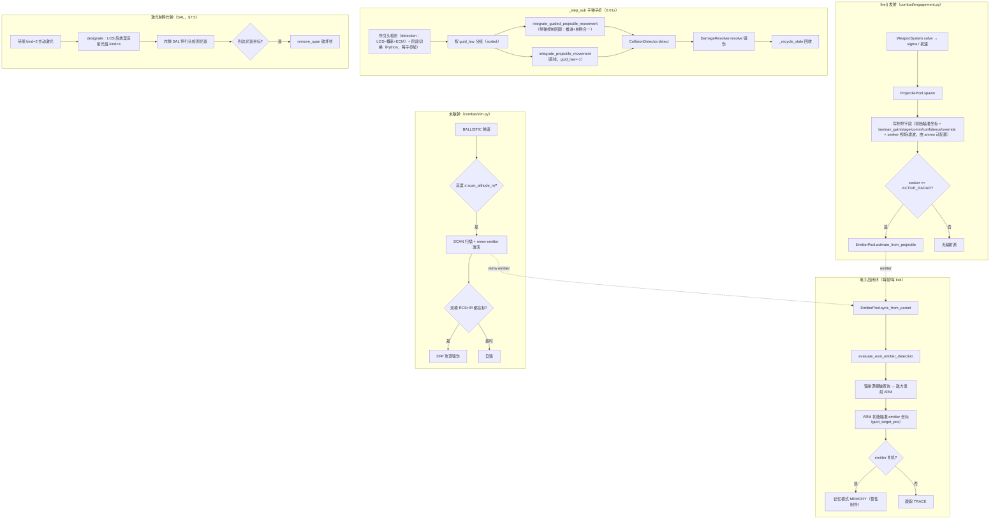
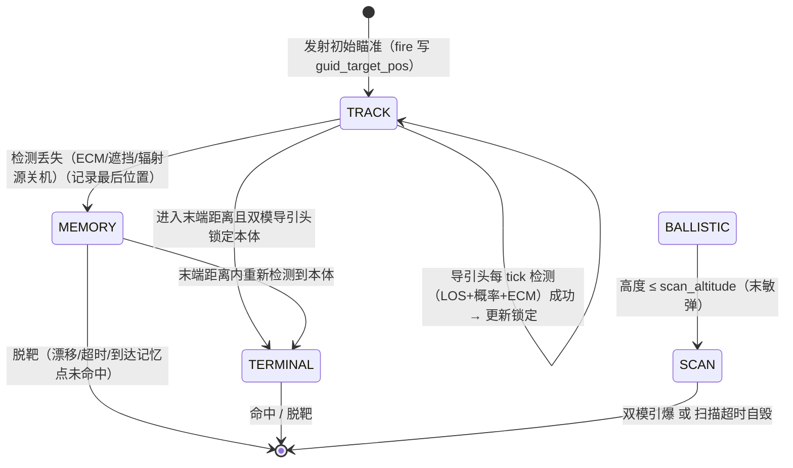

# Phase 6b 制导管线与算法设计（实施级）

> 定位：本文档是 `docs/phase6-guidance-design.md`（设计定稿）的**实施级细化**——
> 把定稿方案落成可直接编码的**管线（数据流 + 编排顺序）**与**算法（公式 + 内核签名 + 接缝）**。
>
> 范围：**制导律 + 电子战闭环 + 末敏弹**（Phase 6b）。
> 不含 Phase 6 其余部分（单位/编队 AI、反坦克地雷、炮兵/巡飞弹/CAS、RWR 告警、超视距空战）。
>
> 读前必读：`phase6-guidance-design.md`（方案选型与概念）——本文不重复论证「为什么用 Numba 回调」，
> 只负责「怎么落地」。

> ✅ **实施状态（2026-08-14）**：**步骤 1~9 全部完成**（制导 + 电子战闭环 + 末敏弹 + 激光制导炸弹），
> 全量 **363 测试全绿**（346 基线 + 17 新增 `tests/test_sfm_sal.py`，含既有 33 用例
> `tests/test_guidance_pipeline.py`）。步骤 10（性能基准 `benchmark_guidance` /
> `benchmark_sfm_scan`）已完成且达标：制导 0.04ms / 完整开火链一帧 2.79ms（2048 装甲
> + 64 导弹含 SCAN）/ SFM 扫描 0.065ms。
> 实施差异已回写本文（§三.5 回调签名、§七.1 末敏弹 guid_law、§八 陷阱 19~22、
> §八 陷阱 23~24：EmitterPool._free_set 性能修复 / SAL 光斑置于表面上方）。

---

## 一、端到端管线总览



**数据流要点**（与现有 Phase 3 开火链的关系）：

| 现有 Phase 3 开火链 | Phase 6b 插入点 |
|------|------|
| `fire()` spawn 后写 `weapon/ammo/age` | 同处追加写制导字段（§二.1） |
| `_step_sub` 调 `integrate_projectile_movement`（直线） | 前置「阶段切换 + 按 `guid_law` 分组」，制导弹走新内核（§四） |
| `CollisionDetector.detect` / `DamageResolver.resolve` | **零改动**——命中判定与毁伤仍走既有路径 |
| `_destroy_projectile` / `_destroy_armor` | 追加「级联关闭关联 emitter」挂点（§六.1） |
| `_recycle_stale` | 零改动——脱靶/超龄回收自然兜底失的弹 |

---

## 二、数据模型与接缝（现状 → 目标）

### 2.1 `ProjectilePool` 新增数组（`entities/pools.py`）

在现有 `pos/vel/radius/dmg/kind/active/owner/weapon/ammo/age` 之后追加：

```python
# ---- 制导字段（docs/phase6-guidance-design.md §六 / §12.3.2）----
self.guid_target_pos  = np.zeros((self.capacity, 3), dtype=np.float32) # 当前检测到的目标世界坐标（detection 输出；TRACK/TERMINAL 有效）
self.guid_law         = np.full(self.capacity, -1, dtype=np.int32)   # 制导律注册表索引（-1=无制导）
self.guid_nav_gain    = np.full(self.capacity, 3.0, dtype=np.float32) # 制导增益 N（per-ammo）
self.guid_stage       = np.zeros(self.capacity, dtype=np.int32)      # GuidanceStage（默认 TRACK=0）
self.guid_memory_pos  = np.zeros((self.capacity, 3), dtype=np.float32) # 最后已知目标位置（MEMORY 用）
self.guid_comm       = np.ones(self.capacity, dtype=np.float32)      # 通信质量 0~1（人在回路命令可达性，同单位 communication）
self.guid_confidence = np.ones(self.capacity, dtype=np.float32)      # 友军对导弹位置的知晓置信度 0~1（认知孪生，与制导无关）
self.guid_override   = np.zeros(self.capacity, dtype=np.int32)       # 人在回路推进指令 0=自主 1=滑翔 2=二次点火（ManualOverride）
self.guid_search_fov_cos = np.ones(self.capacity, dtype=np.float32)  # seeker 搜索视场余弦（fire 由 ammo 写，§6.5）
self.guid_track_fov_cos  = np.ones(self.capacity, dtype=np.float32)  # 跟踪视场余弦（fire 由 ammo 写；per-ammo）
self.guid_filter_quality = np.zeros(self.capacity, dtype=np.float32) # 滤波能力 0~1（Python 检测层用，§6.5）
```

> **`age` 无需新增**：`ProjectilePool.age` 已存在（`_recycle_stale` 每子步累加），
> 制导积分内核**直接把 `age` 作为参数传入**即可（§四）。推进剖面（开机/滑翔/二次点火）
> 靠 `age` 查时序。
>
> **通信 / 置信度（2026-08-14 决策，对齐单位模型）**：导弹不建「专门的数据链系统」，
> 而是像单位一样携带两个标量——`guid_comm`（通信质量）与 `guid_confidence`（置信度），
> 概念对齐 `docs/数据链与战争迷雾设计.md` 的 `communication` / `twin_confidence`：
> - `guid_comm`：弹丸 ↔ 发射平台/操作员之间的通信质量 0~1，**决定人在回路指令能否
>   到达**（二次点火/滑翔/改目标/自毁都过这道门，§3.5）。随距离/干扰/中继丢失衰减。
> - `guid_confidence`：**友军（观察者/指挥官）对导弹位置与状态的知晓置信度** 0~1——
>   与单位 `twin_confidence` 同义，决定「友军能否知道这枚导弹在哪/什么状态」；
>   **与导弹自身制导无关**（制导靠 detection 层，见下）。本阶段恒 1（上帝视角），
>   Phase 8 战争迷雾接入后由孪生层维护。
> - `guid_override`：人在回路推进指令位（非数据链协议，仅 0/1/2 三个推进位），
>   由 Python 层在通信门控通过后写入，控制回调消费。
>
> **制导目标 = detection 输出的坐标（2026-08-14 修订，对 design §12 的修正）**：
> 导弹**不存目标索引**——`guid_target_pos` 是导引头每 tick 检测（detection 层：
> LOS + 检测概率 × ECM 干扰）得到的**目标世界坐标**（TRACK/TERMINAL 阶段有效；
> MEMORY 用 `guid_memory_pos`）。fire() 只写火控解算的**初始瞄准坐标**，随后由
> `_update_guidance_stages`（§五）每 tick 用检测结果覆盖。目标可以是**实体**
> （装甲/辐射源）也可以是**地形点**（桥面等，激光制导炸弹 §7.5）——统一为坐标，
> 制导内核只读坐标、不查池，因此天然可被 ECM 干扰 / 诱饵 / 遮挡打断。

> **新增 `guid_nav_gain` 的理由（对设计文档 §六 的补充）**：`nav_gain` 是 `AmmoConfig`
> 字段，**逐弹药可变**——同一条制导律（如 `proportional_nav`）被两种导弹引用时 gain
> 可能不同。若按 `guid_law` 分组传标量 gain，会强制同律同 gain。故 gain 下沉 SoA，
> `fire()` 从 ammo 写入，内核逐弹丸读取。**max_accel / fov 属导弹平台参数，同律同值，
> 按 `guid_law` 分组传标量**（§四.2）。

**四处同步**：

| 位置 | 动作 |
|------|------|
| `spawn()` | 初始化 `guid_target_pos=0 / guid_law=-1 / guid_nav_gain=3.0 / guid_stage=0 / guid_memory_pos=0 / guid_comm=1.0 / guid_confidence=1.0 / guid_override=0 / guid_search_fov_cos=1.0 / guid_track_fov_cos=1.0 / guid_filter_quality=0.7` |
| `destroy()` / `destroy_batch()` | 与 `weapon/ammo/age` 同批清零 |
| `_expand()` | `_resize` 同步扩容（dtype 维度不变，Numba 免重编译） |
| `simulation/serialization.py` | `_restore_projectiles` 的 name tuple 追加 11 个数组名；`serialize_battlefield` 同步打包（§2.5） |

### 2.2 `EmitterPool` 全新（`entities/pools.py`）——统一电磁辐射源

容量建议 `MAX_EMITTERS = 4096`（2048 装甲红外辐射源 + 平台雷达/导引头/照射器 + 余量）。

```python
class EmitterBand(IntEnum):
    RF = 0      # 射频（雷达 / 主动导引头 / ESM）
    IR = 1      # 红外（目标热辐射 / 红外诱饵）
    LASER = 2   # 激光（激光照射器）

class EmitterPool:
    """电磁辐射源池：射频 / 红外 / 激光统一管理（物理上都是电磁波，仅波段不同）。"""
    def __init__(self, capacity: int = 4096) -> None:
        self.capacity = int(capacity)
        self.pos        = np.zeros((self.capacity, 3), dtype=np.float32)  # 世界位置（sync 自父实体）
        self.power_db   = np.zeros(self.capacity, dtype=np.float32)       # 额定发射强度（RF=dBm / IR=额定热强度 / LASER=功率）
        self.cur_power  = np.zeros(self.capacity, dtype=np.float32)       # 当前热辐射强度（红外：充能/残热；主动=power_db）
        self.decay_per_s = np.zeros(self.capacity, dtype=np.float32)      # 残热衰减速率（红外用，父死亡后指数衰减）
        self.band       = np.zeros(self.capacity, dtype=np.int32)         # EmitterBand：0=射频 1=红外 2=激光
        self.kind       = np.zeros(self.capacity, dtype=np.int32)         # 0=平台雷达 1=主动导引头 2=激光照射器 3=红外辐射源 4=激光漫反射光斑
        self.active     = np.zeros(self.capacity, dtype=np.bool_)         # 是否在辐射（主动=开机；红外=cur_power≥检测阈值）
        self.parent_kind = np.zeros(self.capacity, dtype=np.int32)        # 父实体类型 0=装甲 1=弹丸 2=无父（光斑，不走 sync）
        self.parent_idx  = np.full(self.capacity, -1, dtype=np.int32)     # 父实体索引
        self.normal      = np.zeros((self.capacity, 3), dtype=np.float32) # 光斑法线（kind=4，目标表面法线，半球检测用）
        self._free_stack: list[int] = list(range(self.capacity))

    def activate(self, parent_kind, parent_idx, power_db, band, kind) -> int: ...
    def activate_from_projectile(self, proj_idx, power_db, band) -> int: ...  # kind=1（主动导引头 / 末敏弹毫米波扫描器）
    def activate_ir(self, armor_idx, ir_strength, decay_per_s=0.2) -> int: ...  # 绑定红外源（仅热辐射显著的单位）
    def pulse(self, idx, peak_power) -> None: ...   # 殉爆充能：一次性给红外源充大量能量（cur_power 瞬时拉高）
    def designate(self, illum_idx, target_pos) -> int: ...  # 吊舱 LOS 射线检测后，在 target_pos 放置漫反射光斑（kind=4）
    def deactivate(self, idx) -> None: ...     # 战术关机：保留索引，可 reactivate
    def reactivate(self, idx) -> None: ...
    def sync_from_parent(self, armor, projectiles, dt) -> None: ...  # 位置同步 + 红外充能/残热
    def active_indices(self) -> np.ndarray: ...
```

**生命周期三态**（design §12.2，落地到方法）：

| 操作 | 语义 | 索引回收 |
|------|------|:---:|
| `activate(...)` | 从 `_free_stack` 弹索引，绑定父实体 | — |
| `deactivate(idx)` | 战术关机（保留索引，可 `reactivate` 重新开机） | ❌ |
| **级联失效** | `sync_from_parent` 发现父实体 inactive → 主动辐射立即失活；红外停止充能、残热衰减后失活 | ✅（Python 层收集归还 `_free_stack`） |

> **红外辐射源（2026-08-14 决策）**：红外本质是电磁波，故**不再作为装甲标量**——
> **仅热辐射显著的单位**（主战坦克/开火中的炮管等）在 `spawn`/场景配置时绑定红外
> emitter（`activate_ir(armor_idx, ir_strength, decay_per_s)` → `band=IR, kind=3`）；
> 小功率单位（步兵/卡车怠速等）热信号弱，**不绑定** → 红外导引头/末敏弹天然检测不到。
> **充能-残热模型**：父实体存活 → 每 tick 充能（`cur_power = power_db` 维持额定热强度，
> 开火可调高额定值）；父实体死亡 → 停止充能，`cur_power` 按 `decay_per_s` 指数衰减，
> 低于检测阈值 → 失活（残热）。**殉爆**（弹药架 cookoff/爆炸）→ `pulse(idx, peak_power)`
> 一次性充大量能量（`cur_power` 瞬时拉高后按 `decay_per_s` 衰减）；接入点 = Phase 3 既有
> cookoff 判定，不新增事件链。
> 红外诱饵/热焰弹 = 独立的假红外 emitter（后续，与「反辐射」对称）。

### 2.3 `ArmorPool` 新增 RCS / ECM 特征（`entities/pools.py`）

末敏弹双模扫描（design §13.5）需要「毫米波反射（RCS）+ 红外辐射」双特征——RCS 是
反射特性补在 `ArmorPool`，红外已迁移到 `EmitterPool`（§2.2）。本设计补齐：

```python
self.rcs = np.zeros(self.capacity, dtype=np.float32)   # 雷达截面积（反射特性，末敏弹毫米波阈值用）
self.ecm = np.zeros(self.capacity, dtype=np.float32)   # ECM 干扰强度 0~1（压制敌方导引头检测，§6.5）
# 注：红外特征已迁移到 EmitterPool（红外本质是电磁波辐射，不再是装甲标量，§2.2）
```

- `spawn()` 默认 `rcs=50.0 / ecm=0.0`（可加参数）；`_expand()` 同步扩容。
- 赋值方：战役场景配置（Phase 6 场景加载）或 `FiringControl.set_unit_config` 扩展。
- **红外特征迁移到 EmitterPool（2026-08-14）**：红外本质是电磁波，故不再作装甲标量——
  **仅热辐射显著的单位**绑定「红外 emitter」（`band=IR, kind=3`，`power_db`=额定热强度，
  充能/残热见 §2.2）；小功率单位不绑定 → 红外导引头/末敏弹天然检测不到。
- 本阶段末敏弹双模阈值：`armor_rcs[j] >= mmw_threshold`（毫米波反射）且
  「红外 emitter 的 `cur_power >= ir_threshold`」（红外辐射，含残热），双达标才引爆（抗诱饵）；
  阈值存 `AmmoConfig`（§2.4/§7.2）。`ecm > 0` 按 `(1 - ecm)` 压低射频导引头检测概率（§6.5）。

### 2.4 `AmmoConfig` / 枚举新增（`combat/weapons.py` + `combat/guidance.py`）

**`combat/weapons.py`** 新增枚举：

```python
class SeekerType(IntEnum):
    NONE = 0
    ACTIVE_RADAR = 1
    SEMI_ACTIVE_LASER = 2
    IR_IMAGING = 3
    PASSIVE_RF = 4
    TV_EO = 5
    SENSOR_FUZED = 6        # 毫米波+红外扫描（末敏弹，design §13.3）

class AmmoType(IntEnum):     # 追加，不重排既有值（旧存档兼容）
    SENSOR_FUZED = 35        # 末敏弹（攻顶）
```

**`combat/guidance.py`** 新增枚举：

```python
class GuidanceStage(IntEnum):
    TRACK = 0       # 跟踪（装甲或辐射源）
    MEMORY = 1      # 记忆模式：辐射源关机 → 惯性制导飞向最后已知位置
    TERMINAL = 2    # 末端引导：双模导引头锁定目标本体
    BALLISTIC = 3   # 弹道飞行（末敏弹/普通曲射，走直线积分）
    SCAN = 4        # 开伞扫描（末敏弹特有，悬停 + 双模扫描）


class ManualOverride(IntEnum):
    """人在回路推进指令（经 guid_comm 门控后写入 SoA；非数据链协议，仅三个推进位）。
    改目标/自毁不占位——由 Python 层直接改 guid_target_pos / destroy。"""
    AUTO = 0          # 自主飞行（回调按 age + 距离查时序）
    HOLD = 1          # 停止推进（滑翔）
    REIGNITE = 2      # 二次点火（操作员下令，无视时序/距离门限）
```

**`AmmoConfig`** 追加字段（`model_config = {"extra": "forbid"}` 下需一次性加齐）：

```python
# ---- 导弹控制律（design §五 / §12.1；推进剖面 × 制导律合一，§三）----
control_law_id: str = ""                           # 导弹控制律注册表 id（guidance != NONE 时必填）
nav_gain: float = 3.0                              # 制导增益 N（传给公共制导律求解器）
seeker: SeekerType = SeekerType.NONE
emitter_power_db: float = 60.0                     # ACTIVE_RADAR 辐射功率
# ---- 导引头性能（2026-08-14；全 YAML 可配置，体现导弹优劣，§6.5）----
# —— emitter 方向性（发射侧）：f↑/D↑ → 主瓣窄 → 能量集中、旁瓣低 ——
seeker_freq_ghz: float = 10.0                      # 发射频率（f↑ → 主瓣窄、能量集中、旁瓣低）
antenna_diameter_m: float = 0.3                    # 天线口径（θ≈70°·λ/D，与 f 共同决定主瓣宽度）
# —— seeker 视场（接收侧）：视场是接收方属性，直接配置，不走 GHz ——
search_fov_deg: float = 30.0                       # seeker 搜索视场（宽，未锁定）
track_fov_deg: float = 5.0                         # seeker 跟踪视场（窄，锁定后抗跳变）
filter_quality: float = 0.7                        # 滤波能力 0~1（坐标估计精度 + 抗干扰强度）
# ---- ARM 记忆模式与末端引导（design §12.1）----
memory_mode: bool = True
terminal_seeker: SeekerType = SeekerType.NONE
terminal_range_m: float = 0.0                      # 0=禁用
ins_drift_m_s: float = 0.0                         # 惯性漂移（本阶段 0，Phase 7 启用）
# ---- 激光吊舱（SAL，§7.5）----
beam_divergence_deg: float = 1.0                   # 吊舱激光束发散角（决定光斑大小，本阶段仅描述）
# ---- 通信（2026-08-14；对齐单位模型，人在回路门控，非专门数据链系统）----
comm_threshold: float = 0.5                        # 人在回路命令可达的通信门限（guid_comm ≥ 此值才生效）
# 注：guid_confidence 属友军孪生层（Phase 8），不存 AmmoConfig；制导「丢失」由 detection 决定（§5.2/§6.5）
# ---- 末敏弹（design §13.3）----
efp_pen_mm: float = 0.0
scan_altitude_m: float = 150.0
scan_radius_m: float = 80.0
scan_rps: float = 6.0                              # 预留（本阶段扫描全向，不消费）
scan_duration_s: float = 5.0
top_armor_factor: float = 0.3
mmw_emitter_power_db: float = 40.0
```

> **Emitter vs Seeker（2026-08-14 澄清）**：**Emitter（辐射源）没有视场**——视场是
> **Seeker（接收方）**的属性。频率/口径只描述 emitter 的**发射方向性**：
> 主瓣 `θ ≈ 70°·(c / (seeker_freq_ghz×1e9)) / antenna_diameter_m`——f↑/D↑ → 主瓣越窄 →
> **能量越集中**（目标处信噪比高）+ **旁瓣越低**（侧向 ESM/告警更难截获、干扰更难从旁瓣注入）。
> Seeker 的 `search_fov_deg/track_fov_deg` 是**接收视场**，直接配置，所有 seeker 类型通用。
>
> 兼容性：全给默认值 → 旧 YAML / 旧测试的 `AmmoConfig` 构造**无需改动**即通过校验。

### 2.5 序列化接缝（`simulation/serialization.py`）

- `serialize_battlefield`：`projectiles` 段追加打包 11 个新数组；
  新增 `emitters` 段（`EmitterPool` 全字段，含 `band/kind/cur_power/normal`）；`armor` 段顺带补 `rcs/ecm`。
- `_restore_projectiles`：name tuple 追加 `("guid_target_pos", "guid_law",
  "guid_nav_gain", "guid_stage", "guid_memory_pos", "guid_comm", "guid_confidence",
  "guid_override", "guid_search_fov_cos", "guid_track_fov_cos", "guid_filter_quality")`。
- 新增 `_restore_emitters(data) -> EmitterPool`（与 `_restore_boxes` 同模式）。
- **控制律索引的读档确定性**：`guid_law` 存的是注册表索引，读档后必须保证注册表
  构建顺序一致（`MissileControlRegistry.with_builtin()` 固定注册顺序），否则索引错位。
  存档只存数据数组，**不存函数对象**（design §八）。

---

## 三、导弹控制回调：推进剖面 × 制导律（`combat/guidance.py`）

> 核心决策（2026-08-13，用户拍板）：**把推力剖面与制导律合并为「导弹控制回调」**，
> 制导律（PN/PP）降级为**公共转向求解器**——被控制回调内部调用。
> 理由：推力函数需要 `age`（开机/滑翔/二次点火时序），且二次点火的触发依赖
> 导引头锁定（目标位置）与通信（人在回路），与制导律输入高度重叠。

### 3.1 制导律 = 公共转向求解器（design §三，签名不变）

```python
@njit
def guidance_fn(
    proj_pos: np.ndarray,    # (3,) float32
    proj_vel: np.ndarray,    # (3,) float32
    target_pos: np.ndarray,  # (3,) float32
    target_vel: np.ndarray,  # (3,) float32（地面目标恒 0）
    nav_gain: float,
    dt: float,
    out: np.ndarray,         # (3,) float32 输出理想转向加速度 (m/s²)，仅写此数组
) -> None: ...
```

**公共求解器定位**：制导律**只算转向加速度**，纯数学无副作用，**不注册、不进内核
回调参数**——由导弹控制回调（§3.5）直接 `import` 调用（Numba 编译期内联/直调）。
以下三者**不属于制导律**，由积分内核统一施加（§四.2）：

1. **执行器饱和**（`|a| ≤ max_accel`）——导弹总加速度上限（含推力 + 转向）；
2. **导引头视场角 FOV 门限**——目标超出 FOV 即停导直射；
3. **重力**——内核统一 `vel[2] -= g·dt`。

这样 PN/PP 成为可复用公共求解器，与 `damage.py` 的解析内核同风格。

### 3.2 比例导引（PN，默认 `proportional_nav`）

**数学**（design §3.1 完整化）：

```
r  = target - proj            视线向量
v_rel = target_vel - proj_vel 相对速度
Vc = -(r · v_rel) / |r|       接近速度（>0 逼近，≤0 停导）
λ̇ = (r × v_rel) / |r|²       视线角速率向量
a  = N · max(Vc, 0) · λ̇       N ∈ [3,5]
```

**数值稳定性增强**（对 design §3.1 伪代码的补充）：

- `r2 < ε`（ε=1e-6）→ 零加速度（防除零）；
- `Vc ≤ 0` → 零加速度（目标远离/平行，停导）；
- **加速度限幅留在内核**（§4.2 的 `max_accel` clamp），律内不 clamp——保持纯函数。

```python
@njit
def guidance_proportional_nav(proj_pos, proj_vel, target_pos, target_vel, nav_gain, dt, out):
    rx = target_pos[0] - proj_pos[0]; ry = target_pos[1] - proj_pos[1]; rz = target_pos[2] - proj_pos[2]
    r2 = rx * rx + ry * ry + rz * rz
    if r2 < 1e-6:
        out[0] = out[1] = out[2] = 0.0; return
    vrx = target_vel[0] - proj_vel[0]; vry = target_vel[1] - proj_vel[1]; vrz = target_vel[2] - proj_vel[2]
    vc = -(rx * vrx + ry * vry + rz * vrz) / np.sqrt(r2)
    if vc <= 0.0:
        out[0] = out[1] = out[2] = 0.0; return
    lx = (ry * vrz - rz * vry) / r2
    ly = (rz * vrx - rx * vrz) / r2
    lz = (rx * vry - ry * vrx) / r2
    n = nav_gain * vc
    out[0] = n * lx; out[1] = n * ly; out[2] = n * lz
```

### 3.3 纯追踪（PP，`pure_pursuit`）

**数学**：期望速度 = 当前速率 × 视线单位向量；加速度把速度方向转向目标（保持速率）。

```python
@njit
def guidance_pure_pursuit(proj_pos, proj_vel, target_pos, target_vel, nav_gain, dt, out):
    rx = target_pos[0] - proj_pos[0]; ry = target_pos[1] - proj_pos[1]; rz = target_pos[2] - proj_pos[2]
    r = np.sqrt(rx * rx + ry * ry + rz * rz)
    if r < 1e-6:
        out[0] = out[1] = out[2] = 0.0; return
    speed = np.sqrt(proj_vel[0]**2 + proj_vel[1]**2 + proj_vel[2]**2)
    out[0] = nav_gain * (speed * rx / r - proj_vel[0])
    out[1] = nav_gain * (speed * ry / r - proj_vel[1])
    out[2] = nav_gain * (speed * rz / r - proj_vel[2])
```

### 3.4 推进剖面与速度模型（明确决策）

- **轴向速度由推进剖面决定**：开机段（boost）沿速度方向施加轴向推力 → 加速；
  滑翔段（coast）无推力 → 仅重力减速；二次点火（dual-pulse）在末端再施一次推力。
  **推进时序由 `age` 查表**（§3.5 控制回调内实现）。
- **制导律只改速度方向**（PN 的 `a⊥视线`、PP 的 `a ∝ (期望方向 − v)` 天然不增速率），
  与轴向推力正交叠加 → **总加速度 = 转向 + 轴向**（§3.5 在控制回调里相加）。
- 重力由内核统一施加，制导律自动补偿（PN 把弹道拉回目标方向）。
- `guid_law=-1`（无控制律）分支就是原直线积分，零行为差异。

### 3.5 导弹控制回调（推进 × 制导合一）

**统一签名**（制导律 7 参数 + `age` + `stage` + `override`，out 输出**总加速度**）：

> 🔧 **实施修正（2026-08-14 用户澄清）**：`guid_stage` / `guid_override` 是**传给该函数的
> 状态机输入**——控制回调签名实际为 **10 参数（含 `stage: int`）**，实现见
> `combat/guidance.py::control_*`。回调内部按状态机分派：
> - `stage ∈ {BALLISTIC, SCAN}` → **不制导**（输出 0；BALLISTIC 由内核走直线快速路径）
> - `stage ∈ {TRACK, MEMORY, TERMINAL}` → 制导律转向 + 按 `override` 叠加轴向推力
> Numba 中 IntEnum 不可直接比较 → 回调内用**模块级 int 常量**（`_STAGE_*` / `_OVERRIDE_*`）。

```python
@njit
def control_fn(
    proj_pos: np.ndarray,    # (3,) float32
    proj_vel: np.ndarray,    # (3,) float32
    target_pos: np.ndarray,  # (3,) float32
    target_vel: np.ndarray,  # (3,) float32（地面目标恒 0）
    age: float,              # 飞行时间（推进剖面查时序：开机/滑翔/二次点火）
    stage: int,              # 阶段状态机（GuidanceStage：BALLISTIC → 本函数不制导）
    override: int,           # 人在回路推进指令（ManualOverride，已通过通信门控）
    nav_gain: float,         # 制导增益（透传给公共制导律求解器）
    dt: float,
    out: np.ndarray,         # (3,) float32 输出总加速度 = 转向 + 轴向推力
) -> None: ...
```

**实现模式**：控制回调内部**调用公共制导律求解器**求转向，再按 `age` / `override`
叠加轴向推力。`override` 是**已通过通信门控的人机指令位**（下表）——回调不感知通信
质量，只消费「操作员已下令且确实送达」的结果；门控判定在 Python 层完成。
推进参数（开机时长/加速度/二次点火门限）**写死在函数内**（内置标准剖面），
用户自定义时直接写函数——与「写制导律」同一套流程。per-ammo 参数化剖面（SoA 参数数组）
留作后续增强。

**内置示例 1：单次开机 + 滑翔 + PN（中远程典型）**

```python
BOOST_DUR = 5.0      # 首次开机时长 (s)
BOOST_ACCEL = 294.0  # 轴向推力 (m/s²，≈30g)

@njit
def control_boost_coast_pn(pos, vel, tpos, tvel, age, override, nav_gain, dt, out):
    guidance_proportional_nav(pos, vel, tpos, tvel, nav_gain, dt, out)  # 转向（公共求解器）
    if age < BOOST_DUR and override != ManualOverride.HOLD:             # 开机窗口 + 操作员未下令滑翔
        sp = np.sqrt(vel[0]**2 + vel[1]**2 + vel[2]**2)
        if sp > 1e-6:
            out[0] += BOOST_ACCEL * vel[0] / sp
            out[1] += BOOST_ACCEL * vel[1] / sp
            out[2] += BOOST_ACCEL * vel[2] / sp
```

**内置示例 2：双脉冲（二次点火）+ PN**

```python
BOOST1_DUR = 3.0; BOOST1_ACCEL = 294.0
BOOST2_RANGE = 800.0; BOOST2_ACCEL = 147.0   # 末端二次点火：距目标 < 800m 或操作员下令

@njit
def control_dual_pulse_pn(pos, vel, tpos, tvel, age, override, nav_gain, dt, out):
    guidance_proportional_nav(pos, vel, tpos, tvel, nav_gain, dt, out)
    sp = np.sqrt(vel[0]**2 + vel[1]**2 + vel[2]**2)
    if sp < 1e-6:
        return
    ux = vel[0] / sp; uy = vel[1] / sp; uz = vel[2] / sp
    rx = tpos[0] - pos[0]; ry = tpos[1] - pos[1]; rz = tpos[2] - pos[2]
    dist = np.sqrt(rx*rx + ry*ry + rz*rz)
    if age < BOOST1_DUR:
        thrust = BOOST1_ACCEL
    elif override == ManualOverride.REIGNITE or dist < BOOST2_RANGE:
        thrust = BOOST2_ACCEL                     # 二次点火（操作员下令或末端距离触发）
    else:
        thrust = 0.0                              # 滑翔
    out[0] += thrust * ux; out[1] += thrust * uy; out[2] += thrust * uz
```

**人在回路语义（通信门控，2026-08-14）**：导弹不设专门数据链系统——操作员指令是否生效
只看 `guid_comm`。指令由 Python 层执行（叙事层/操作员指令 → `CommandQueue` → 任意 tick），
执行前先判定 `guid_comm[p] >= ammo.comm_threshold`，门控失败则丢弃、导弹继续自主飞行：

| 指令 | 门控通过后的动作 | 消费方 |
|------|------|------|
| 二次点火 REIGNITE | 写 `guid_override[p] = ManualOverride.REIGNITE` | 控制回调 |
| 滑翔 HOLD | 写 `guid_override[p] = ManualOverride.HOLD` | 控制回调 |
| 改目标 RETARGET | 改 `guid_target_pos[p]`（回调只读，下一子步用新目标坐标） | Python 层 |
| 自毁 SELF_DESTRUCT | `destroy(p)`（回调不消费） | Python 层 |

`guid_comm` 衰减来源：数据链作用距离外 / 电子干扰 / 中继被毁（Phase 8 干扰体系接入）。

> 🔧 **实施（2026-08-14）**：`FiringControl._set_manual_override(proj_idx, override)` 执行
> 门控判定——`guid_comm[p] >= ammo.comm_threshold` 通过才写 `guid_override[p]`；门控失败
> 丢弃（导弹继续自主飞行）。改目标/自毁由叙事层直接改 `guid_target_pos` / `destroy`，
> 不占 override 位。内置注册表固定顺序：
> `boost_coast_pn`(0) / `dual_pulse_pn`(1) / `boost_coast_pp`(2) / `sfm_ballistic`(3)
> （读档确定性依赖，勿重排）。

### 3.6 注册表（design §五 改名扩展）

```python
class MissileControlRegistry:
    """导弹控制律注册表：law_id → @njit 控制回调（推进 + 制导合一）。"""
    def __init__(self) -> None:
        self._laws: dict[str, Any] = {}      # 插入序即索引序
    def register(self, law_id: str, fn) -> None: ...
    def get(self, law_id: str): ...
    def index_of(self, law_id: str) -> int:  # -1 未注册
    def law_at(self, index: int):            # 越界 None
    @classmethod
    def with_builtin(cls) -> "MissileControlRegistry":
        reg = cls()
        reg.register("boost_coast_pn", control_boost_coast_pn)
        reg.register("dual_pulse_pn", control_dual_pulse_pn)
        reg.register("boost_coast_pp", control_boost_coast_pp)
        return reg
```

> 制导律求解器（`guidance_proportional_nav` / `guidance_pure_pursuit`）**不注册**——
> 它们是公共求解器，被控制回调直接调用。注册表只注册「可被 YAML 引用的控制律」。

---

## 四、分组积分管线（`movement/integrate.py` + `combat/engagement.py`）

### 4.1 分组算法（`FiringControl._step_sub` 内，design §7.2）

```python
active = self.projectiles.active
law_ids = sorted({int(x) for x in np.unique(self.projectiles.guid_law[active]) if x >= 0})
for lid in law_ids:
    fn = self.control.law_at(lid)
    if fn is None:
        continue
    integrate_guided_projectile_movement(
        self.projectiles.pos, self.projectiles.vel, self.projectiles.active,
        self.projectiles.age,
        self.projectiles.guid_target_pos, self.projectiles.guid_memory_pos,
        self.projectiles.guid_stage,
        self.projectiles.guid_nav_gain, self.projectiles.guid_override,
        self.projectiles.guid_search_fov_cos, self.projectiles.guid_track_fov_cos,
        self._max_accel_of(lid),
        sub_dt, self.gravity, fn,
    )
# 无制导弹（guid_law == -1，含子弹与 BALLISTIC 阶段末敏弹）仍走直线积分
integrate_projectile_movement(
    self.projectiles.pos, self.projectiles.vel, self.projectiles.active,
    sub_dt, self.gravity,
)
```

- **`sorted()` 保证可复现**（design §九.4）。
- **`age`**：直接传 `self.projectiles.age`（已有数组，`_recycle_stale` 每子步累加），
  控制回调靠它查推进时序（开机/滑翔/二次点火）。
- **目标速度恒 0**：本阶段地面目标静止，内核内用模块级 `zero3` 缓存
  （`np.zeros(3, np.float32)`）作 `target_vel`；Phase 7 空战接入真实 `target_vel`。
- **`_max_accel_of(lid)`**：由 `guid_law`（控制律）反查平台参数（`max_accel=40g` 覆盖
  推力+转向）。**seeker 视场/滤波是 per-ammo**（fire 时由 ammo 写入 SoA，§2.1/§6.5）——
  不同导弹型号性能不同（频率/口径/滤波全 YAML 可配），不下沉 law 分组。

> ⚠️ 分组内 `nav_gain` 不再按 law 取标量——由 `guid_nav_gain` SoA 逐弹丸提供（§2.1）。

### 4.2 内核签名（精确）

```python
@njit(cache=True, parallel=True)
def integrate_guided_projectile_movement(
    pos, vel, active,                       # (M,3)/(M,3)/(M,)
    age,                                    # (M,) float32 飞行时间（推进剖面时序）
    guid_target_pos, guid_memory_pos,       # (M,3)/(M,3) 目标坐标（检测输出 / 记忆点）
    guid_stage,                             # (M,) int32
    guid_nav_gain, guid_override,           # (M,) float32 / (M,) int32 人在回路推进指令
    guid_search_fov_cos, guid_track_fov_cos,  # (M,) float32 seeker 搜索/跟踪视场余弦（per-ammo）
    max_accel,                              # float 总加速度饱和（按 law 分组）
    dt, gravity,                            # float
    control_fn,                             # @njit 导弹控制回调（推进+制导合一，Numba 多版本缓存）
) -> None:
```

**循环体伪代码**（逐弹丸）：

```
for i in prange(M):
    if not active[i]: continue
    stage = guid_stage[i]

    # BALLISTIC：直射退化（同 guid_law=-1，末敏弹弹道段）
    if stage == BALLISTIC:
        pos[i] += vel[i] * dt; vel[i,2] -= gravity * dt; continue

    # SCAN：悬停扫描（末敏弹），z 不变，不追踪
    if stage == SCAN:
        # 本阶段悬停（可选：z 缓降 scan_descent；暂定 z 不变），继续
        continue

    # 目标坐标（detection 输出；本阶段目标速度恒 0，Phase 7 空战接入真实 tvel）
    if stage == MEMORY:                                # 惯性制导飞向记忆点
        tpos = guid_memory_pos[i]
    else:                                              # TRACK / TERMINAL
        tpos = guid_target_pos[i]                      # 导引头检测到的目标坐标
    tvel = zero3

    # FOV 门限：目标超出 seeker 接收视场 → 停导直射（seeker 视场 per-ammo；跟踪窄视场抗跳变）
    fov_cos = guid_track_fov_cos[i] if stage in (TRACK, TERMINAL) else guid_search_fov_cos[i]
    if fov_cos < 1.0:                                   # fov_cos=1 表示全向（禁用门限）
        dx = tpos[0]-pos[i,0]; dy = tpos[1]-pos[i,1]; dz = tpos[2]-pos[i,2]
        dr = sqrt(dx*dx+dy*dy+dz*dz)
        if dr > 1e-6 and (dx*vel[i,0]+dy*vel[i,1]+dz*vel[i,2]) / (dr * |vel[i]|) < fov_cos:
            straight(i); continue

    accel = np.empty(3, np.float32)
    control_fn(pos[i], vel[i], tpos, tvel, age[i], guid_override[i], guid_nav_gain[i], dt, accel)

    # 执行器饱和（总加速度上限：转向 + 轴向推力）
    a2 = accel[0]*accel[0] + accel[1]*accel[1] + accel[2]*accel[2]
    if a2 > max_accel * max_accel:
        s = max_accel / sqrt(a2)
        accel[0]*=s; accel[1]*=s; accel[2]*=s

    # 半隐式积分：a → v → x + 重力（与直线积分同阶）
    vel[i,0] += accel[0]*dt; vel[i,1] += accel[1]*dt; vel[i,2] += accel[2]*dt
    vel[i,2] -= gravity * dt
    pos[i,0] += vel[i,0]*dt; pos[i,1] += vel[i,1]*dt; pos[i,2] += vel[i,2]*dt
```

> `straight(i)` 是内核内的直线积分小段（等价 `guid_law=-1` 分支）：停导直射，
> 碰撞检测自然判脱靶（design §7.3，不新增自毁逻辑）。
> `np.empty(3)` 在 Numba `prange` 内是 cheap 的线程局部分配（design §四 注），
> 导弹数量远小于子弹，采用**逐弹丸标量版**起步，实测超标再改批量 out 版。

### 4.3 目标坐标来源表（`stage`）

| stage | 目标来源 | target_vel |
|-------|----------|-----------|
| TRACK(0) | `guid_target_pos[i]`（导引头检测到的目标坐标） | zero |
| MEMORY(1) | `guid_memory_pos[i]`（最后已知坐标） | zero |
| TERMINAL(2) | `guid_target_pos[i]`（末端导引头重新锁定的本体坐标） | zero |
| BALLISTIC(3) | 直线 + 重力（同 `guid_law=-1`） | — |
| SCAN(4) | 悬停（不追踪） | — |

### 4.4 编排顺序（`_step_sub` 完整序）

```
0. boxes.sync_all_from_parent(armor)            # 既有
1. emitters.sync_from_parent(...)               # 新增（2026-08-14 实施）：辐射源位置同步
                                                #   + 级联失效 + 红外残热；导引头检测读最新坐标
2. self._update_guidance_stages()               # 新增：导引头检测 + 阶段切换（§五）
3. 分组制导积分（§4.1）+ 直线积分               # 替代原单一 integrate 调用
4. CollisionDetector.detect                     # 既有
5. 逐命中毁伤 + _destroy_projectile             # 既有
6. _recycle_stale                               # 既有
```

> 🔧 **实施（2026-08-14）**：实际顺序与原设计一致，仅把 emitter 同步显式插入子步开头
> （`_step_sub` 内 `emitters.sync_from_parent(armor, projectiles, sub_dt)`），
> 保证 `_seeker_detect` 读到最新辐射源坐标。

---

## 五、阶段状态机（`GuidanceStage`，design §12.3）

### 5.1 迁移表



### 5.2 Python 层切换循环（`FiringControl._update_guidance_stages`）

导弹数量少，逐弹丸 O(k) 扫描（design §12.3.3）：

```python
def _update_guidance_stages(self) -> None:
    # 1) 导引头检测（detection 层，§6.5）：LOS + 检测概率 × ECM 干扰 → 写 guid_target_pos / 返回丢失
    detected = self._seeker_detect()                # 检测成功时已更新 guid_target_pos 为新坐标
    for p in self.projectiles.active_indices():
        stage = int(self.projectiles.guid_stage[p])
        ammo = self._ammo_of(p)                     # 由 projectiles.ammo[p] 反查

        if stage in (GuidanceStage.TRACK, GuidanceStage.TERMINAL):
            if detected[p]:
                # 检测成功 → guid_target_pos 已是新坐标；末端距离内切换锁定本体
                if stage == GuidanceStage.TRACK and self._terminal_ready(p, ammo):
                    self._relock_body(p)            # 双模末端：guid_target_pos = 末端导引头锁定的本体坐标
            else:
                # 检测丢失（ECM/遮挡/辐射源关机）→ 记忆模式或直接失的
                if ammo.memory_mode:
                    self.projectiles.guid_memory_pos[p] = self.projectiles.guid_target_pos[p]
                    self.projectiles.guid_stage[p] = GuidanceStage.MEMORY
                else:
                    self._stop_guidance(p)          # guid_law=-1，走直线积分

        elif stage == GuidanceStage.MEMORY:
            if detected[p] and self._terminal_ready(p, ammo):
                self._relock_body(p)                # 记忆飞行中重新检测到本体 → 末端引导
            elif self._memory_expired(p):           # 已到达记忆点未命中（§5.3）
                self._stop_guidance(p)              # 自然脱靶

        # 末敏弹：BALLISTIC → SCAN
        if stage == GuidanceStage.BALLISTIC and self.projectiles.pos[p, 2] <= ammo.scan_altitude_m:
            self.projectiles.guid_stage[p] = GuidanceStage.SCAN
            self.emitters.activate_from_projectile(p, ammo.mmw_emitter_power_db, EmitterBand.RF)
            self.projectiles.age[p] = 0.0           # 扫描窗口计时复用 age（清零后 _recycle_stale 按 scan_duration_s 判超时）
```

> ⚠️ **扫描窗口计时**：design §13.2 用 `scan_duration_s` 超时自毁，但 `age` 是飞行总龄。
> 建议**新增 `guid_scan_age`（或复用 `guid_memory_pos` 之外的独立标量）**；为少加数组，
> 也可在 `SCAN` 切换时把 `age` 清零、让 `_recycle_stale` 的 `PROJECTILE_MAX_AGE` 之外
> 再按 `scan_duration_s` 判定。**实施取后者**（SCAN 切换清零 `age` + `_recycle_stale`
> 对 SCAN 弹丸用 `scan_duration_s` 判超时），零新数组。

### 5.3 记忆模式与末端引导（design §12.3.4 / §12.3.5）

- **MEMORY**：`tpos = guid_memory_pos[i]`（固定坐标），`target_vel=0`，直接复用 PN/PP
  追固定点 = 惯性外推飞向最后已知位置。`ins_drift_m_s` 本阶段 0，预留（Phase 7）。
  **脱靶判定与置信度无关**（confidence 属友军孪生层）：MEMORY 靠**漂移/超时耗尽**
  （`_memory_expired`：记忆飞行时长 > 门限，或到达记忆点未命中 → `_recycle_stale` 回收）。
- **TERMINAL**：触发 = 导弹到目标本体距离 < `terminal_range_m` 且 `terminal_seeker != NONE`；
  `_relock_body` 把 `guid_target_pos` 更新为末端导引头锁定的本体坐标。命中判定仍走既有
  `CollisionDetector`——末端引导只改**制导目标坐标**，不新增毁伤逻辑。
- **`guid_confidence` 与制导无关**：它是友军对导弹位置的知晓置信度（§2.1），由 Phase 8
  孪生层维护；制导的「丢失」只由 detection 层决定（§6.5）。

---

## 六、电子战闭环管线（design §12）

### 6.1 EmitterPool 生命周期挂点

| 挂点 | 动作 |
|------|------|
| 装甲 `spawn` / 场景配置 | `emitters.activate_ir(armor_idx, ir_strength, decay_per_s)`（仅热辐射显著单位） |
| `fire()`（`seeker == ACTIVE_RADAR`） | `emitters.activate_from_projectile(proj_idx, ammo.emitter_power_db, EmitterBand.RF)` |
| 末敏弹 `BALLISTIC→SCAN` | `emitters.activate_from_projectile(p, ammo.mmw_emitter_power_db, ...)` |
| 吊舱照射（SAL，§7.5） | `emitters.designate(illum_idx, target_pos)` 放漫反射光斑（kind=4） |
| 殉爆（Phase 3 cookoff） | `emitters.pulse(ir_idx, peak_power)` 一次性充大量能量 |
| `_destroy_projectile(proj_idx)` | 显式关闭父实体=弹丸的 emitter（即时性，双保险之一） |
| `_destroy_armor(armor_idx)` | 显式关闭父实体=装甲的主动 emitter（红外除外，走残热） |
| 每 tick 末 | `emitters.sync_from_parent(armor, projectiles, dt)` 级联兜底 + 红外残热衰减 + 收集失效索引归还 `_free_stack` |

### 6.2 `sync_from_parent` 内核（`entities/pools.py`）

与 `_sync_boxes_kernel` 同模式（design §12.2，落地）：

```python
@njit(cache=True, parallel=True)
def _sync_emitters_kernel(
    epos, eactive, eparent_kind, eparent_idx,   # (M,3)/(M,)/(M,)/(M,)
    eband, epower, ecur,                        # (M,) band / 额定强度 / 当前强度
    armor_pos, armor_active,                    # (N,3)/(N,)
    proj_pos, proj_active,                      # (P,3)/(P,)
) -> None:
    for i in prange(epos.shape[0]):
        if not eactive[i]: continue
        if eparent_kind[i] == 0:                # 父 = 装甲
            p = eparent_idx[i]
            if p < 0 or not armor_active[p]:
                if eband[i] != EmitterBand.IR: eactive[i] = False   # 非红外：立即失活
                continue                                          # 红外：交给 Python 层残热衰减
            epos[i,0]=armor_pos[p,0]; epos[i,1]=armor_pos[p,1]; epos[i,2]=armor_pos[p,2]
        elif eparent_kind[i] == 1:              # 父 = 弹丸
            p = eparent_idx[i]
            if p < 0 or not proj_active[p]:
                if eband[i] != EmitterBand.IR: eactive[i] = False
                continue
            epos[i,0]=proj_pos[p,0]; epos[i,1]=proj_pos[p,1]; epos[i,2]=proj_pos[p,2]
        else:                                   # 无父（光斑 kind=4）：位置固定，不参与 sync，由 SAL 系统管理存活
            continue
        if eband[i] == EmitterBand.IR:          # 红外：父存活 → 充能维持额定强度
            ecur[i] = epower[i]
```

Python 侧 `EmitterPool.sync_from_parent` 调内核后：
- 非红外 emitter 父已死 → 归还 `_free_stack`（主动辐射随载体毁灭）。
- 红外 emitter（`band=IR`）父已死 → **不立即归还**：`cur_power *= exp(-decay_per_s * dt)`
  残热衰减，低于检测阈值 → inactive + 归还；否则保留 active（残热，位置冻结在最后已知处）。
- 光斑（`kind=4`）：**无父、不走 sync**——由 SAL 系统（Python 层）每 tick 检查
  「吊舱 active 且 LOS（吊舱↔光斑）通」决定保留或 deactivate（§7.5）。

### 6.3 ESM 检测辐射源内核（`detection/sensors.py`，design §12.4）

现有 `evaluate_sensor_detection` 的 ESM 分支用默认功率且目标是装甲，**不动它**，
新增专用内核（避免破坏既有装甲检测链路）：

```python
@njit(cache=True, parallel=True)
def evaluate_esm_emitter_detection(
    sensor_x, sensor_y, sensor_z,        # (N,) ESM 传感器位置（= 装甲平台 pos）
    sensor_active,                       # (N,) bool_
    emitter_x, emitter_y, emitter_z,     # (M,) 辐射源位置
    emitter_power_db, emitter_active,    # (M,)
    max_range_cache,                     # (N, M) float32 输出：sensor 对 emitter 的最大检测距离
) -> None:
    for s in prange(sensor_x.shape[0]):
        if not sensor_active[s]: continue
        for t in range(emitter_x.shape[0]):
            if not emitter_active[t]:
                max_range_cache[s, t] = 0.0; continue
            dx = emitter_x[t]-sensor_x[s]; dy = emitter_y[t]-sensor_y[s]; dz = emitter_z[t]-sensor_z[s]
            dist = np.sqrt(dx*dx+dy*dy+dz*dz)
            max_r = esm_detection_range(emitter_power_db[t])
            max_range_cache[s, t] = max_r if dist <= max_r * 1.5 else 0.0
```

**查询接口（本阶段最小化，design §12.4「先产出事件/查询接口」）**：

```python
class EmitterContactProvider:   # 或并入 FiringControl
    def detected_emitters(self, sensor_idx: int, max_range_cache) -> np.ndarray:
        """返回 sensor_idx 可检测的 emitter 索引（距离 ≤ max_range）。"""
```

- 检测结果 → 辐射源接触 → 敌方单位据此发射 ARM（目标 = emitter 索引）。
- 接触数据进入 Phase 8 战争迷雾观测体系（`docs/数据链与战争迷雾设计.md`），本阶段
  只做实体层 + 检测层 + 查询接口。

### 6.4 ARM 反辐射数据流

```
敌方 ESM 检测到主动导引头 emitter
  → fire() 以 emitter 坐标为初始瞄准（guid_target_pos = emitter 位置）
  → 每 tick 导引头（PASSIVE_RF）对 emitter 做 ESM 检测（§6.3/§6.5）
  → 检测成功 → 更新 guid_target_pos = 检测到的 emitter 坐标
  → emitter 关机 → 检测失败 → _update_guidance_stages 切 MEMORY（guid_memory_pos = 最后坐标）
  → 惯性制导飞向记忆点 → 命中 / 脱靶
```

### 6.5 导引头检测（detection 驱动制导）+ 干扰（2026-08-14 修订）

> 修订依据：制导不依赖发射时写死的目标坐标，而依赖 **detection 层**的逐 tick 检测——
> 导引头（seeker）就是一枚小传感器，目标可被 ECM 干扰、红外诱饵欺骗、地形遮挡而
> 「从导引头视野里消失」，从而打断制导。「看见目标」分两类：
> - **主动发射-接收**（主动雷达导引头）：自己发雷达波（自身 = RF emitter，可被 ESM/ARM 反辐射），
>   检测目标反射的 RCS——与激光吊舱「主动照射 + 光斑」同构，只是照射源与接收器合体；
> - **被动接收**（红外/ESM/激光）：红外收目标热辐射、ESM 收辐射源射频、激光导引头收光斑。
> 二者统一于「制导内核只能看见 detection 层给出的坐标」。

**检测链（每 tick，Python 层，`_seeker_detect()`）**：

1. **目标选择（坐标制导的关键）**：不存目标索引 → 每 tick 在**当前锁定坐标附近**
   （搜索半径 `seek_radius_m`，如 200m）搜「合格目标」，**选距 `guid_target_pos` 最近者**——
   目标机动时坐标自然跟随，多目标时防跳变；搜不到 → 检测失败（丢失 → MEMORY/停导）。

   > 🔧 **实施（2026-08-14）**：`SEEK_RADIUS_M = 200.0` 常量（`combat/engagement.py`）；
   > 目标选择 = `_find_nearest_armor`（装甲池）/ `_find_emitter`（emitter 池，band+kind 过滤），
   > 均取「ref 附近 seek_radius² 内最近」；检测链 = `_seeker_probe`（LOS → 概率×ECM →
   > RNG 采样 → `_write_detected_pos` 滤波噪声 σ∝(1-filter_quality)）。
   **抗跳变双重机制（导弹特色）**：①「选最近」保持锁定连续性；②**锁定后切窄接收视场**
   （`track_fov_deg` 如 5° vs 搜索 `search_fov_deg` 30°）——窄视场把诱饵/邻近目标挡在
   跟踪门之外，假信号也进不来；目标反射特征（`ArmorPool.rcs`）决定信号强度。

2. **目标来源按 seeker 类型分派**（制导内核只读 `guid_target_pos`，不管来源）：

   | SeekerType | 检测对象 | 数据源 |
   |------|------|------|
   | ACTIVE_RADAR | 目标反射的射频（RCS）；导引头自身 = RF emitter（kind=1，§6.1） | `ArmorPool.rcs` + `line_of_sight` |
   | IR_IMAGING | 目标红外辐射 | `EmitterPool`（`band=IR`, `kind=3`） |
   | PASSIVE_RF | 目标/辐射源射频 | `EmitterPool`（`band=RF`），§6.3 |
   | SEMI_ACTIVE_LASER | 激光漫反射光斑（半球：法线 `normal` 半球内 + FOV） | `EmitterPool`（`band=LASER`, `kind=4`），§7.5 |
   | TV_EO | 可见光（简化并入红外） | 同 IR_IMAGING |

> **Emitter vs Seeker 性能（2026-08-14，per-ammo YAML 可配，体现导弹优劣）**：
> - **Seeker 视场（接收）**：`search_fov_deg/track_fov_deg` 直接配（所有 seeker 类型通用），
>   fire() 转 cos 写 SoA；跟踪用窄视场 → 抗跳变（把诱饵/邻近目标挡在接收视场外）。
> - **Emitter 方向性（发射）**：`seeker_freq_ghz + antenna_diameter_m` → 主瓣宽度 →
>   能量集中（目标处信噪比）+ 旁瓣水平（侧向 ESM/告警可探测性、干扰旁瓣注入难度）。
> - **滤波能力 `filter_quality`**：①坐标估计——detect 成功后 `guid_target_pos` 加高斯噪声
>   σ∝(1-filter_quality)；②抗干扰——ECM 减益/诱饵欺骗率 ×(1-filter_quality)。
> - 组合体现优劣：高端弹=高频窄主瓣（能量集中、旁瓣低）+ 强滤波（坐标准、抗干扰）+
>   窄跟踪视场（抗跳变）；低端弹反之。

3. **LOS**：`line_of_sight`（导弹 ↔ 目标坐标）——被地形/结构遮挡 → 检测失败。
4. **检测概率**：按波段分派公式——射频复用 `evaluate_seeker_detection`（RCS + S 曲线）、
   红外/ESM 复用被动单程公式（`esm_detection_range` 同构，仅波段不同）；
   红外检测读 `cur_power`（当前热强度，含残热），非额定 `power_db`。
5. **干扰**（对称于「主动辐射 = 暴露」）：
   - 射频导引头被目标 `ecm` 压制：`P = S曲线(distance) × (1 - ecm)`；
   - 红外导引头被红外诱饵/热焰弹欺骗（后续假 IR emitter，本阶段留接口）；
   - 激光导引头被烟雾/激光告警打断（Phase 7）。
6. **RNG 采样**：`rng.uniform() < P` → 检测成功（写 `guid_target_pos` 为新坐标），否则丢失。

**内核签名（射频导引头对装甲，独立新增，不破坏既有装甲检测链路）**：

```python
@njit(cache=True, parallel=True)
def evaluate_seeker_detection(
    seeker_x, seeker_y, seeker_z,     # (M,) 导引头位置（=弹丸 pos）
    seeker_type,                      # (M,) int32（SeekerType → 波段映射）
    seeker_active,                    # (M,) bool_
    target_x, target_y, target_z,     # (N,) 目标位置
    target_rcs, target_ecm,           # (N,) RCS / ECM 干扰强度 0~1
    target_active,                    # (N,) bool_
    max_range_cache,                  # (M,N) float32 输出：最大检测距离（含 ECM 衰减后）
) -> None: ...
```

- 红外/ESM/激光的检测复用同构的**被动接收内核**（`evaluate_esm_emitter_detection`
  泛化到 `band`），不新增三种重复内核——**「被动接收电磁波」是同一个物理模型**：

```python
@njit(cache=True, parallel=True)
def evaluate_passive_emitter_detection(
    sensor_x, sensor_y, sensor_z,        # (N,) 接收器位置（红外导引头/ESM/激光告警）
    sensor_band,                         # (N,) int32 接收波段（IR/RF/LASER）
    sensor_active,                       # (N,) bool_
    emitter_x, emitter_y, emitter_z,     # (M,) 辐射源位置
    emitter_cur_power, emitter_band,     # (M,) 当前强度 / 波段
    emitter_active,                      # (M,) bool_
    max_range_cache,                     # (N,M) float32 输出：最大检测距离
) -> None: ...
```

`evaluate_esm_emitter_detection`（§6.3）是 `band=RF` 的特例；红外/激光本阶段先共用单程公式，
后续按 band 微调（红外平方反比、激光直线）。
- **干扰闭环**：`ecm` 上升 → 射频导引头检测概率下降 → 制导丢失 → MEMORY/脱靶；
  红外诱饵（假 IR emitter）→ 红外导引头锁到假目标坐标 → 脱靶。这正是「制导可被干扰」。

---

## 七、末敏弹管线（`combat/sfm.py`，design §13）

### 7.1 阶段机与阶段切换

- **BALLISTIC**（🔧 2026-08-14 用户澄清修正）：**末敏弹有 `guid_law` 索引**——
  `fire()` 只要 `ammo.control_law_id` 非空即写索引（末敏弹 = `sfm_ballistic`），初始
  `guid_stage=BALLISTIC`。**弹道阶段该函数不制导**（回调输出 0 → 直线 + 重力，与
  `guid_law=-1` 直线积分物理等价）；内核 §4.2 对 BALLISTIC 走直线快速路径（不调回调）。
  **判定写索引不依赖 `GuidanceType`**——`control_law_id` 非空即写（`fire()` 按
  `ammo_type == AmmoType.SENSOR_FUZED` 设初始 stage=BALLISTIC，其余 TRACK）。
- **BALLISTIC → SCAN**：`pos[p,2] ≤ ammo.scan_altitude_m`（§5.2），激活 mmw emitter，
  清零 `age` 作扫描窗口计时。
- **SCAN**：内核悬停（z 不变），不追踪；每 tick 调扫描探测内核。
- **SCAN → DETONATE**：扫描命中 → 立即 EFP 毁伤 + 销毁弹丸 + 关 emitter（一次事件）。
- **SCAN → 自毁**：`age > scan_duration_s` → `_recycle_stale` 回收（复用超龄路径）。

### 7.2 扫描探测内核（`combat/sfm.py`，design §13.5）

```python
@njit(cache=True, parallel=True)
def scan_armor_detect(
    proj_x, proj_y, proj_z,          # (M,) SCAN 阶段末敏弹位置
    scan_radius,                     # float（按 ammo 分组）
    armor_x, armor_y, armor_rcs,     # (N,) 装甲位置 / RCS（毫米波反射，ArmorPool）
    armor_active,                    # (N,)
    ir_emitter_cur_power,            # (E,) 红外当前热强度（EmitterPool cur_power，band=IR，含残热）
    ir_emitter_parent,               # (E,) 红外辐射源的父装甲索引
    ir_emitter_active,               # (E,) 红外辐射源是否有效
    mmw_threshold, ir_threshold,     # 双模阈值（抗诱饵）
    out_target,                      # (M,) int32 输出：命中装甲索引（-1 无）
) -> None:
    for i in prange(proj_x.shape[0]):
        best = -1
        for j in range(armor_x.shape[0]):
            if not armor_active[j]: continue
            dx = armor_x[j]-proj_x[i]; dy = armor_y[j]-proj_y[i]
            if dx*dx + dy*dy > scan_radius*scan_radius: continue
            if armor_rcs[j] < mmw_threshold: continue                      # 毫米波反射不达标
            if not _ir_emitter_hot(j, ir_emitter_cur_power, ir_emitter_parent,
                                   ir_emitter_active, ir_threshold): continue  # 红外辐射不达标
            best = j; break
        out_target[i] = best
```

- **双模跨源（2026-08-14）**：毫米波阈值查 `ArmorPool.rcs`（反射），红外阈值查
  `EmitterPool` 红外 emitter（辐射，`band=IR`）——双源都达标才引爆，抗诱饵。
- 复杂度 O(M×N)（M≤32 × N≤2048 ≈ 6.5 万对/帧），远低于碰撞 3355 万对；
  末敏弹增多时复用碰撞的**空间哈希** broad phase（预留）。
- **扫描参数按 ammo 分组传入**（同 §4.1 `guid_law` 分组模式），不新增 SoA 数组。

### 7.3 EFP 攻顶毁伤（复用 `DamageResolver`）

```python
result = self.damage_resolver.resolve(
    armor_idx=target,
    armor_mm=cfg.armor_mm * ammo.top_armor_factor,   # 顶部 = 正面 × 0.3
    impact_angle_deg=0.0,                            # 垂直攻顶
    range_m=0.0,
    pen_mm_rha=ammo.efp_pen_mm,                      # EFP 固定穿深
    is_heat=True,                                    # 爆炸成型，化学能语义
    drag_coefficient=0.0, muzzle_velocity=0.0,       # 穿深不随距离衰减
    rng_u=self.rng.uniform(),
)
# 后续走既有 health 扣减 / 部位毁伤 / 摧毁事件（复用 _resolve_hit 尾部逻辑）
```

- 命中部位：顶部投影 → 简化取最近 box（复用 `_resolve_hit_part` 的 fallback 分支）。
- **mmw_threshold / ir_threshold 来源**：本阶段存 `AmmoConfig`（或模块级常量），
  与 `scan_*` 一起按 ammo 分组传入。

### 7.4 电子战暴露（design §13.7，零新增逻辑）

SCAN 阶段 mmw emitter 已激活 → 自动进入 §六 ESM 检测 → 可被敌方 ARM 反辐射。
暴露窗口 = `scan_duration_s`（设计权衡，后续 AI 层可缩短/频闪）。

### 7.5 激光制导炸弹（SAL）：炸桥定点打击

> 动机（2026-08-14）：制导目标改为**坐标**后，「目标」不再限于实体——激光制导炸弹
> 可以打击**桥面坐标**（地形点），命中后破坏桥。激光吊舱与红外一样复用 `EmitterPool`，
> 但物理上分两个辐射源：**吊舱本身**（主动、锥形漏光）与**目标表面的漫反射光斑**（半球）。

- **照射器（吊舱）**：`EmitterPool`（`band=LASER, kind=2`），自身是主动激光源 →
  可被激光告警（Phase 7）。激光束是**锥形**（发散角 `beam_divergence_deg`），照到目标
  表面形成光斑——漏光只向前，**吊舱背面检测不到**。父实体=装甲/地面单位，
  `activate(parent, idx, power, band=LASER, kind=2)`。
- **漫反射光斑（designate）**：吊舱通过 **LOS 射线检测**，在目标坐标放置一个
  「激光漫反射 emitter」（`kind=4`，位置 = 目标坐标，强度 = 吊舱功率 × 漫反射系数，
  `normal` = 目标表面法线）。**光斑无父属性**——存活由 SAL 系统（Python 层）每 tick
  检查「吊舱 active 且 LOS（吊舱↔光斑）通」。一个吊舱可 `designate` 多个光斑
  （多目标齐射），或多个吊舱各照射一个。
- **炸弹**：`seeker=SEMI_ACTIVE_LASER`，fire() 初始瞄准 = 光斑坐标（火控给出）。
- **导引头检测（每 tick，§6.5）**：SAL 导引头有**接收视场（FOV，`track_fov_deg`）**，
  只检测视场内的光斑；且**光斑漫反射是半球形**（Lambert）——导引头须位于光斑法线
  `normal` 的半球内（点积 > 0），在目标背面/被遮挡则检测不到。检测失败 → MEMORY 或停导。
  目标坐标恒为光斑坐标，因桥不动，基本无目标机动。
- **命中判定（弹丸 vs 地形，新增）**：炸弹到达 `guid_target_pos` 附近（距离 < 引爆半径）
  或轨迹与地形相交（复用 `terrain_intercept`）→ 引爆。
- **毁伤（地形破坏，复用既有）**：`Heightfield.remove_span(gx, gy, z0, z1)` 截断桥面 span
  → `TileManager.mark_dirty()` → 后台局部重建（AGENTS.md §3.3 自由破坏路径）。
- **电子战**：吊舱（主动激光）与光斑（漫反射）都是激光辐射源 → 均可被激光告警（Phase 7）；
  光斑同样受半球限制（背面告警不到）。SAL 炸弹本身被动，不可被 ESM/ARM 反辐射
  （design §12.1 辐射特性表）。

---

## 八、性能预算与陷阱

| 项 | 预算 | 依据 |
|------|------|------|
| 制导积分（几十发导弹） | < 1ms/帧 | 导弹数远小于子弹 16384，回调开销可忽略 |
| 被动接收检测（N×M，N 平台≤2048 × M emitter≤4096） | 后台/战斗 tick，非每帧 | 复用既有 ESM 单程公式（泛化到 band），O(N×M) 可接受 |
| 末敏弹扫描（32×2048） | < 1ms/帧 | design §13.5 测算 6.5 万对 |
| 阶段切换扫描 | O(k) 导弹数 | Python 循环，导弹少 |

**陷阱（实施必读）**：

1. **纯函数纪律**：控制回调（含被调用的制导律求解器）不得读/写全局状态（`prange` 并行）。
   限幅/FOV/重力全在内核；制导律只写 `out`，控制回调叠加轴向推力也写同一 `out`。
2. **Numba 回调多版本缓存**：同一内核传不同 `control_fn` → 各自编译缓存；重命名控制回调
   后清 `__pycache__`（AGENTS.md 既有坑）。**改任何 Numba 核后跑 `clear_numba_cache.py -y`**。
3. **制导律是公共求解器，不注册、不进回调参数**：控制回调直接 `import` 调用 PN/PP
   （Numba 编译期内联/直调）。若把制导律也作为参数传入控制回调，缓存版本会膨胀为
   「控制律 × 制导律」笛卡尔积。
4. **`sorted(law_ids)`**：可复现调试（确定性已废弃，但保排序防测试抖动）。
5. **分组内 nav_gain 是 SoA**：不要按 law 传标量 gain（§2.1）。
6. **`zero3` 模块级缓存**：制导内核内目标速度恒 0，用模块级 `zero3 = np.zeros(3, np.float32)`
  缓存，别在内核里每弹丸 `np.zeros(3)`（分配开销）。
7. **`age` 滞后一子步**：`age` 由 `_recycle_stale`（子步末）累加，制导积分读的是上一子步
   累计值（0.01s 量级）——推进剖面（秒级时序）无影响，勿在 `_step_sub` 内再累加一次（会翻倍）。
8. **max_accel 语义升级**：从「转向过载」变为「总加速度上限」（转向+轴向推力），默认
   给足（40g）避免截断轴向推力；否则二次点火推力会被饱和截掉。
9. **SCAN 阶段计时**：复用 `age` 清零 + `_recycle_stale` 按 `scan_duration_s` 判超时，
   避免新增数组；`_recycle_stale` 需按 ammo 区分超时阈值。
10. **emitter 池耗尽**：级联失效的索引必须每 tick 归还 `_free_stack`（design §12.2），
   否则主动导引头反复发射会把池占满。
11. **枚举不重排**：`AmmoType.SENSOR_FUZED=35`、`SeekerType.SENSOR_FUZED=6`、
   `GuidanceStage.BALLISTIC=3/SCAN=4` 均追加，旧存档/旧测试兼容。
12. **导引头检测与通信门控都在 Python 层**：`_seeker_detect`（LOS+概率+ECM 采样）、
   `guid_comm` 门控判定都发生在 `_update_guidance_stages` / 命令入队处（Python，导弹少
   O(k) 可接受），**不进 Numba 内核**——内核只读 `guid_target_pos`（检测结果坐标）与
   `guid_override`（门控结果）两个最终结果位，保持纯函数纪律。
13. **`guid_override` 是门控后的结果**：操作员指令须先判定 `guid_comm >= comm_threshold`
   再写 `guid_override`；控制回调不判断通信质量，否则「通信」语义会混入推进逻辑，
   又变回一套隐藏的数据链系统。
14. **`guid_target_pos` 是坐标，禁止内核查池/查索引**：制导内核不得读
   `armor_pos[锁定索引]`——那会让制导免疫干扰。目标只来自「导引头检测到的坐标」；
   检测失败 → Python 层先切 MEMORY/停导，再进内核。
15. **RCS 是反射、不是辐射源**：`ArmorPool.rcs` 保留（被照射时的散射截面）；红外/激光
   已迁移到 `EmitterPool`（按 band 区分）。别把 RCS 塞进 emitter，也别把红外塞回装甲标量。
16. **红外 emitter 是充能-残热模型，不是开关**：父实体存活 → 充能维持额定强度；死亡 →
   停止充能，`cur_power` 按 `decay_per_s` 衰减，低于阈值才失活。别把「已毁坦克」立即
   置 inactive——那会丢掉残热；也别永不失活——那会让末敏弹/红外导引头永久误锁残骸。
17. **热脉冲 = 殉爆充能，接入点是既有 cookoff 事件**：`pulse()` 语义即「弹药架殉爆/爆炸时
   一次性给红外源充大量能量」（`cur_power` 瞬时拉高后按 `decay_per_s` 衰减）。Phase 3 已有
   `AMMO_RACK cookoff → 秒杀` 判定，在该处调用 `pulse` 即可，不新增事件链。
18. **seeker 视场 ≠ emitter 方向性**：FOV 是接收方（seeker）属性，直接配
   `search_fov_deg/track_fov_deg`；频率/口径描述发射方（emitter）主瓣（能量集中、旁瓣），
   二者不要混用——别用 GHz 推算 FOV，也别给 emitter 配「视场」。

19. **（2026-08-14 实测）PN 是 3D 转向**：λ̇ = (r×v_rel)/|r|² 沿叉积方向——对水平面目标
   常沿 z 轴，所以「目标斜向」单轴断言（如 y 增大）会失败；应断言**三维距离收敛**
   （`tests/test_guidance_pipeline.py::test_track_guides_to_target`）。
20. **（2026-08-14 实测）红外残热衰减慢**：0.7·exp(-0.2·dt·n) 降到阈值 0.05 需 n>132 次
   sync（dt=0.1）——「最终失活」断言迭代数要够（250 次），别用 50 次。
21. **（2026-08-14 实测）ECM 干扰测试必须显式设 `armor.ecm≈0.99`**：默认 ecm=0 时
   RCS=50 → max_r≈26km → 检测概率≈1.0，`uniform()=0.99` 也判「检测成功」——干扰测试
   不设 ecm 会恒成功而非恒失败（`test_ecm_breaks_lock_to_memory` 已设）。
22. **（2026-08-14 实测）`_destroy_projectile` 前勿手动 `projectiles.destroy`**：该方法
   开头 `if not active: return` 会跳过 emitter 级联关闭——让 `_destroy_projectile` 自己
   先关 emitter 再 destroy（`_close_projectile_emitters`）。

---

## 九、实施顺序与测试映射

按 design §十一 + 本文细化（每步跑一次 `clear_numba_cache.py -y`）：

| 步 | 模块 | 内容 | 对应测试（design §十/§12.6/§13.8） |
|---|------|------|------|
| 1 | `combat/guidance.py` | `GuidanceStage` + `ManualOverride` + PN/PP 公共求解器 + `MissileControlRegistry` + 内置控制回调（boost_coast_pn / dual_pulse_pn） | `test_registry_index_roundtrip` / `test_dual_pulse_reignites` |
| 2 | `movement/integrate.py` | `integrate_guided_projectile_movement` | `test_unguided_fallback`（回归） |
| 3 | `entities/pools.py` | ProjectilePool 控制字段（含 `guid_target_pos` / seeker 视场与滤波 SoA / `guid_comm` / `guid_confidence` / `guid_override`）+ `EmitterPool`（band/kind/cur_power/normal）+ `_sync_emitters_kernel` + ArmorPool `rcs/ecm` | `test_emitter_lifecycle` / `test_ir_emitter_binding` |
| 4 | `combat/weapons.py` | `SeekerType` + `AmmoConfig` 新字段 | 旧构造兼容回归 |
| 5 | `combat/engagement.py` | `fire` 写初始瞄准坐标 + `_step_sub` 分组积分 + `_update_guidance_stages`（导引头检测 + 阶段切换）+ emitter 生命周期挂点 | `test_proportional_nav_converges` / `test_pure_pursuit_hits_moving_target` / `test_custom_control_law_injected` / `test_boost_coast_then_coast` / `test_comm_gated_reignite` / `test_ecm_breaks_lock` / `test_target_lost_stops_guidance` |
| 6 | `detection/sensors.py` | `evaluate_seeker_detection`（射频）+ `evaluate_esm_emitter_detection` 泛化到 band + 接触查询 | `test_seeker_detection_driven` / `test_ecm_breaks_lock` / `test_esm_detects_active_seeker` / `test_arm_tracks_emitter` |
| 7 | `simulation/serialization.py` | 制导字段 + emitter（band/kind/cur_power）+ rcs/ecm 打包/恢复 | 序列化 round-trip 扩展 |
| 8 | `combat/sfm.py` | 末敏弹阶段切换 + `scan_armor_detect`（双模跨源）+ EFP 攻顶 | `test_sfm_*` 全套（design §13.8） |
| 9 | `combat/sal.py`（或并入 engagement） | 激光制导炸弹：吊舱 + designate 漫反射光斑 + SAL 导引头 + 炸桥（remove_span） | `test_sal_strikes_bridge` / `test_sal_loses_spot` / `test_sal_designate_spot` |
| 10 | 回归 + 基准 | `benchmark_guidance` / `benchmark_sfm_scan` | 全量 `uv run python -m pytest --tb=short -q` 无回归（313 基线） |

> ✅ **实施状态（2026-08-14）**：**步骤 1~9 已完成**，对应测试落在
> `tests/test_guidance_pipeline.py`（33 用例）+ `tests/test_sfm_sal.py`（17 用例）；
> **全量 363 passed 零回归**（346 基线 + 50 新增）。步骤 10 性能基准
> `benchmark_guidance` / `benchmark_sfm_scan` 已完成且达标。

**验收标准**（design §十 + 本文 §三）：控制律可自定义（注册 + YAML 引用）零新依赖；
导弹命中静止/运动目标；制导由 detection 驱动、可被 ECM 干扰/红外诱饵打断（检测丢失 →
记忆/脱靶）；推进剖面（开机/滑翔/二次点火）按 `age` + 通信门控正确执行；
激光制导炸弹可炸桥（坐标目标 + remove_span）；目标丢失安全退化；无制导弹行为不变；制导积分 < 1ms。

---

## 十、参考项目对照（stochastic-warfare）

> 路径：`C:\Users\32965\Desktop\sw\stochastic-warfare\stochastic_warfare\`
> 协议：**PolyForm Noncommercial 1.0.0** —— 仅参考设计思路与架构模式，不复制代码
> （AGENTS.md §10.1）。本节结论基于 2026-08-13 源码阅读：
> `combat/missiles.py` / `combat/ballistics.py` / `combat/ammunition.py` / `ew/emitters.py`。

### 10.1 它的实现方式（与本文的关键差异）

| 模块 | 实现 | 粒度 |
|------|------|------|
| `missiles.py` | 解析式：`FlightProfile` 预计算 + `update_missiles_in_flight` 线性插值 + 末端 CEP 命中判定 | 战役层（几百 km TBM/巡航导弹） |
| `ballistics.py` | RK4 数值积分 + 马赫阻力/风偏/Coriolis（`optional_jit` **可选** Numba） | 炮弹弹道（非导弹制导） |
| `ammunition.py` | 推进/制导是**枚举字符串字段**（`propulsion` / `guidance` / `seeker_fov_deg`），引擎按类型分派 | 数据驱动 |
| `ew/emitters.py` | `dict[str, Emitter]` Python 对象 + 按 type/freq/side 过滤查询 | 对象注册表 |

**关键结论**：它**没有逐帧制导、没有推力剖面、没有二次点火**——`propulsion` 只决定
「用哪种速度」且全程恒速 `max_speed_mps`。本文的「控制回调 + `age` 时序 + 通信/置信度」是
它之上的**更细粒度原创设计**，无可直接复制的实现。

### 10.2 可借鉴项（已吸收 / 建议吸收）

| 它的字段 | 本文对应 | 建议 |
|------|------|------|
| `GuidanceType`（INERTIAL/GPS/LASER/RADAR_ACTIVE/RADAR_SEMI/IR/WIRE/COMMAND/TERCOM/COMBINED） | `SeekerType` / `GuidanceType` | 扩展枚举值（INERTIAL/GPS/TERCOM/COMMAND），Phase 7 空战用 |
| `seeker_fov_deg` / `seeker_range_m` | 积分内核 FOV 门限 + `terminal_range_m` | ✅ 印证本文 FOV/距离门限设计正确 |
| `propulsion`（rocket/turbojet/ramjet） | `MissileControlRegistry` 的推进剖面类别 | 注册表命名可对齐：`boost_coast`（rocket）/ `cruise`（turbojet/ramjet） |
| `terminal_maneuver` | `GuidanceStage.TERMINAL` | ✅ 对应末端引导阶段 |
| `EmitterRegistry.get_active_emitters(freq_range, type, side)` | `EmitterPool` 查询接口 | 补一个 SoA 版过滤查询（按 kind/freq/side） |

### 10.3 不借鉴（AGENTS.md §10.6 已定）

- 解析式飞行模型（与实时制导粒度不兼容）
- 制导/推进做枚举分派而非回调（正是本文「脚本化」要解决的痛点）
- `optional_jit` 可选 Numba（本文强制 `@njit(cache=True)`）
