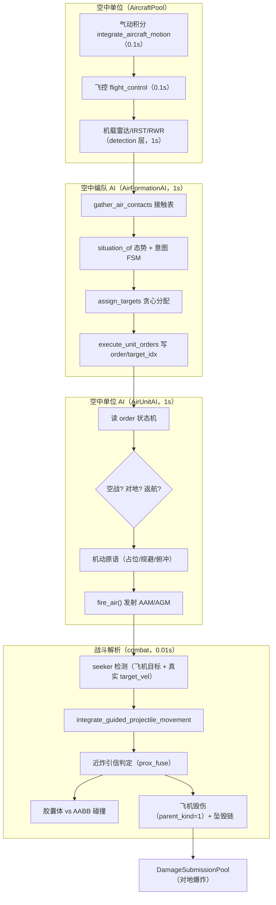

# Phase 7 空中部队管线与算法设计（实施级）

> 定位：本文档是 `docs/phase7-air-design.md`（设计定稿）的**实施级细化**——把定稿方案落成
> 可直接编码的**管线（数据流 + 编排顺序）**与**算法（公式 + 内核签名 + 接缝）**。
>
> 范围：**一般气动 + 飞控 + 空中编队/单位 AI + 航空弹药（AAM/AGM/滑翔弹/自由落体/反辐射）+
> 地面防空激活 + RWR/干扰弹 + 坠毁链 + 起降**（Phase 7 全量）。
> 不含 Phase 8 数据链（认知孪生 / A 导 B 射 / 磨盘战术——接口预留见 design §十）。
>
> 读前必读：`phase7-air-design.md`（方案选型）＋ `phase6-guidance-pipeline.md`（制导/电子战）＋
> `phase6-ai-pipeline.md`（编队 AI 框架）。本文复用其中 SoA 约定、`EmitterPool` 电磁世界、
> `detection` 检测层、`FiringControl` 开火链与 `DamageSubmissionPool` 毁伤提交，**不重复论证**。
>
> **本文与 design 的关系**：design 论证「为什么」（复用 6b/6c，净新增五块）；本文负责「怎么落地」——
> 逐条给出**真实源码接缝（文件/字段/行号）**、**内核签名**、**公式**、**状态机迁移表**、**测试映射**。
> 所有「现状」均以 2026-08 代码库实读为准（含 6c 步骤⑨ RWR/诱饵**已落地**这一与 AGENTS.md 台账不符的事实，见 §十一）。

---

## 〇、架构红线（贯穿全文）

1. **万物皆单位，导弹皆弹丸**：飞机 = `AircraftPool`，AAM/SAM/AGM/滑翔弹/自由落体 = `ProjectilePool`，
   巡飞弹/CAS = 任务类型（不建实体）。**零新抛射物池**。
2. **编队 AI 决策，单位 AI 执行**：空中决策主体是 `AirFormationAI`（意图 FSM + 任务分配），
   单位 AI 只飞/只打（写 `order`/`target_idx`，由飞控 + `FiringControl.fire_air()` 落地）。
3. **AI 只决策不执行**：不直改 SoA 运动态；一切行动走飞控输入（`throttle/phi_cmd/gamma_cmd`）或
   `FiringControl` 开火链。唯一例外：**坠毁链**（CRASHING 是物理态，由气动内核驱动）。
4. **热路径向量化，冷路径 Python**：气动积分 + 坠毁 = `@njit(parallel=True)`；空战 OODA/编队 FSM
   是 Python 决策层（≤128 架 × 秒级分支，可忽略）。
5. **感知驱动，非上帝视角**：机载雷达/IRST/RWR 全部走 `EmitterPool` + `detection` 层输出，
   进编队接触表；Phase 8 换孪生数据只换 `contact_provider` 注入源。
6. **不破坏既有编号**：新枚举值**追加不重排**（`PartType.AIRCRAFT=5`、`EMITTER_PARENT_AIRCRAFT=3`、
   新 `control_glide_bomb` 追加在 `with_builtin()` 末尾），旧存档/旧测试/旧 Numba 缓存兼容。

---

## 一、端到端管线总览

### 1.1 数据流（mermaid）



### 1.2 调度链（`simulation/loop.py` 唯一改动点）

现状（`loop.py:189`）硬编码 `("movement", "detection", "ai", "combat", "logistics")`。
Phase 7 插入两个 hook（**都在 `combat` 之前**，保证「飞→探测→AI→开火→弹丸推进」因果序）：

```python
# loop.py step() 调度链（改动后）
for name in ("movement", "air_movement", "detection", "ai", "air_ai", "combat", "logistics"):
    ...

# configure_default_rates() 追加：
self.set_rate("air_movement", TICK_AIR)    # 0.1s：气动积分 + 飞控
self.set_rate("air_ai", TICK_GROUND)       # 1.0s：编队 AI + 单位 AI（OODA 是秒级慢决策）
# combat 不变（TICK_BULLET 0.01s）：AAM/SAM 弹丸仍按子弹子步推进
```

> 因果论证：`air_movement` 必须在 `detection` 之前（先飞到位再探测）；`air_ai` 必须在 `combat`
> 之前（AI 决定开火 → 本 tick 内 `combat` 推进弹丸）；`ai`（地面）与 `air_ai` 顺序可互换
> （互不依赖，但都读 `detection` 之后、写 `combat` 之前）。**只改这一个 tuple + 一处 set_rate**，
> 不动 `SimulationLoop.step` 的累加器逻辑。

---

## 二、数据模型与接缝（现状 → 目标）

> 本节所有「现状」均实读源码确认；「目标」列明净新增/改动字段。改动一律**追加不重排**。

| # | 文件 | 现状（实读） | 目标（Phase 7 改动） |
|---|---|---|---|
| 1 | `entities/pools.py` | `PartType` 只有 HULL..AMMO_RACK（0~4） | **追加 `AIRCRAFT = 5`** + `PART_MAX_HP[AIRCRAFT]=100.0` |
| 2 | `entities/pools.py` | `BoxPool` 有 `parent`（int32，装甲索引）+ `part`，**无 parent_kind** | **追加 `parent_kind`（0=armor/1=aircraft）**；`sync` 内核加 aircraft 分支（§2.2） |
| 3 | `entities/pools.py` | `MAX_ARMOR/BOXES/PROJ/EMITTERS/FORMATIONS` | **追加 `MAX_AIRCRAFT = 128`、`MAX_AIR_FORMATIONS = 32`** |
| 4 | `entities/pools.py` | `EmitterPool.parent_kind` 0/1/2（`EMITTER_PARENT_ARMOR/PROJECTILE/NONE`） | **追加 `EMITTER_PARENT_AIRCRAFT = 3`**；`_sync_emitters_kernel`/`_parent_alive` 加飞机分支 |
| 5 | `entities/pools.py` | `ProjectilePool` 制导字段齐全，**无 target_vel、无 prox_fuse** | **追加 `guid_target_vel (N,3)`、`prox_fuse_radius (N,)`**（§七） |
| 6 | `combat/weapons.py` | `AmmoConfig` 有 `ins_drift_m_s`（注释 Phase 7 启用）、`blast_*`/`frag_*` | **追加 `prox_fuse_radius: float = 0.0`**；新弹药 YAML（§八） |
| 7 | `combat/guidance.py` | `MissileControlRegistry.with_builtin()` 注册 4 律（固定序） | **追加 `control_glide_bomb`**（末尾，不动前 4 索引） |
| 8 | `combat/engagement.py` | `fire()` 射手恒 `self.armor`；`_seeker_probe` ACTIVE_RADAR 只搜 `_find_nearest_armor` | **新增 `fire_air()`**；`_seeker_probe` 加飞机分支 + 诱饵分支（§七/§十一） |
| 9 | `combat/damage_submission.py` | `resolve_area_damage` 只结算装甲（`box_hp` + `armor_hull_idx`） | **追加飞机爆轰结算分支**（或独立内核，§七.4） |
| 10 | `simulation/loop.py` | 硬编码 5 hook（§1.2） | 插入 `air_movement`/`air_ai`（§1.2） |
| 11 | `simulation/state.py` | `SimulationState` 有 armor/box/projectile/emitter/formation/damage | **追加 `aircraft_pool`、`air_formation_pool`**（snapshot 同步） |
| 12 | `simulation/serialization.py` | `_restore_armor/boxes/projectiles/emitters` | **追加 `_restore_aircraft`/`_restore_air_formations`** |
| 13 | `simulation/ai.py` | `RWRDetector` 已存在但硬编码 `ArmorPool` | **泛化到飞机**（`_emitter_side` + 遍历 aircraft，§十一） |
| 14 | `detection/sensors.py` | `radar_detection_range`/`evaluate_sensor_detection` 已泛化（平台级） | 仅**追加飞机 RCS 常量**（§四），内核零改 |

### 2.1 新池 `AircraftPool`（`entities/pools.py`，净新增）

SoA 布局沿用 design §1.2（36 数组 × 128 元素 ≈ 数十 KB），此处只列**关键差异与内核消费字段**：

```python
MAX_AIRCRAFT = 128

class AircraftRole(IntEnum):
    FIGHTER = 0; ATTACKER = 1; SEAD = 2; RECON = 3

class AircraftState(IntEnum):
    TAKEOFF = 0; CRUISE = 1; ENGAGE = 2; RTB = 3
    LANDING = 4; CRASHING = 5; PARKED = 6

class AircraftPool:
    def __init__(self, capacity: int = MAX_AIRCRAFT) -> None:
        # —— 运动态（气动内核 in/out）——
        self.pos = np.zeros((cap, 3), np.float32)       # 世界坐标
        self.vel = np.zeros((cap, 3), np.float32)       # 速度向量
        self.heading = np.zeros(cap, np.float32)        # 航向 ψ
        self.pitch = np.zeros(cap, np.float32)          # 俯仰 θ = γ + α（体轴）
        self.bank = np.zeros(cap, np.float32)           # 滚转 φ（bank-to-turn 控制量）
        # —— 飞控输入（Python 层写，内核读）——
        self.throttle = np.zeros(cap, np.float32)       # 油门 0~1
        self.phi_cmd = np.zeros(cap, np.float32)        # 期望滚转 (rad)
        self.gamma_cmd = np.zeros(cap, np.float32)      # 期望航迹角速率 (rad/s)
        # —— 状态/身份/AI（对齐 ArmorPool 6c 约定）——
        self.active = np.zeros(cap, np.bool_)
        self.state = np.zeros(cap, np.uint8)            # AircraftState
        self.side = np.zeros(cap, np.int8)
        self.role = np.zeros(cap, np.uint8)             # AircraftRole
        self.order = np.zeros(cap, np.uint8)            # AirUnitOrder（§六）
        self.target_idx = np.full(cap, -1, np.int32)    # -1 无；指向 aircraft/armor 池
        self.target_kind = np.zeros(cap, np.int8)       # 0=空中 1=地面
        self.formation_id = np.full(cap, -1, np.int32)
        self.comm = np.ones(cap, np.float32)
        self.contact_age = np.full(cap, 1e9, np.float32)
        # —— 任务载荷 ——
        self.wp = np.zeros((cap, 8, 3), np.float32)     # 空间航路点（含 z）
        self.wp_count = np.zeros(cap, np.uint8)
        self.wp_idx = np.zeros(cap, np.uint8)
        self.fuel = np.ones(cap, np.float32)            # 归一化 0~1
        self.fuel_burn = np.zeros(cap, np.float32)      # 巡航消耗 /s（per-机型）
        self.bingo = np.full(cap, 0.3, np.float32)
        self.aam_left = np.zeros(cap, np.uint8)
        self.agm_left = np.zeros(cap, np.uint8)
        # —— 空战/传感器 ——
        self.cruise_alt = np.zeros(cap, np.float32)
        self.cruise_spd = np.zeros(cap, np.float32)
        self.rwr_state = np.zeros(cap, np.uint8)        # 0静默 1搜索 2跟踪 3锁定
        self.chaff_left = np.zeros(cap, np.uint8)
        self.flare_left = np.zeros(cap, np.uint8)
        # —— 物理/毁伤 ——
        self.health = np.full(cap, 100.0, np.float32)
        self.dmg_factor = np.ones(cap, np.float32)      # 结构损伤 0~1
        self.rcs = np.full(cap, 5.0, np.float32)        # 战斗机默认 RCS 5 m²
        self.ecm = np.zeros(cap, np.float32)
        self._free_stack = list(range(cap))
```

> 接口风格对齐 `ArmorPool`：`spawn/destroy/active_indices/_expand`，扩容用 `_resize` + 非零默认补填
> （`health/rcs/fuel/dmg_factor/comm/contact_age/target_idx/formation_id/bingo`）。**复用 6c 修的扩容坑**：
> `_resize` 用 zeros，必须显式回填非零默认，否则扩容段 spawn 出残值单位。

### 2.2 `BoxPool.parent_kind` + 同步内核飞机分支

飞机 spawn 时挂 **1 个机身碰撞箱**（`part=AIRCRAFT=5`，`parent_kind=1`），
`box_half` = 机身胶囊包围盒（典型 `(1.2, 4.5, 0.8)` m）。命中解析按 `parent_kind==1` 分流（§七.4）。

改动点：
1. `BoxPool.spawn` 加 `parent_kind: int = 0` 形参，存 `self.parent_kind[idx]`；`_expand` 同步。
2. `_sync_boxes_kernel`（`pools.py:451`）加 aircraft 分支：`parent_kind==1` 时从
   `aircraft.pos/heading/pitch/bank` 变换（**与装甲同一 Rz(yaw)·Rx(roll)·Ry(pitch) 约定**——
   飞机 `heading→yaw`、`bank→roll`、`pitch→pitch`，零新旋转逻辑）。
3. `BoxPool.sync_all_from_parent` 加 `aircraft` 形参透传。

> 碰撞检测内核**零改动**：既有「胶囊体 vs AABB」自动覆盖「弹丸 vs 飞机」——飞机挂的是 AABB 箱，
> 弹丸轨迹胶囊扫掠算法不变。

### 2.3 `EmitterPool` 飞机父实体（`EMITTER_PARENT_AIRCRAFT = 3`）

spawn 时绑定（§四.1）：机载雷达（`kind=0` RF）+ 尾焰（`kind=3` IR）。改动：

1. `_sync_emitters_kernel`（`pools.py:890`）加 `aircraft_pos/aircraft_active` 形参 + 分支：
   `pk == EMITTER_PARENT_AIRCRAFT` → 从 `aircraft.pos` 同步（非红外父死亡 → 失活，红外保留残热）。
2. `EmitterPool._parent_alive` 加 aircraft 分支。
3. `sync_from_parent` 签名加 `aircraft` 透传。
4. 新 helper：`activate_aircraft_radar(air_idx, power_db)`、`activate_aircraft_ir(air_idx, ir_strength)`。
5. `RWRDetector._emitter_side`（`ai.py:342`）加飞机分支：父飞机 → `aircraft.side`；
   弹丸 owner 是飞机 → `aircraft.side[owner]`（AAM 主动导引头暴露，触发敌方 RWR）。

---

## 三、气动模型与飞控（`movement/aerodynamics.py` + `movement/flight_control.py`，净新增）

### 3.1 模型选择：点质量 3-DOF + 「解 α」升力/阻力曲线

不做完整 6DoF 姿态动力学（舵面/惯性矩/角动量），做**点质量飞行模型**（兵棋行业标准切分，design §二.1）。
满足用户要求「不同迎风面的升力阻力」的关键：**迎角 α 不是自由状态，而是由所需升力反解**——每帧先算
平衡当前飞行状态所需的升力，反推出 α，再套升力/阻力曲线。这样「大攻角 → 升力增大 + 诱导阻力激增」
的物理闭环自然成立。

**大气模型**（`rho(z)` 指数衰减）：
```
ρ(z) = ρ0 · exp(−z / H),   ρ0 = 1.225 kg/m³,  H = 8500 m（标高）
q = ½ ρ V²                 （动压）
```

**气动系数**（per-机型 `AircraftConfig`）：
```
CL(α) = CL_α · α，   CL_α ≈ 5.7 / rad（≈ 0.1 / deg，线性段）
CL 截断到 [−CL_max·dmg, +CL_max·dmg]        （dmg = dmg_factor，结构损伤退化升力）
CD(α) = CD0 + k_ind · CL²                   （抛物线阻力极曲线：零升阻力 + 诱导阻力）
```

**升力反解**（核心，满足「不同 α 的升阻」）：
```
L_req = m · (V · γ̇_cmd + g · cos γ) / cos φ_cmd      # 由 γ̇ = (L cosφ)/(mV) − (g cosγ)/V 反解
CL_req = L_req / (q · S)
α = clamp(CL_req / CL_α, α_min, α_max · dmg)
CL = CL_α · α（截断后）；CD = CD0 + k_ind · CL²
```

**点质量 EOM**（比力形式，单位质量）：
```
a_L = q S CL / m,   a_D = q S CD / m,   a_T = τ · T_max · dmg / m
V̇  = a_T − a_D − g·sin γ
γ̇  = (a_L·cos φ − g·cos γ) / V
ψ̇  = a_L·sin φ / (V·cos γ)              # bank-to-turn；限幅到 ±turn_rate_max
ẋ = V·cosγ·cosψ,  ẏ = V·cosγ·sinψ,  ż = V·sinγ
```

> **过载限制**：`|a_L|/g > max_g` → 按比例缩 `a_L`（等效缩 `φ` 的转弯分量，限制盘旋）。
> **失速判定**：`V < v_min·(1 + 0.3·(1−dmg))`（损伤后失速速度上升）→ 输出 `stall_out[i]=True`，
> Python 层转 `CRASHING`。

### 3.2 气动积分内核 `integrate_aircraft_motion`

```python
@njit(cache=True, parallel=True)
def integrate_aircraft_motion(
    pos, vel, heading, pitch, bank,           # (N,3)/(N,) 运动态（in/out）
    throttle, phi_cmd, gamma_cmd,             # (N,) 飞控输入（Python 写）
    state, fuel, dmg_factor, active,          # (N,) 状态
    wing_area, cl_max, cd0, k_ind,            # (N,) 气动（per-机型广播）
    thrust_max, mass, max_g, v_min, v_max,
    turn_rate_max, climb_rate_max,            # (N,) 包线
    rho0, altitude_scale, gravity, dt,
    stall_out,                                # (N,) bool_ out：失速标志
) -> None:
    for i in prange(N):
        if not active[i]: continue
        st = state[i]
        if st == CRASHING:                     # 坠毁：升力≈0（失控），推力=0，仅重力 + 水平惯性滑行
            vel[i,2] -= gravity*dt; pos[i] += vel[i]*dt; continue
        V = |vel[i]|; γ = asin(clamp(vel.z/V)); ψ = atan2(vel.y, vel.x)
        rho = rho0 * exp(-pos[i,2]/altitude_scale); q = 0.5*rho*V*V
        # 升力反解（§3.1）
        L_req = mass[i]*(V*gamma_cmd[i] + gravity*cos(γ)) / max(cos(phi_cmd[i]), 0.2)
        CL_req = L_req/(q*wing_area[i]); clmax = cl_max[i]*dmg_factor[i]
        α = clamp(CL_req/CL_alpha, -clmax, clmax)
        CL = CL_alpha*α; CD = cd0[i] + k_ind[i]*CL*CL
        a_L = q*wing_area[i]*CL/mass[i]; a_D = q*wing_area[i]*CD/mass[i]
        a_T = throttle[i]*thrust_max[i]*dmg_factor[i]/mass[i]
        # 过载限制
        if a_L > max_g[i]*gravity: a_L = max_g[i]*gravity
        # EOM
        Vdot = a_T - a_D - gravity*sin(γ)
        gdot = (a_L*cos(bank[i]) - gravity*cos(γ)) / max(V, 1e-3)
        psidot = clamp(a_L*sin(bank[i]) / max(V*cos(γ), 1e-3), -turn_rate_max[i], turn_rate_max[i])
        V2 = V + Vdot*dt
        if V2 < v_min[i]*(1+0.3*(1-dmg_factor[i])): stall_out[i]=True; V2 = v_min[i]
        if V2 > v_max[i]: V2 = v_max[i]
        γ2 = clamp(γ + gdot*dt, -climb_limit, climb_limit)
        ψ2 = ψ + psidot*dt
        vel[i] = V2*[cosγ2*cosψ2, cosγ2*sinψ2, sinγ2]
        pos[i] += vel[i]*dt
        heading[i]=ψ2; pitch[i]=γ2+α; bank[i]=phi_cmd[i]   # 体轴俯仰=γ+α
```

> **性能目标**：128 架 × 0.1s tick → 内核 < 0.05ms（对比：2048 装甲贴地积分 ~0.2ms，规模小两个数量级）。
> **CL_alpha 处理**：作为模块级常量（`_CL_ALPHA = 5.7`）内联，不进参数（避免 Numba 多版本缓存膨胀）。

### 3.3 飞控层（`flight_control.py`，Python，逐架 128 次/0.1s）

**定高定航（CRUISE 核心）**——三个独立通道，均为带限幅的 PID 简化：

```python
def cruise_control(a: AircraftPool, i: int, dt: float) -> None:
    # ① 高度保持：垂直加速度指令 → 航迹角速率指令（小角近似）
    a_z_cmd = Kp_h*(a.cruise_alt[i] - a.pos[i,2]) - Kd_h*a.vel[i,2]
    a_z_cmd = clamp(a_z_cmd, -climb_rate_max, climb_rate_max)          # 爬升率限幅
    a.gamma_cmd[i] = a_z_cmd / max(V, 1e-3)
    # ② 速度保持：油门 PI（满油不再加）
    err = a.cruise_spd[i] - V
    a.throttle[i] = clamp(Kp_v*err + Ki_v*∫err, 0.0, 1.0)
    # ③ 航路点转向：水平距离 < WP_RADIUS(200m) → wp_idx+1；φ_cmd 限幅 ±max_bank(45°)
    if 到 wp 水平距离 < WP_RADIUS: a.wp_idx[i] += 1
    ψ_des = atan2(wp.y - pos.y, wp.x - pos.x)
    a.phi_cmd[i] = clamp(Kp_ψ * wrap_pi(ψ_des - a.heading[i]), -max_bank, max_bank)
```

**三个机动原语**（单位 AI 调用，§六.2）：
- **占位 lead pursuit**：`ψ_des = atan2(拦截点−pos)`，拦截点 = 目标 `pos + vel·t_go`，`t_go = range/closing_speed`。
- **规避 kinematic defeat**（RWR 锁定）：`φ_cmd = ±max_bank`（急转弯）+ `gamma_cmd` 下降高度入杂波 + 抛诱饵。
- **俯冲/拉起**：`gamma_cmd` 程序化序列（对地投弹俯冲 → 投后拉起脱离）。

### 3.4 移动 hook（`build_air_movement_hook`）

仿 `build_armor_movement_hook`（`integrate.py:656`）：`hook(loop, dt)` 内
先 `flight_control.tick(dt)` 写飞控输入，再 `integrate_aircraft_motion(...)`，最后
`boxes.sync_all_from_parent(armor, aircraft)` 同步机身碰撞箱 + `emitters.sync_from_parent(...)` 同步辐射源。

---

## 四、机载传感器（复用 `EmitterPool` + `detection`，近零新内核）

### 4.1 辐射源绑定（spawn 时）

| 源 | EmitterPool 配置 | 备注 |
|---|---|---|
| 机载雷达（开机） | `kind=0` RF，`power=radar_power_db`，`parent_kind=AIRCRAFT` | AI 可控战术关机（静默突防） |
| 发动机尾焰 | `kind=3` IR，`cur_power` 高（充能-残热直接套用） | 红外 AAM/IRST 检测目标 |
| 主动雷达导引头（AAM 发射后） | `kind=1`（6b 已建，`activate_from_projectile`） | 触发敌方 RWR |
| 干扰弹（箔条/热焰） | `kind=5` DECOY（`deploy_decoy` 已建） | §十一.3 |

### 4.2 机载雷达搜索（**内核零改**，design §四.2 的「泛化」已由 6b 完成）

实读 `detection/sensors.py`：`evaluate_sensor_detection`（`sensors.py:208`）**本就是平台级批量检测**，
`sensor_type=0`（雷达）→ `radar_detection_range(target_rcs)`（`sensors.py:41`，RCS 四次方根）。
飞机雷达搜索 = 把飞机作为 `sensor`（`sensor_x/y/z = aircraft.pos`、`sensor_type=0`），
目标 = 敌方飞机 + 敌方地面单位（`target_rcs` = `aircraft.rcs` / `armor.rcs`）打包进数组。**改动仅**：

1. `sensors.py` 追加飞机 RCS 常量：`RCS_FIGHTER = 5.0`、`RCS_BOMBER = 10.0`。
2. 新 helper `gather_air_contacts(...)`（`air_ai.py`）：打包飞机+地面目标 → 调 `evaluate_sensor_detection`
   → LOS 过滤（复用 `detection/los.py` DDA）→ 检测概率（`RNGManager` 采样）→ 写编队接触表。
3. **视距修正**（可选增强）：雷达地平线 `R_h = √(2·Re·h)` 截断超视距目标（`Re=6371km`），
   作为 `max_range_cache` 的上限 `min(R_radar, R_h)`——**加在 helper，不动内核**。

> IRST（被动红外）＝ `evaluate_passive_emitter_detection`（`sensors.py:339`）对 band=IR emitter 单程检测，
> 零改；RWR = `evaluate_esm_emitter_detection`（`sensors.py:306`）对 kind=0/1 RF emitter，零改。
> **这三条全复用 6b 交付物，Phase 7 不写任何新检测公式。**

---

## 五、空中编队 AI（`simulation/air_ai.py`，净新增）

### 5.1 决策主体 `AirFormationAI`（对齐地面 `FormationAI` 框架，不复用其池）

```python
class AirFormationIntent(IntEnum):
    CAP = 0; STRIKE = 1; SEAD = 2; ESCORT = 3; RTB = 4

class AirFormationPool:                      # 独立 SoA（MAX_AIR_FORMATIONS=32）
    active/side/intent/order/target_zone(3)/comm/member_count + 队形槽
    # 队形：leader_wp（长机航路点）+ slot_offset（僚机相对编队位）

class AirFormationAI:
    def tick(self, loop, dt):
        1. gather_air_contacts()            # §四.2，detection 层输出（非上帝视角）
        2. situation_of(fidx)               # 兵力比（AAM 剩余 + 存活）、威胁等级
        3. update_intent(fidx, sit)         # 意图 FSM（§5.2）
        4. assign_targets(fidx)             # 贪心两轮（§5.3）
        5. execute_unit_orders()            # 逐成员写 order/target_idx/target_kind
```

### 5.2 意图 FSM（迁移表）

| 当前 | 条件（`situation_of` 输出） | 迁移 |
|---|---|---|
| CAP | 接敌且 `weapons_free=True` 且兵力占优（AAM 比 ≥ 1.2） | CAP（交战中，单位 AI 自主 OODA） |
| CAP | 兵力劣势（AAM 比 < 0.7 或存活 < 40%） | RTB |
| CAP | 收到 STRIKE 任务 | STRIKE |
| STRIKE | 弹药耗尽（`agm_left==0`）或 bingo | RTB |
| SEAD | 目标雷达全灭 / 弹药耗尽 | RTB |
| ESCORT | 被护航编队消失 / 自身 bingo | RTB |
| RTB | 到达基地空域 | （触发分组降落，§九） |

> `weapons_free`（自由开火令）由上级/玩家命令注入（`CommandQueue`），编队 AI 只读——AGENTS.md
> Phase 7 清单「接受自由开火命令后空战自主」的落点。

### 5.3 目标分配（贪心两轮，沿用 6c 模式）

1. **覆盖轮**：对每个敌接触，指派 1 个「剩余 AAM 最多且未指派」的成员（保证全部目标有压制）。
2. **并发轮**：剩余成员按 `score_targets`（`ai.py:202` 既有内核，加 `alt`/energy 权重，§六.3）
   威胁分排序，追加到高威胁目标（集中火力打最危险敌机）。
3. 分配结果写 `order=ENGAGE_AIR` + `target_idx` + `target_kind=0`。

### 5.4 编队飞行（队形）

长机持有任务航路点；僚机 `wp = leader.pos + slot_offset`（相对编队位），队形按任务切换：
`CAP=楔形`、`STRIKE=纵队`、`SEAD=松散横队`。`slot_offset` 由 `slot ∈ [0,count)` 索引查表
（每编队一个 `slot_table`，Python list 非热路径）。僚机航路点由飞控 `cruise_control` 追（§3.3），
天然形成编队保持（无显式队形 PID）。

---

## 六、空中单位 AI（`simulation/air_ai.py`，净新增）

### 6.1 状态机 `AirUnitOrder`

```python
class AirUnitOrder(IntEnum):
    HOLD = 0; CAP = 1; ENGAGE_AIR = 2; STRIKE_GROUND = 3
    SUPPRESS = 4; RTB = 5; LAND = 6
```

**「自由开火后自主空战」OODA 循环**（单位 AI 消费 `order=CAP` + 编队 `weapons_free`）：

```
发现（雷达/IRST 接触）→ 判定（超视距 BVR？进入射程？）→ 攻击（发射 AAM，§七）
→ 战果评估（命中/脱靶 → 追击或重射）→ 规避（RWR 锁定告警，§十一）→ 返航（BINGO/弹尽）
```

### 6.2 交战几何（简化 BVR/WVR）

- **BVR（超视距）**：迎头接敌 → 雷达锁定（`EmitterPool kind=1` 导引头激活）→ `fire_air()` 发射 →
  6b 制导管线自主飞行（PN + 真实 target_vel）→ 命中/脱靶反馈（`contact_age` 刷新或导弹回收）。
- **WVR（近距）**：**不做完整狗斗几何**——胜负由「位置优势 + 能量」评分裁决（design §六.2）：
  打分最高的进入占位机动 + AAM 全向射程判定。机炮格斗范围外。
- **燃油/弹药强制返航**：`fuel < bingo` 或 `aam_left==0` → 覆盖任何 order 转 RTB（除规避机动外最高优先）。

### 6.3 空战评分内核（`score_air_targets`，`@njit`）

```python
@njit(cache=True)
def score_air_targets(
    dist, d_alt,                        # (K,) 距离 / 高度差
    tgt_speed, tgt_health,              # (K,) 目标速度/血量
    los_me, tgt_vel,                    # (K,3) 我方→目标视线 / 目标速度（单位向量化）
    max_range, w_r, w_alt, w_aspect, w_energy, out,
) -> None:
    for i in range(K):
        tail = dot(unit(los_me[i]), unit(tgt_vel[i]))   # +1=我在目标后方（尾追优势）
        energy_adv = -d_alt[i]                          # 我比目标高 → 能量优势
        out[i] = (w_r*(1-dist[i]/max_range)
                  + w_alt*(-d_alt[i]/max_range)
                  + w_aspect*(1+tail)/2
                  + w_energy*(1-tgt_health[i]))
```

> 复用 `score_targets`（`ai.py:202`）的评分骨架，替换 `speed/weapon_pen` 为 `tail/energy` 项——
> 空战的「位置优势」本质是尾追角 + 高度（比能），与地面的「速度/穿深威胁」正交。

---

## 七、空战交战链：AAM/SAM + 近炸 + 飞机毁伤 + 坠毁

### 7.1 发射：新增 `FiringControl.fire_air()`

`fire()`（`engagement.py:337`）射手硬编码 `self.armor`，飞机开火需新增 `fire_air`：

```python
def fire_air(self, shooter_idx, target_pos, *, ammo_id, owner_is_air=True):
    # 与 fire() 同构，差异三处：
    # ① shooter 位置 = aircraft.pos[shooter_idx] + 挂架偏移（简化为 pos）
    # ② 弹药消耗 = aircraft.aam_left/agm_left -= 1（非 logistics.ammo）
    # ③ owner = shooter_idx（AircraftPool 索引；ProjectilePool.owner 语义不变）
    # 其余（WeaponSystem.solve 散布 / 制导字段写入 / emitter 激活）全复用 fire() 现有代码
```

> 建议：把 `fire()` 的「统计解算 + spawn + 制导字段写入 + emitter 激活」抽成私有
> `_fire_common(shooter_pos, target_pos, ammo_id, owner)`，`fire()` 与 `fire_air()` 共用——
> **避免复制 150 行开火链**。`fire()` 语义零变（旧测试全绿），`fire_air()` 只多挂架偏移 + 航空弹药扣减。

### 7.2 AAM 制导：补 `guid_target_vel`（**内核必须改**）

实读 `integrate_guided_projectile_movement`（`integrate.py:813`）：控制回调恒传 `_ZERO_VEL`
（地面目标速度=0）。**AAM 打高速飞机必须传真实目标速度**（PN 前置量依赖 `target_vel`，否则迎头/横切
目标打不中）。改动：

1. `ProjectilePool` 追加 `guid_target_vel (N,3) float32`（spawn/destroy/expand 同步）。
2. `integrate_guided_projectile_movement` 加 `guid_target_vel` 形参，`_ZERO_VEL` → `guid_target_vel[i]`。
   - 兼容：地面目标/AAM 打静止目标时 `guid_target_vel` 恒 0，与旧行为**逐位一致**（旧测试不退化）。
3. `_write_detected_pos`（`engagement.py:1360`）加飞机分支：目标 kind=0 空中 → 同时写
   `guid_target_pos` 与 `guid_target_vel = aircraft.vel[t]`（滤波加噪声同位置）。

> **Seeker 目标源泛化**：`_seeker_probe`（`engagement.py:1226`）的 `ACTIVE_RADAR` 分支现在只
> `_find_nearest_armor`（`engagement.py:1324`）。新增 `_find_nearest_air_target`：按
> `guid_target_kind` 分派搜 aircraft 或 armor（AAM 打飞机、AGM 打地面），探测公式复用
> `radar_detection_range(rcs)·(1−ecm)`——**公式不变，只换目标数组来源**。

### 7.3 近炸引信（AAM 对飞机，`prox_fuse_radius`）

飞机是高速目标，直接碰撞概率低；AAM 用**近炸**。`AmmoConfig` 追加：

```python
prox_fuse_radius: float = 0.0   # >0 时：AAM 与飞机相对距离 < 此半径 → 近炸起爆
```

`_step_sub` 碰撞检测**之前**，对 `prox_fuse_radius>0` 的活跃弹丸做「点 vs 球」判定：

```
对每枚 AAM（prox_fuse>0）：
  对每架活跃敌机：dist(proj.pos, aircraft.pos) < prox_fuse_radius + aircraft 等效半径
    → 起爆：提交 DamageSubmissionPool（SPHERE，center=proj.pos，radius=blast_radius，
       strength=blast_dmg，见 §七.4）+ 关闭弹丸（destroy + 关闭其 seeker emitter）
```

> 复杂度 256 AAM × 128 飞机 = 3.2 万次点距，每子弹子步（0.01s）< 0.1ms（纯 NumPy 广播即可，不必 Numba）。
> 起爆后破片对地/对邻近飞机毁伤走既有 `resolve_area_damage`（§七.4 飞机分支）。

### 7.4 飞机毁伤 + 坠毁链

**命中解析分流**（碰撞 `parent_kind==1`）：`_resolve_hit` 现有装甲分支不适用，新增：

```
① 弹丸命中飞机（胶囊体 vs AABB 命中 box，box.parent_kind==1）：
   health -= dmg；dmg_factor 按 health 分段退化：
     health > 70% → dmg_factor = 1.0（无损）
     40~70%        → dmg_factor = 0.8（轻微：升力/推力×0.8）
     < 40%         → dmg_factor = 0.6（重度）
   health <= 0 → state = CRASHING
② 爆轰（SPHERE/FRAG_CONE 事件，坠毁/AAM 近炸/炸弹对飞机）：
   新增 resolve_aircraft_area_damage（@njit）：遍历活跃飞机，d < radius 的飞机
   health -= strength·(1−d/radius)（与 resolve_area_damage 的 SPHERE 分支同公式，但扣
   aircraft.health 而非 box_hp）。
```

> `resolve_area_damage`（`damage_submission.py:55`）**不动**——它只吃装甲数组。飞机爆轰另写
> 一个薄内核 `resolve_aircraft_area_damage`（约 20 行，公式同 SPHERE 分支），在
> `_finalize_area_kills` 内装甲结算后追加一次调用。**零侵入既有装甲结算路径。**

**坠毁链（CRASHING）**：

```
CRASHING（§3.2 内核分支：升力≈0（失控），推力=0，仅重力 + 水平惯性滑行 → 弹道坠落）
  → 触地判定：pos.z ≤ ground_z(pos.x, pos.y) + 机身半高（采样 span 高度场）
  → 提交 SPHERE 爆炸（radius=坠机爆炸半径, strength=blast_dmg）
  → 可选弹坑 remove_span（复用 6b SAL 炸桥路径，_remove_terrain_crater）
  → 残骸标记（active=False + 渲染数据位，PARKED 之外的终态）
```

> 坠毁对地毁伤**自然吃**既有 `DamageSubmissionPool` → `resolve_area_damage`（装甲），零新结算逻辑。

**坠毁期间的边界条件（Python 层在置 `state=CRASHING` 时一次性执行的副作用）**：

1. **从交战/感知中剔除**：`gather_air_contacts` 与 `assign_targets` 均过滤 `state==CRASHING`
   的飞机——坠毁机不能再被编队 AI 分配任务、不能被 AAM/SAM 选为目标（已失控，打它无意义）。
   实现：接触表打包与目标分配循环开头各加一行 `if state[i] == CRASHING: continue`。
2. **关闭机载雷达 emitter**：转 CRASHING 时，对父实体=该飞机的 `kind=0` RF emitter 调
   `emitters.deactivate()`（保留索引，残骸阶段不再辐射，避免坠毁机继续被敌方 RWR 定位）；
   **尾焰（`kind=3` IR）保留**——让充能-残热衰减自然跑完（符合「发动机已失效但仍在烧」直觉），
   红外 AAM 仍可短暂锁定坠毁机尾焰（可选，不影响主链）。
3. **编队成员计数**：`AirFormationPool.member_count -= 1`；该编队存活成员归零 → 编队 `destroy`
   （对齐地面 `FormationAI` 的成员生命周期）。

---

## 八、对地武器与航空弹药（`combat/guidance.py` + YAML）

| 弹种 | 制导复用 | `control_law_id` | `seeker` | 发射条件 |
|---|---|---|---|---|
| 红外 AAM | PN + 推力剖面 | `dual_pulse_pn`（既有） | `IR_IMAGING` | 尾追/全向 IRST 锁定 |
| 雷达 AAM | PN + 推力剖面 | `dual_pulse_pn`（既有） | `ACTIVE_RADAR` | BVR 雷达锁定 |
| 激光 AGM | SAL（6b 已实施） | `boost_coast_pn` | `SEMI_ACTIVE_LASER` | 吊舱照射 |
| 反辐射导弹 | ARM（6b 已实施） | `boost_coast_pn` | `PASSIVE_RF` | RWR 锁定雷达 |
| 滑翔炸弹 | **新增 `control_glide_bomb`** | `glide_bomb` | `SEMI_ACTIVE_LASER`/无 | 俯冲投弹 |
| 自由落体炸弹 | 无制导 | `""`（`guid_law=-1`） | `NONE` | 平飞/俯冲投放 |

### 8.1 滑翔炸弹 `control_glide_bomb`（追加注册，不动既有索引）

```python
@njit(cache=True)
def control_glide_bomb(pos, vel, tpos, tvel, age, stage, override, nav_gain, dt, out):
    """滑翔炸弹：无推力（只读重力转向），BALLISTIC 后接 TERMINAL 比例导引。
    BALLISTIC → 不制导（自由落体）；TRACK/MEMORY/TERMINAL → PN 转向（无轴向推力项）。
    """
    if stage == _STAGE_BALLISTIC or stage == _STAGE_SCAN:
        out[0] = out[1] = out[2] = 0.0; return
    guidance_proportional_nav(pos, vel, tpos, tvel, nav_gain, dt, out)
    # 无推力项（与 control_boost_coast_pn 的区别就在此）
```

`with_builtin()` 追加 `reg.register("glide_bomb", control_glide_bomb)`（**末尾**，读档索引稳定）。

> AAM/SAM 直接复用 `dual_pulse_pn`（双脉冲 PN）——**零新控制律**；滑翔炸弹是唯一新增回调。
> `nav_gain`、`max_accel` 按 per-ammo 写（AAM 高机动 40g，滑翔弹 10g），体现弹种差异。

### 8.2 航空弹药 YAML（`assets/ammunition/air/…`，Pydantic 校验）

新增示例（字段全在既有 `AmmoConfig` 内，只加 `prox_fuse_radius`）：

```yaml
# aim120_amraam.yaml（雷达 AAM）
ammo_id: aim120_amraam
ammo_type: ATGM
projectile_type: MISSILE
guidance: FIRE_AND_FORGET
control_law_id: dual_pulse_pn
seeker: ACTIVE_RADAR
emitter_power_db: 70.0
nav_gain: 4.0
search_fov_deg: 60.0
track_fov_deg: 10.0
filter_quality: 0.85
prox_fuse_radius: 12.0      # ← 新增字段
blast_radius: 15.0
blast_dmg: 90.0
```

---

## 九、起飞 / 降落 / 基地（闭环但简化）

`AirbaseConfig(BaseModel)`：`坐标 (x,y,z)`、`跑道航向 run_heading`、`半径`。场景 YAML 配置。

- **起飞**：`PARKED → TAKEOFF`：航向对齐 `run_heading` + 加速到 `V_rotate` → 爬升到
  `cruise_alt` → `CRUISE`。起飞阶段不参与空战判定（豁免目标分配）。
- **降落（分组）**：RTB 编队到基地空域 → 按梯队拆分 → 依次 `LANDING`（间隔 30s 程序化进近：
  降高度减速 `gamma_cmd`）→ 触地判定（`pos.z ≤ 跑道 z + 余量`）→ 滑跑减速 → `PARKED`。
- **基地抽象**：不建模跑道物理（Phase 10 前无新地图），基地 = 配置坐标；被击毁/无基地 → 飞机转场
  （简化：地图外退出）。

---

## 十、地面防空激活（role=3，`UnitRole.AA=3` 已有）

6c 已建 `UnitRole.AA=3` 枚举 + `detection` 层全电磁模型，Phase 7 激活交战行为：

- **检测**：防空单位（发射车 + SAM）用 `evaluate_sensor_detection`（雷达，`sensor_type=0`）或
  `evaluate_passive_emitter_detection`（红外）检测空中目标——飞机 `rcs` 大、尾焰红外强，天然可检。
- **SAM 开火**：`ProjectilePool` 制导弹丸（`dual_pulse_pn` + `guid_target_pos` 坐标制导）。
  **注意**：现有制导内核读坐标、不查池（design §八），SAM 追飞机只需把 `aircraft.pos` 写入
  `guid_target_pos` + `aircraft.vel` 写入 `guid_target_vel`（§七.2 已支持）——**零内核改动**。
- **编队接入**：防空编队挂地面 `FormationAI`（成员 `role=3`），目标 `target_kind` 扩展空中/地面。
- **空中对抗 SAM**：RWR 检测防空雷达（`kind=0` RF）→ 规避机动 + 反辐射导弹（SEAD，`PASSIVE_RF`）压制 → 闭环。

---

## 十一、RWR 告警 + 规避 + 干扰弹（**泛化既有 `RWRDetector`，非新建**）

> ⚠️ 事实澄清：6c 步骤⑨「通信簇 + RWR + 诱饵」**已实施**——`RWRDetector`（`ai.py:316`）、
> `_deploy_decoy`（`ai.py:1047`）、`EmitterPool.deploy_decoy`（`pools.py:1082`）均在，且有
> `tests/test_phase6_comms_rwr.py`。AGENTS.md 台账「⑥⑦⑨⑩ 未实施」已过期。Phase 7 做的是**把既有
> 装甲 RWR 泛化到飞机**，不重复造轮子。

### 11.1 RWR 泛化

`RWRDetector`（`ai.py:316`）现在硬编码 `ArmorPool`（遍历 `a.active_indices()`）。
泛化：`_emitter_side` 加飞机父分支（§2.3.5）；`tick` 遍历装甲 + 飞机两池，对飞机写
`aircraft.rwr_state`（0 静默 / 1 搜索 / 2 跟踪 / 3 锁定——按辐射源 `kind` 与功率稳定度分档）。
判定公式复用 `esm_detection_range`（`ai.py:383`），零新公式。

### 11.2 规避

锁定告警（`rwr_state==3`）→ 单位 AI 选规避机动（§3.3 kinematic defeat：急转弯 + 降高度 + 抛诱饵）。

### 11.3 干扰弹（唯一需动 6b 内核的点，design §九.3 已预警）

实读 `_seeker_probe` IR 分支（`engagement.py:1258`）：`_find_emitter(band=IR, kind=IR_SOURCE)`
**只搜 `kind=3` 红外源，不含 `kind=5` DECOY**——当前诱饵**无法诱骗**红外 AAM。修复：

1. `_find_emitter` 的 IR 分支改为「搜 `kind∈{IR_SOURCE, DECOY}` 且选 **cur_power 最大**」而非最近
   （flare 高功率瞬时拉高 `cur_power` → seeker 转锁 flare）。
2. 或新增 `_find_ir_hot`（选最大 `cur_power`）：红外导引头本质锁**最热源**，flare 应胜出。
3. **保守替代**：若不想动 `_seeker_probe` 热路径，可在 `_find_emitter` 结果旁做「flare 优先」判定——
   但推荐方案 1（语义最正确，改动 5 行内）。

> 箔条（chaff）同理：band=RF、`kind=DECOY`，对 `ACTIVE_RADAR` 导引头（`_find_nearest_air_target`
> 需同样考虑 RF 诱饵的 `cur_power` 竞争）。**诱饵闭环 = seeker 目标选择列表纳入 DECOY + 按功率竞争**，
> 是 §九.3 的唯一内核风险点，列入实施步骤 ⑩ 的验收项。

---

## 十二、调度链与序列化

- **调度**：§1.2 的 tuple + set_rate（`loop.py` 两处改动）。扩容纪律：`AircraftPool._expand`
  只在 Tick 间隙（`sim_paused=True`）触发，沿用 AGENTS.md 约束。
- **状态**：`SimulationState` 追加 `aircraft_pool`/`air_formation_pool`（`state.py:35` 附近），
  `snapshot().pools` 同步加 `"aircraft"`/`"air_formation"`。
- **序列化**：`serialization.py` 追加 `_restore_aircraft`（msgpack 打包 `AircraftPool` 全部数组）+
  `_restore_air_formations` + `serialize_battlefield`/`deserialize_battlefield` 接缝；`_rebuild_free_stack`
  复用既有。**弹丸制导字段新增 `guid_target_vel`/`prox_fuse_radius` 需进 `_pack_pool_arrays`。**

---

## 十三、性能预算与陷阱

| 场景 | 目标 | 依据 |
|---|---|---|
| 气动积分（128 架 × 0.1s） | < 0.05ms | 规模比 2048 装甲贴地（~0.2ms）小两个数量级 |
| 机载雷达搜索（128 架 × 全目标） | < 1ms | 复用 `evaluate_sensor_detection` 批量向量化 |
| 近炸判定（256 AAM × 128 飞机） | < 0.1ms | 纯 NumPy 广播点距 |
| 完整空战帧（128 架 + 256 AAM + 2048 装甲） | 全帧 < 5ms | 对标 Phase 3 战斗预算 |
| 持续压测（10min 空战） | 无内存增长 | 扩容只 Tick 间隙触发 |

**陷阱（沿用 AGENTS.md §六 + 6b/6c 教训）**：
1. **改 `integrate_guided_projectile_movement` 签名后必须 `clear_numba_cache.py -y`**（`cache=True`
   签名变化 → 旧缓存静默失效）。
2. `guid_target_vel` 默认 0 → 地面弹药行为逐位不变；**别在非制导弹上写非零 target_vel**。
3. `_resize` 用 zeros → 飞机扩容段必须回填 `health=100/rcs=5/dmg_factor=1/fuel=1` 等非零默认。
4. `fire_air` 与 `fire` 共用的 `_fire_common` 抽取，**不得改动 `fire()` 现有分支顺序**（旧测试）。
5. 坠毁链的 `ground_z` 采样用 span 高度场（`surface_z_ground`），**不用 WorldMesh 面片**（飞机可能坠在
   桥下/隧道上方，span 语义更稳）。
6. `_sync_emitters_kernel` 加飞机分支后，`sync_from_parent` 调用点（scenario + loop）必须透传 `aircraft`
   形参，否则飞机 emitter 位置不更新（静默 bug）。

---

## 十四、实施顺序与测试映射

> 与 design §十二 的 11 步一致，此处补**每步的源码落点 + 测试文件**。
>
> ✅ **实施状态（2026-08-16）：步骤①~⑪ 全部落地**（除步骤⑨ 的「分组降落 AI 接线」为
> 简化闭环、⑩ 的 SEAD 规避机动为 rwr_state 数据 + STRIKE 打防空本体）；全量回归通过。

| 步 | 内容 | 源码落点 | 测试 | 验收 |
|---|---|---|---|---|
| ① | AircraftPool + PartType.AIRCRAFT + BoxPool.parent_kind + EmitterPool 飞机父 | pools.py / state.py / serialization.py | `test_phase7_pool.py` | ✅ spawn/destroy/扩容/序列化往返单测 |
| ② | 气动内核 + 大气模型 | aerodynamics.py | `test_phase7_aero.py` | ✅ 平飞/爬升/转弯 vs 解析解（§三） |
| ③ | 飞控（定高定航/航路点/机动原语） | flight_control.py | `test_phase7_flight.py` | ✅ 巡航 10min 高度/速度误差 < 1% |
| ④ | 机载雷达搜索 + 飞机 emitter 绑定 | sensors.py(常量)/air_ai.py(gather) | `test_phase7_sensor.py` | ✅ 探测距离/概率；RWR 检测飞机雷达 |
| ⑤ | AirFormationAI + AirFormationPool（编队飞行 + 意图 FSM） | air_ai.py | `test_phase7_formation.py` | ✅ 编队保持/队形切换/CAP 巡逻 |
| ⑥ | 单位 AI 状态机 + 空战评分内核 | air_ai.py | `test_phase7_air_ai.py` | ✅ 端到端 BVR 空战互射有胜负 |
| ⑦ | AAM/AGM/滑翔弹 + 近炸 + `control_glide_bomb` + `guid_target_vel` | guidance.py / weapons.py / engagement.py / integrate.py | `test_phase7_aam.py` | ✅ AAM 近炸起爆；滑翔弹命中静止目标；PN 前置量命中迎头机 |
| ⑧ | 飞机毁伤（parent_kind=1）+ 坠毁链 | engagement.py / damage_submission.py | `test_phase7_crash.py` | ✅ 被击落→坠地→爆炸→残骸全链 |
| ⑨ | 起飞/降落/基地 + 分组降落 | air_ai.py / scenario.py | `test_phase7_takeoff.py` | ✅ 梯队间隔进近、着陆驻停（分组降落 AI 接线为简化闭环） |
| ⑩ | 地面防空激活（role=3）+ RWR/诱饵泛化 | ai.py / engagement.py | `test_phase7_sead.py` | ✅ SAM 击落突防机；flare 诱骗红外导引头；RWR 分档 |
| ⑪ | 集成测试 + 性能基准 + 文档 | scenario.py / benchmark | `test_phase7_integration.py` + `benchmark_phase7.py` | ✅ 全量回归 + 压测达标（§十三） |

**每步跑法**：改任何 Numba 核后 `uv run python clear_numba_cache.py -y`；单测 `uv run python -m pytest tests/test_phase7_*.py --tb=short -q`；
压测 `uv run python -m tests.benchmark_phase7`。

---

## 十五、一句话总结

> **Phase 7 不发明新轮子——它把 6b 的制导弹丸（补 `guid_target_vel` + 近炸）、6c 的编队 AI 框架和
> `EmitterPool` 电磁世界（补飞机父实体）抬到 3000 米高空，然后补上气动（点质量 3-DOF + 解 α 升阻）、
> 飞控（三通道定高定航）、坠毁链这三块唯一缺的拼图。净新增五块、动九处接缝、写十一个测试文件。** 🛩️
