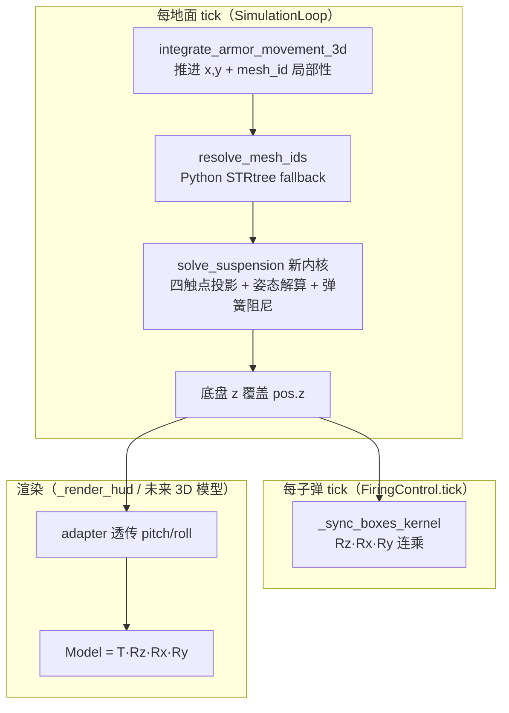

# 悬挂模拟 + 斜面 管线与算法设计

> 创建日期：2026-08-13
> 状态：**设计阶段，未实施**
> 前置文档：`docs/worldmesh-3d-surface-design.md`（§4.2 完整 QEF、§5.6 悬挂）
> 依赖：WorldMesh Phase A/B/D 已落地（`terrain/world_mesh.py` / `terrain/dual_contour.py`）

---

## 一、动机与现状盘点

### 1.1 要解决什么

| 目标 | 现象 |
|------|------|
| **悬挂模拟** | 单位翻越坡道/桥梁/弹坑时，车身 pitch/roll 应跟随路面坡度，悬挂弹簧阻尼平滑；当前所有单位姿态恒为水平（pitch=roll=0） |
| **斜面（采样层）** | 地面面片顶点 z 已用 `continuous_ground` 平滑成斜面，但法线仍恒 `(0,0,1)`、`ray_plane_z` 用 `v0.z`（常量）→ 单位在一个面片内移动 z 不变（阶梯感） |
| **斜面（提取层）** | 结构（坡道/斜坡桥）与破坏弹坑仍是轴对齐台阶，无真正斜面 |

### 1.2 代码级现状（2026-08-13 实测）

| 位置 | 现状 |
|------|------|
| `entities/pools.py::ArmorPool` | 有 `mesh_id`/`pitch`/`roll`/`suspension` 字段（恒 0）；**缺 `contact_z (N,4)` 与 `contact_mesh_id (N,4)`** |
| `movement/integrate.py::integrate_armor_movement_3d` | 单点 z 同步：`_ray_plane_z_flat`（平面求交，n=(0,0,1) 时 = `v0.z`） |
| `entities/pools.py::_sync_boxes_kernel` | 纯 `Rz(yaw)` 旋转；第 252 行 `TODO(WorldMesh §5.6.4)：pitch/roll 非零后需连乘` |
| `terrain/dual_contour.py::_smooth_ground` | 地面顶面顶点 z ← `_bilinear_z`（连续场），但 `normal` 仍是 `FACE_TOP=(0,0,1)` |
| `terrain/world_mesh.py::_ray_plane_z_impl` | `t = (n·v0 − n.x·x − n.y·y) / n.z`，n=(0,0,1) 时退化 `z = v0[2]`（**非插值**） |
| `render/adapter.py::WorldAdapter` | 只透传 `armor_yaw`，无 pitch/roll |
| `render/gl_widget.py::_render_hud_inner` | 单位仅 HUD 圆点（`pos[:,2] += 0.5`），无 3D 模型消费姿态 |

### 1.3 关键事实

1. **所有 `walkable` 顶面（FACE_TOP）都是轴对齐矩形**，顶点顺序固定 `[x0,y0] [x1,y0] [x1,y1] [x0,y1]`
   （`dual_contour._build_horizontal` 逐格地面与 `_emit_merged` 结构合并均遵守此约定）。
2. **地面面片 = 非平面双线性四边形**：4 顶点 z 各不相同（连续场插值），但 `normal` 常量 `(0,0,1)`。
3. **结构面片 = 平面**：4 顶点 z 相同 → 双线性插值自然退化为常量。
4. `continuous_ground` 仅工厂 fBm 场景存在；人工编辑地形地面顶点 z = 量化层（恒定）→ 双线性退化常量，
   悬挂 pitch/roll 只在过桥（结构面片高度差）时有值，属**可接受退化**。

---

## 二、管线总览



### 2.1 分层原则（沿用 WorldMesh 设计）

- **Heightfield（量化台阶）**：碰撞粗筛 + 弹道阻挡，保持 `ch=1.0` 不变。
- **WorldMesh（连续斜面）**：单位 z 采样 + 姿态来源 + 渲染 + 碰撞精算。
- **悬挂**：纯渲染/姿态消费，**不改碰撞逻辑**（碰撞箱仍走 `Rz·Rx·Ry` 变换，见 §4.6）。

---

## 三、悬挂模拟（§5.6 落地）

### 3.1 数据层扩展（ArmorPool）

```python
# ArmorPool.__init__ / spawn / _expand 同步新增
self.contact_z       = np.zeros((self.capacity, 4), dtype=np.float32)  # 四触点表面 z
self.contact_mesh_id = np.full((self.capacity, 4), -1, dtype=np.int32) # 四触点各自面片
self.pitch_vel       = np.zeros(self.capacity, dtype=np.float32)       # 俯仰角速度（弹簧阻尼）
self.roll_vel        = np.zeros(self.capacity, dtype=np.float32)       # 侧倾角速度
```

> `pitch_vel`/`roll_vel` 用于带速度项弹簧（§3.4 方案 B）；若选方案 A（无速度项）则不需要。

### 3.2 触点模型

```
        前（+lx，车长方向）
        ↑
   ┌─────────┐
   │ c2    c3│  ← 四角触点（车身局部坐标）
   │         │     lx = ±half_len, ly = ±half_wid
   │ c0    c1│
   └─────────┘
        ↓
        后
```

- `half_len = half[1]`（车长半，沿 yaw 朝向），`half_wid = half[0]`（车宽半）。
- 触点世界坐标：

```python
cos_y, sin_y = cos(yaw[i]), sin(yaw[i])
offsets = [(-L,-W), (-L,+W), (+L,-W), (+L,+W)]   # c0,c1,c2,c3
cx = pos[i,0] + cos_y*lx - sin_y*ly
cy = pos[i,1] + sin_y*lx + cos_y*ly
```

### 3.3 触点 z 采样：双线性插值（与「斜面 E1」耦合）

触点 z 用**面片双线性插值**，非平面 `ray_plane_z`。对轴对齐矩形面片（顶点 `[v0,v1,v2,v3]`）：

```
u = (x - v0.x) / (v1.x - v0.x)
v = (y - v0.y) / (v3.y - v0.y)
z = (1-u)(1-v)·v0.z + u(1-v)·v1.z + u·v·v2.z + (1-u)·v·v3.z
```

结构面片（4 顶点 z 相同）自动退化为常量 z。**所有 FACE_TOP 面片统一走双线性**，无需类型分派。

对应 Numba 内核（展平数组）：

```python
@njit(cache=True)
def _z_bilinear_flat(patch_v, vstart, vcnt, pid, x, y):
    """轴对齐矩形面片双线性 z 采样（顶点顺序 [x0y0, x1y0, x1y1, x0y1]）。"""
    s = int(vstart[pid])
    v0 = patch_v[s]; v1 = patch_v[s+1]; v2 = patch_v[s+2]; v3 = patch_v[s+3]
    dx = v1[0] - v0[0]; dy = v3[1] - v0[1]
    if dx < 1e-9 or dy < 1e-9:
        return v0[2]                                  # 退化：单点/线
    u = (x - v0[0]) / dx; v = (y - v0[1]) / dy
    u = max(0.0, min(1.0, u)); v = max(0.0, min(1.0, v))
    return ((1-u)*(1-v))*v0[2] + (u*(1-v))*v1[2] + (u*v)*v2[2] + ((1-u)*v)*v3[2]
```

> 触点采样用**各自 `contact_mesh_id[j]`**（§3.5），不是单位 `mesh_id`——车头上桥、车尾在岸时各触点面片不同。

### 3.4 姿态解算：三点平面拟合

用触点**车身局部坐标** `(lx, ly)` 拟合平面 `z = a·lx + b·ly + c`（偏移对称，中心即车体中心）：

```
取 c0=(-L,-W,z0), c1=(-L,+W,z1), c3=(+L,+W,z3)
b = (z1 - z0) / (2W)          # ∂z/∂ly
a = (z3 - z1) / (2L)          # ∂z/∂lx
c = z0 + a·L + b·W            # 底盘中心目标 z（偏移对称 → 即车体中心）

target_pitch = atan(a)        # 沿车长方向坡度（抬头为正）
target_roll  = atan(b)        # 沿车宽方向坡度
target_z     = c
```

> 三点 vs 四触点最小二乘：三点公式闭式、无矩阵求逆、Numba 友好，**先落地三点**。
> 四触点最小二乘（§5.6.2 设计稿）留作可选增强（颠簸路面更稳），接口预留。

### 3.5 触点面片追踪（contact_mesh_id）

每触点独立追踪（沿用 §5.5「局部性 + hint_z」范式）：

```python
# Numba 内核内，对每个触点 j：
cid = contact_mesh_id[i, j]
if cid >= 0 and _point_in_poly_flat(cx, cy, patch_v, vstart, vcnt, cid):
    contact_z[i, j] = _z_bilinear_flat(patch_v, vstart, vcnt, cid, cx, cy)
else:
    contact_mesh_id[i, j] = -1          # 标记待 Python fallback

# Python 侧（solve_suspension 之后，仅对 -1 触点）：
def resolve_contact_mesh_ids(armor, world_mesh):
    for i in range(armor.capacity):
        if not armor.active[i]: continue
        for j in range(4):
            if armor.contact_mesh_id[i, j] == -1:
                cx, cy = _contact_world(armor, i, j)
                armor.contact_mesh_id[i, j] = world_mesh.locate_patch(
                    cx, cy, hint_z=armor.contact_z[i, j])
```

> **简化版（先落地）**：触点 `mesh_id` 直接继承单位 `mesh_id`（假设整车同面片）。
> 四触点独立面片在车跨越桥头（portal）时才需要，列为 Phase 2 增强。

### 3.6 弹簧阻尼平滑

**方案 B（推荐，带速度项，临界阻尼）**：

```python
k = stiffness      # 弹簧刚度 (rad/s²)，建议 8~16
c = 2*sqrt(k)      # 临界阻尼系数
# 半隐式欧拉（速度先更新，再位置更新，稳定性好）
pitch_vel[i] += ((target_pitch - pitch[i]) * k - pitch_vel[i] * c) * dt
pitch[i]     += pitch_vel[i] * dt
roll_vel[i]  += ((target_roll  - roll[i])  * k - roll_vel[i]  * c) * dt
roll[i]      += roll_vel[i] * dt
```

**方案 A（原设计稿，无速度项，过阻尼近似）**：

```python
pitch[i] += (target_pitch - pitch[i]) * stiffness * dt * dt
roll[i]  += (target_roll  - roll[i])  * stiffness * dt * dt
```

> 方案 A 无需 `pitch_vel/roll_vel` 字段、公式最短，但 `stiffness·dt²` 需针对地面 Tick（1s）
> 重新标定且无真实震荡；方案 B 物理正确、参数与 dt 解耦。**推荐 B**。

悬挂压缩量：

```python
suspension[i] = target_z - contact_z[i].mean()   # 底盘中心 − 平均触点（负值=压缩）
```

底盘 z 覆盖（§5.6.2）：

```python
pos[i, 2] = target_z    # 取代原单点 ray_plane_z 同步
```

### 3.7 新内核签名

```python
@njit(cache=True, parallel=True)
def solve_suspension(
    pos, yaw, half, active, mesh_id,          # ArmorPool 主数组
    contact_z, contact_mesh_id,               # (N,4) 触点（原地写）
    pitch, roll, suspension,                  # (N,) 姿态（原地写）
    pitch_vel, roll_vel,                      # (N,) 速度（方案 B）
    dt, stiffness,
    patch_v, vstart, vcnt, patch_norm,        # WorldMesh 展平
) -> None:
    for i in prange(n):
        if not active[i]: continue
        mid = mesh_id[i]
        if mid < 0: continue                  # 空中单位跳过
        L = half[i,1]; W = half[i,0]
        cos_y = cos(yaw[i]); sin_y = sin(yaw[i])
        # 1) 触点世界坐标 + z 采样（局部性 + 双线性）
        # 2) 三点平面拟合 → target_pitch/roll/z
        # 3) 弹簧阻尼平滑 + suspension + pos.z
```

### 3.8 碰撞箱跟随（`_sync_boxes_kernel` 改造）

```python
@njit(cache=True, parallel=True)
def _sync_boxes_kernel(
    box_local, box_parent, box_active, box_pos,
    armor_pos, armor_yaw,
    armor_pitch, armor_roll,      # 新增
    armor_active,
) -> None:
    for i in prange(m):
        ...
        # R_total = Rz(yaw)·Rx(roll)·Ry(pitch)，先俯仰后侧倾后偏航
        cy, sy = cos(armor_yaw[p]), sin(armor_yaw[p])
        cr, sr = cos(armor_roll[p]), sin(armor_roll[p])
        cp, sp = cos(armor_pitch[p]), sin(armor_pitch[p])
        # 局部 → 世界（先 Ry(pitch)，再 Rx(roll)，再 Rz(yaw)）
        # ly_p = lx*sp + lz*cp ; lz_p = -lx*cp + lz*sp   ... 逐步连乘
        # 最终:
        # x = pos.x + cy*(cr*lx + sr*sp*ly + sr*cp*lz) - sy*(cp*ly - sp*lz)
        # y = pos.y + sy*(cr*lx + sr*sp*ly + sr*cp*lz) + cy*(cp*ly - sp*lz)
        # z = pos.z + (-sr*lx + cr*sp*ly + cr*cp*lz)
```

> 旋转约定：`world = pos + Rz(yaw)·Rx(roll)·Ry(pitch)·local`。
> `pitch` 绕车身横轴（ly）、`roll` 绕车身纵轴（lx）。与 §3.4 的 `a=∂z/∂lx`(pitch)、`b=∂z/∂ly`(roll) 一致。

### 3.9 渲染消费

- `WorldAdapter` 加 `armor_pitch`/`armor_roll`（`from_snapshot` 用 `getattr` 防御读，缺失时全 0）。
- HUD 圆点继续用 `pos.z`（已覆盖为底盘 z），无需姿态。
- **未来 3D 单位模型**（Phase 6/7）：`Model = T(pos)·Rz(yaw)·Rx(roll)·Ry(pitch)`，
  与碰撞箱同一约定，消费 `adapter.armor_pitch/armor_roll`。当前无 3D 单位模型，仅留接口。

### 3.10 性能预算

| 项 | 量级 | 估算 |
|----|------|------|
| 触点投影 | 2048×4 | 8192 次双线性（各 4 次乘加） |
| 姿态解算 | 2048 | 三点平面（闭式） |
| 弹簧阻尼 | 2048 | 常数 |
| **合计** | — | **< 0.05 ms**（全 Numba 并行，60fps 安全） |

---

## 四、斜面设计

### 4.1 三层分解

| 层 | 内容 | 优先级 | 依赖 |
|----|------|--------|------|
| **E1 采样斜面** | 地面面片双线性 z 采样 + 梯度法线（修正「法线常量 + ray_plane_z 非插值」） | **先做（悬挂前置）** | 无 |
| **E2 结构斜面** | 坡道/斜坡桥面的非轴对齐表面表达 | 中 | E1 |
| **E3 破坏斜面** | 弹坑边缘 QEF 平滑（完整 Dual Contouring） | 后 | E1/E2 |

### 4.2 E1：采样斜面（双线性 z + 梯度法线）

**问题**：地面面片 4 顶点 z 已平滑，但 `normal=(0,0,1)`、`ray_plane_z` 退化 `v0.z` → 单位在同一面片内移动 z 不变。

**修复**：为 `WorldPatch` 增加逐点采样，替代常量平面假设。

```python
@dataclass
class WorldPatch:
    ...
    def z_at(self, x: float, y: float) -> float:
        """面片内任意点 z：FACE_TOP 轴对齐矩形 → 双线性；其余 → ray_plane_z。"""
        if self.face == FACE_TOP:
            return _bilinear_rect(self.vertices, x, y)
        return _ray_plane_z_impl(self, x, y)

    def normal_at(self, x: float, y: float) -> np.ndarray:
        """面片内任意点法线：FACE_TOP 地面 → 双线性梯度；结构 → 常量 normal。"""
        if self.face == FACE_TOP and self.mat == MAT_TERRAIN:
            return _gradient_normal(self.vertices, x, y)
        return self.normal
```

**双线性梯度法线**（地面面片，轴对齐矩形 `[v0,v1,v2,v3]`）：

```
∂z/∂u = (1-v)(z10-z00) + v(z11-z01),   ∂z/∂v = (1-u)(z01-z00) + u(z11-z10)
∂z/∂x = ∂z/∂u / (x1-x0),  ∂z/∂y = ∂z/∂v / (y1-y0)
n = normalize(-∂z/∂x, -∂z/∂y, 1)
```

**展平数组扩展**（`flatten_world_mesh` 返回值不变签名，新增辅助数组）：

```python
def flatten_world_mesh(mesh) -> tuple[...]:
    # 现有: patch_v, patch_vstart, patch_vcnt, patch_norm
    # 新增: patch_face (M,) int8   —— FACE_TOP 才走双线性
    #       patch_bbox (M,4) float32 —— [x0,y0,x1,y1]（轴对齐矩形，TOP 有效）
    ...
```

> 移动 z 同步（`integrate_armor_movement_3d`）与悬挂触点采样**统一改调 `_z_bilinear_flat`**，
> 消除「单位走平路但 z 阶梯」的旧问题。`resolve_mesh_ids` 的 Python 侧同步改 `world_mesh.patches[pid].z_at(x,y)`。

### 4.3 E2：结构斜面（坡道/斜坡桥面）

**问题**：column-span 是平段（`[zmin,zmax)` 轴对齐），无法表达斜坡桥面/坡道——结构与地面不同，
地面靠 `continuous_ground` 平滑，结构没有对应连续场。

**方案（渲染/采样与碰撞解耦，沿用地面平滑思路）**：

| 层 | 表达 |
|----|------|
| Heightfield（碰撞粗筛） | 保持**台阶**（多层薄 span 阶梯近似斜坡） |
| WorldMesh（采样/渲染） | 结构面片顶点 z 用**坡道定义函数**（线性斜坡/缓坡）重写，面片变斜面 |

```python
# 坡道定义（新数据，TerrainFactory 提供）
@dataclass
class RampConfig:
    axis: str          # 'x' | 'y' 坡道走向
    start_z: float     # 起点高度
    end_z: float       # 终点高度
    length: float      # 坡道长度
    width: float       # 坡道宽度
```

- Heightfield 侧：按 `cs` 每格一个薄 span（高度线性递增，台阶高 ≤ `ch`）→ 碰撞近似斜坡。
- WorldMesh 侧：结构顶面顶点 z = 斜坡线性函数（`z = start_z + (end_z-start_z)·t`），
  `normal = normalize(-slope, 0, 1)`（斜面向上的法线），面片保持矩形但倾斜。
- 双线性/`z_at` 对斜面（非水平矩形）退化为平面 `ray_plane_z`（矩形倾斜但共面）。

> E2 使 `WorldPatch` 首次出现**非水平 FACE_TOP**：`ray_plane_z`（平面求交）对共面斜矩形正确；
> 双线性插值对共面矩形也退化为平面（4 顶点共面时双线性 = 平面）。两者兼容，无需额外分派。

### 4.4 E3：破坏斜面（弹坑 QEF 平滑，完整 Dual Contouring）

**问题**：`Heightfield.remove_span` 挖坑后弹坑边缘是垂直直角（轴对齐柱），无斜坡。

**方案**：完整 Dual Contouring（`docs/worldmesh-3d-surface-design.md` §4.2 预留项）。

1. **Hermite 数据**：每个体素格点 `(gx, gy, layer)` 估计法线（实心/空心符号距离的中心差分）。
   对 column-span：法线来自「该格点到最近实心边界的距离梯度」——弹坑边缘格点法线朝坑内。
2. **QEF 顶点定位**：每体素单元内，顶点 x 最小化到各相交边平面（法线 + 交点）的距离平方和：

```
E(x) = Σ_i (n_i·x - n_i·p_i)²
求 ∂E/∂x = 0 → A·x = b,  A = Σ n_i n_iᵀ,  b = Σ (n_i·p_i) n_i
A 为 3×3 对称（半正定），用 Cholesky/SVD 求解；退化时回退边交点均值。
```

3. **弹坑管线**：`remove_span` → 标记受影响格 → 局部重建（格点法线 + QEF 顶点）→
   热交换 WorldMesh 面片（复用 `TileManager` 双缓冲模式，后台线程）。
4. **弹坑斜坡**：QEF 顶点在坑缘格点内缩 → 坑壁变斜坡（坡度由法线场控制）。

> E3 依赖完整 QEF 解算 + Hermite 法线 + 局部重建，工作量大，列为**最后一项**，
> 与「地形破坏 → NavGraph/WorldMesh 重算」管线（§4.3）合并规划。

### 4.5 与 Heightfield 的关系（不变）

- 碰撞粗筛 / 弹道阻挡仍走 `Heightfield`（台阶量化）。
- 斜面仅影响 **WorldMesh 采样与渲染**，不改碰撞语义。
- 弹坑碰撞 = `remove_span`（台阶），渲染 = QEF 斜坡，两者解耦（斜坡是视觉/采样近似）。

---

## 五、实施步骤（按依赖排序）

### Step 1：E1 采样斜面（最小改动，悬挂前置）✅ 先行

| # | 内容 | 影响面 |
|---|------|--------|
| 1.1 | `WorldPatch.z_at` / `normal_at` + `_bilinear_rect` / `_gradient_normal` 工具 | world_mesh.py |
| 1.2 | `flatten_world_mesh` 增 `patch_face`/`patch_bbox`（或约定 TOP=4 顶点矩形） | world_mesh.py |
| 1.3 | `_z_bilinear_flat` Numba 内核；`integrate_armor_movement_3d` z 同步改双线性 | integrate.py |
| 1.4 | `resolve_mesh_ids` Python 侧改 `z_at` | integrate.py |
| 1.5 | 测试：斜面四边形双线性精度 / 梯度法线 / 面片内移动 z 连续 | tests/ |

### Step 2：悬挂模拟（核心）

| # | 内容 | 影响面 |
|---|------|--------|
| 2.1 | ArmorPool 加 `contact_z`/`contact_mesh_id`/`pitch_vel`/`roll_vel`（spawn/_expand 同步） | pools.py |
| 2.2 | `solve_suspension` Numba 内核（四触点 + 三点拟合 + 弹簧阻尼） | movement/suspension.py（新建）或 integrate.py |
| 2.3 | 接入 SimulationLoop：`integrate_3d` → `resolve_mesh_ids` → `solve_suspension` → `resolve_contact_mesh_ids` | simulation/loop.py |
| 2.4 | `_sync_boxes_kernel` 加 pitch/roll 连乘（§3.8） | pools.py |
| 2.5 | `WorldAdapter` 透传 pitch/roll（getattr 防御） | render/adapter.py |
| 2.6 | 测试：三点拟合 / 弹簧收敛 / 过桥姿态 / 碰撞箱连乘 | tests/ |

### Step 3：触点独立面片（车跨桥头）

| # | 内容 |
|---|------|
| 3.1 | 四触点 `contact_mesh_id` 独立追踪（§3.5 完整版） |
| 3.2 | 测试：车头上桥车尾在岸，前轮 z 取桥面、后轮 z 取地面 |

### Step 4：E2 结构斜面（坡道/斜坡桥）

### Step 5：E3 破坏斜面（弹坑 QEF，与破坏重算管线合并）

---

## 六、测试计划

| 模块 | 用例 | 断言 |
|------|------|------|
| E1 双线性 | 斜面四边形 4 顶点 z 各异，面片内多点 | `z_at` 与手算双线性一致（1e-4） |
| E1 梯度法线 | 已知坡度斜面 | `normal_at` 与解析法线夹角 < 1e-3 |
| E1 移动 z 连续 | 单位沿斜面面片移动 | z 随 x/y 线性变化，无阶梯 |
| 悬挂三点拟合 | 构造 4 触点 z（含坡度） | pitch/roll 与解析坡度一致 |
| 悬挂弹簧 | 阶跃 target_pitch，跑 N tick | 指数收敛，无过冲（临界阻尼） |
| 悬挂过桥 | 车驶上桥面（桥高差 2m） | 上桥瞬间 pitch 有值，驶离归 0 |
| 悬挂空中 | mesh_id=-1 单位 | 姿态不变（跳过） |
| 碰撞箱连乘 | pitch/roll 非零 + yaw | box_pos 与解析 Rz·Rx·Ry 一致 |
| 触点跨面片 | 车跨桥头 | 前触点 z=桥面、后触点 z=地面 |

---

## 七、风险与缓解

| 风险 | 缓解 |
|------|------|
| 双线性插值对非矩形/非轴对齐面片失效 | FACE_TOP 面片当前恒轴对齐矩形（dual_contour 约定）；未来非矩形面片走 `ray_plane_z` fallback |
| `continuous_ground` 缺失（人工地形） | 地面顶点 z=量化层 → 双线性退化常量，姿态仅来自结构高度差（可接受） |
| 弹簧参数与 dt 耦合 | 方案 B 带速度项，`k` 与 dt 解耦；地面 Tick=1s 时临界阻尼仍稳定 |
| 触点跨面片 fallback 频率 | 仅车跨越 portal 时触发，每 tick 极少单位；STRtree O(log N) 无碍 |
| QEF 退化（A 奇异） | 回退边交点均值 / 格点质心（recast 同款兜底） |
| 姿态与碰撞解耦不一致 | 碰撞箱与渲染共用同一 `Rz·Rx·Ry` 约定，单测锁定 |

---

> **一句话**：斜面先修「采样」（E1 双线性），悬挂吃采样结果做四触点姿态，碰撞箱与渲染共用同一旋转约定；
> 结构斜坡（E2）与弹坑 QEF（E3）是「提取」层的大工程，按需后置。
